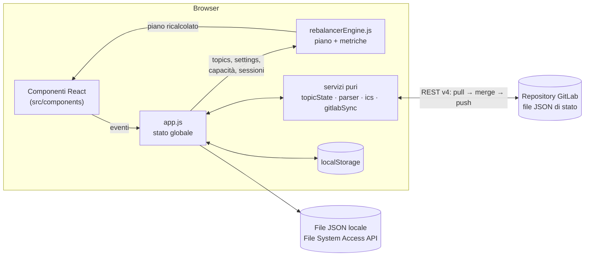

# StudiPlanner

**Pianificatore di studio adattivo per Analisi Matematica 1 e Geometria e Algebra Lineare**
Ingegneria Informatica — Università di Modena e Reggio Emilia (UNIMORE)

StudiPlanner è una Single Page Application React pensata per uno studente lavoratore a tempo pieno che prepara due esami entro una data fissa (default **10 gennaio 2027**, roadmap dal **16 novembre 2026**). Invece di un calendario statico, l'app ricalcola il piano a ogni modifica: i giorni saltati fanno slittare gli argomenti in avanti, gli anticipi liberano tempo per il ripasso, e l'ordine propedeutico degli argomenti non viene mai alterato.

Funziona interamente nel browser, senza backend: i dati restano in `localStorage` e, se lo si desidera, vengono sincronizzati tra dispositivi tramite un repository GitLab privato.

---

## Indice

- [Funzionalità](#funzionalità)
- [Avvio rapido](#avvio-rapido)
- [Sviluppo](#sviluppo)
- [Architettura in breve](#architettura-in-breve)
- [Struttura del repository](#struttura-del-repository)
- [Documentazione](#documentazione)
- [Vincoli di progetto](#vincoli-di-progetto)
- [Licenza](#licenza)

---

## Funzionalità

### Pianificazione
- **Ribilanciamento continuo.** Il piano viene ricostruito da "oggi" in avanti a ogni modifica di argomenti, sessioni, impostazioni o budget giornalieri.
- **Propedeuticità rigorosa.** Gli argomenti seguono sempre l'ordine `A-01 → A-32` e `G-01 → G-31`; priorità e difficoltà non riordinano mai la coda.
- **Allocazione a blocchi.** Ogni giorno riceve al massimo il proprio budget; un argomento più lungo viene diviso su più giorni ("Parte 1/3", "Parte 2/3", …).
- **Buffer +20%** sulle ore residue degli argomenti con priorità o difficoltà ≥ 4.
- **Prova generale `A-32` solo nell'ultima settimana**, e nessuno studio pianificato nel giorno d'esame.
- **Saturazione esplicita.** Se le ore residue non entrano nel calendario, il budget viene scalato in modo uniforme e la dashboard lo segnala, invece di ammassare tutto sugli ultimi giorni.
- **Time Shifter.** Pulsanti `−30m` / `+30m` su ogni giorno (da 0 a 12 h), modalità "Emergenza lavoro" settimanale e profilo "Bootcamp Natale" (24/12 – 6/1).

### Tracciamento
- Registrazione delle sessioni di studio (data, argomento, ore, completamento, note), con avanzamento parziale: un argomento resta nel piano con le sole ore residue.
- Timer Pomodoro 50/10 per argomento: il tempo di focus viene registrato come sessione a fine ciclo o al raggiungimento dell'obiettivo.
- Modalità **Stasera**: un solo argomento, timer persistente e registrazione automatica della sessione con gli esiti degli esercizi svolti senza appunti.
- Storico giorno per giorno, heatmap delle attività, streak di studio con giorno di riposo e jolly mensile, grafico burndown, retrospettiva settimanale e "punto della domenica".
- Ripassi attivi con intervalli adattivi all'esito (+3 giorni il primo, poi più lunghi o più corti), checklist di Feynman, registro degli errori ricorrenti, formulario (F2), PDF affiancati.
- Temi d'esame settimanali a tempo nelle ultime 4 settimane, con voto e curva dei risultati.
- Stima euristica di preparazione e voto atteso, che tiene conto degli esercizi senza appunti e dei temi svolti.
- Promemoria serale facoltativo tramite notifica.

### Dati e integrazioni
- Import di CSV/TXT, Excel/ODS e backup JSON. Reimportare un dataset aggiorna i metadati **senza cancellare il progresso**.
- Export Excel, backup JSON, calendario `.ics` (con i blocchi realmente pianificati, dalla data odierna in poi).
- Generatori di prompt per NotebookLM/NeuraDeck (flashcard) e per simulazioni d'esame con Claude o ChatGPT.
- **Sincronizzazione GitLab multi-dispositivo** senza perdite: le sessioni registrate offline su più dispositivi si sommano, le cancellazioni si propagano e le scritture concorrenti vengono rilevate e rifuse (vedi [docs/03](docs/03_SERVICES_AND_SYNC.md)).
- Salvataggio automatico su un file locale tramite File System Access API (Chrome/Edge).
- PWA installabile, utilizzabile offline dopo il primo caricamento.

---

## Avvio rapido

Requisito: **Python 3** (solo per il server statico locale).

```powershell
python server.py
```

Il server ascolta su `http://localhost:3000` (o sulla prima porta libera fino a 3009) ed è raggiungibile anche dalla LAN all'indirizzo mostrato nei log. In alternativa, con doppio clic su `start-app.bat`.

Per l'uso quotidiano su Windows sono disponibili collegamento sulla taskbar, icona nella system tray e installazione come servizio: vedi [docs/06_DEVOPS_AND_SCRIPTS.md](docs/06_DEVOPS_AND_SCRIPTS.md).

> L'apertura diretta di `index.html` da file system (`file://`) funziona solo in parte: Service Worker e alcune API del browser richiedono un'origine HTTP. Usare il server locale.

La guida d'uso completa è in [GUIDA_APPLICAZIONE.md](GUIDA_APPLICAZIONE.md).

---

## Sviluppo

Non c'è un build tool JavaScript: i moduli in `src/` vengono concatenati in `bundle.js` da uno script Python e transpilati nel browser da Babel standalone.

Dopo **ogni** modifica in `src/`:

```powershell
python scripts\build_bundle.py
```

```powershell
npm test
```

```powershell
python scripts\test_rolling_rebalance.py
```

```powershell
python scripts\test_tonight_and_mock_exams.py
```

- `npm test` esegue con Node (≥ 16) i test unitari dei servizi puri (motore, parser, stato argomenti, export ICS, sync GitLab con un server finto) e verifica che `bundle.js` venga transpilato senza errori. Non richiede `npm install`: il progetto non ha dipendenze npm.
- `test_rolling_rebalance.py` e `test_tonight_and_mock_exams.py` sono i test end-to-end Playwright di riferimento (richiedono `pip install playwright` e `playwright install chromium`): il primo copre data, piano e storico, il secondo i flussi serali di Stasera e dei temi d'esame. Altri test E2E per singole funzionalità sono in `scripts/test_*.py`.

`bundle.js` è versionato: va ricompilato e committato insieme ai sorgenti. I dettagli della pipeline e dei test sono in [docs/06_DEVOPS_AND_SCRIPTS.md](docs/06_DEVOPS_AND_SCRIPTS.md).

---

## Architettura in breve



- **`app.js`** possiede tutto lo stato (argomenti, impostazioni, budget giornalieri, sessioni, tombstone, metadati di sync, bug tracker) e lo persiste in `localStorage`.
- **`rebalancerEngine.js`** è una funzione pura: dato lo stato produce calendario, piani settimanali, storico e metriche. Viene richiamato in un `useMemo` a ogni cambiamento.
- **Servizi puri** (`topicStateService`, `parserService`, `calendarExportService`, `gitlabSyncService`) sono testabili in Node senza browser.

Approfondimenti: [Architettura](docs/01_ARCHITECTURE.md) · [Motore](docs/02_REBALANCER_ENGINE.md) · [Servizi e sync](docs/03_SERVICES_AND_SYNC.md).

---

## Struttura del repository

```
StudiPlanner/
├── index.html                 Entry point: carica vendor/, poi bundle.js via Babel
├── bundle.js                  Bundle generato (versionato) — NON modificare a mano
├── sw.js, manifest.json       PWA: Service Worker e manifest
├── server.py                  Server statico locale (porta 3000, accesso LAN)
├── package.json               Script npm: build, test (nessuna dipendenza)
├── src/
│   ├── app.js                 Componente radice, stato globale, persistenza, sync
│   ├── data/defaultData.js    Dataset ufficiale dei 63 argomenti
│   ├── services/
│   │   ├── rebalancerEngine.js     Motore di ribilanciamento e metriche
│   │   ├── topicStateService.js    Transizioni di stato degli argomenti
│   │   ├── parserService.js        Import CSV/TXT/Excel e fusione con il progresso
│   │   ├── calendarExportService.js Export iCalendar (.ics)
│   │   └── gitlabSyncService.js    Sync GitLab: pull, merge, push con concorrenza
│   └── components/            Viste, modali e strumenti di studio (19 componenti)
├── tests/                     Test unitari Node (npm test)
├── scripts/                   build_bundle.py e test end-to-end Playwright
├── docs/                      Documentazione tecnica
├── vendor/                    React, ReactDOM, Babel, SheetJS, Tailwind (offline)
├── Analisi/, Geometria/       Dataset sorgente (CSV/TXT/XLSX) e materiali
└── *.ps1, *.bat, *.vbs        Integrazione Windows (tray, taskbar, servizio NSSM)
```

---

## Documentazione

| Documento | Contenuto |
| :--- | :--- |
| [GUIDA_APPLICAZIONE.md](GUIDA_APPLICAZIONE.md) | Manuale d'uso: schermate, flussi, sincronizzazione, FAQ |
| [docs/INDEX.md](docs/INDEX.md) | Indice della documentazione tecnica e glossario |
| [docs/01_ARCHITECTURE.md](docs/01_ARCHITECTURE.md) | Build, stato globale, chiavi di persistenza, modello dati, PWA |
| [docs/02_REBALANCER_ENGINE.md](docs/02_REBALANCER_ENGINE.md) | Algoritmo di ribilanciamento, allocazione a blocchi, metriche |
| [docs/03_SERVICES_AND_SYNC.md](docs/03_SERVICES_AND_SYNC.md) | Servizi: stato argomenti, parser, ICS, sincronizzazione GitLab |
| [docs/04_UI_COMPONENTS.md](docs/04_UI_COMPONENTS.md) | Componenti React, props e comportamenti |
| [docs/05_ACADEMIC_MODEL_AND_SYLLABUS.md](docs/05_ACADEMIC_MODEL_AND_SYLLABUS.md) | Modello didattico, syllabus, teoremi, metodo di studio |
| [docs/06_DEVOPS_AND_SCRIPTS.md](docs/06_DEVOPS_AND_SCRIPTS.md) | Pipeline di build, test, server locale, integrazione Windows |
| [GEMINI.md](GEMINI.md) / [AGENTS.md](AGENTS.md) | Regole per gli agenti AI che lavorano sul repository |

---

## Vincoli di progetto

Questi vincoli sono parte del dominio e valgono per ogni modifica (dettagli in [GEMINI.md](GEMINI.md)):

1. **Ordine sequenziale** `A-01 → A-32`, `G-01 → G-31`: mai ordinare per priorità o difficoltà.
2. **Buffer +20%** solo per priorità ≥ 4 o difficoltà ≥ 4.
3. **Modello del lavoratore**: 2,5 h nelle sere feriali, 4,5 h nei giorni di weekend, Time Shifter per singolo giorno, soglia di sovraccarico configurabile (default 25 h/settimana).
4. **Build e test obbligatori** dopo ogni modifica in `src/`.
5. **Sync GitLab**: decodifica base64 UTF-8, debounce, fusione senza perdite e scrittura con `last_commit_id`.

---

## Licenza

Il repository non contiene ancora un file di licenza: il codice è da intendersi per uso personale. Aggiungere un file `LICENSE` prima di distribuirlo.
