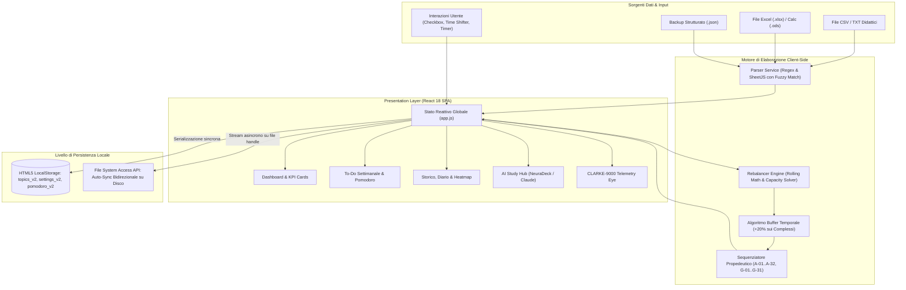

# 🎓 Study Plan Rebalancer (StudiPlanner)
### *Piattaforma Adattiva di Ribilanciamento Didattico per Studenti Lavoratori*
**Corso di Laurea in Ingegneria Informatica — Università degli Studi di Modena e Reggio Emilia (UNIMORE)**

---

[](https://react.dev/)
[](https://tailwindcss.com/)
[](https://sheetjs.com/)
[](https://python.org/)
[](https://nssm.cc/)
[]()
[]()
[](LICENSE)

> **StudiPlanner** è una Single Page Application (SPA) responsive ad alta densità informativa, ingegnerizzata per eliminare la fragilità intrinseca dei calendari di studio convenzionali. Progettata per studenti universitari lavoratori full-time, trasforma il piano accademico in un **sistema dinamico auto-ribilanciante a circuito chiuso**, capace di assorbire imprevisti professionali, redistribuire i carichi di lavoro in tempo reale e salvaguardare con rigore matematico la propedeuticità didattica fino al traguardo del **10 Gennaio 2027**.

---

## 📑 Indice Generale

1. [Visione e Analisi Funzionale](#-visione-e-analisi-funzionale)
   - [Il Problema: La Fragilità dei Piani Tradizionali](#il-problema-la-fragilità-dei-piani-tradizionali)
   - [La Soluzione: Resilienza Adattiva](#la-soluzione-resilienza-adattiva)
   - [Funzionalità Chiave (Core Features)](#funzionalità-chiave-core-features)
   - [Guida all'Avvio Rapido (Quick Start)](#guida-allavvio-rapido-quick-start)
2. [Architettura Tecnica e Infrastruttura](#-architettura-tecnica-e-infrastruttura)
   - [Panoramica dello Stack Tecnologico](#panoramica-dello-stack-tecnologico)
   - [Diagramma dell'Architettura di Sistema](#diagramma-dellarchitettura-di-sistema)
   - [Deployment Locale come Servizio Windows (NSSM & LAN Access)](#deployment-locale-come-servizio-windows-nssm--lan-access)
   - [Mappa Strutturale del Repository](#mappa-strutturale-del-repository)
3. [Filosofia di Ingegneria del Software e Linee Guida](#-filosofia-di-ingegneria-del-software-e-linee-guida)
   - [Principi di Design Matematico (First-Principles)](#principi-di-design-matematico-first-principles)
   - [Filosofia UI/UX: Telemetria Distraction-Free](#filosofia-uiux-telemetria-distraction-free)
   - [Flusso di Sviluppo AI-Driven (Swarm Architecture)](#flusso-di-sviluppo-ai-driven-swarm-architecture)
   - [Linee Guida di Contribuzione e Revisione Codice](#linee-guida-di-contribuzione-e-revisione-codice)
4. [Syllabus Ufficiale Precaricato](#-syllabus-ufficiale-precaricato)
5. [Licenza](#-licenza)

---

## 🧭 Visione e Analisi Funzionale

### Il Problema: La Fragilità dei Piani Tradizionali
La preparazione simultanea di esami cardine dell'ingegneria (come **Analisi Matematica 1** e **Geometria e Algebra Lineare**) impone un volume orario considerevole e una rigorosa sequenzialità logica. Per uno **studente lavoratore full-time** (40 ore lavorative settimanali, orario 09:00 - 18:00), i piani di studio basati su tabelle statiche (fogli Excel tradizionali o calendari a blocchi fissi) falliscono sistematicamente:
- **Effetto Domino degli Imprevisti:** Uno straordinario lavorativo, una trasferta o un calo di energie serale invalidano istantaneamente le scadenze future.
- **Debito Cognitivo Insoluto:** I temi saltati finiscono dimenticati o forzati in sessioni di recupero irrealistiche, inducendo sovraccarico e abbandono del piano.
- **Violazione della Propedeuticità:** I tipici to-do list scheduler basati sulla priorità tendono ad anticipare argomenti pesanti (es. integrali impropri o diagonalizzazione) prima che lo studente abbia consolidato i prerequisiti fondamentali (limiti, derivate, determinanti).

### La Soluzione: Resilienza Adattiva
StudiPlanner introduce un paradigma di **allocazione rolling dinamica**. Il piano di studio non è una sequenza statica di scadenze, ma un **vettore fluido di argomenti propedeutici** che fluisce attraverso la disponibilità oraria residua fino alla data d'esame. Se una data non viene presidiata, il sistema non distrugge la programmazione: fa scorrere gli argomenti in avanti sul primo slot utile, preservando l'integrità del percorso formativo.

### Funzionalità Chiave (Core Features)

- 🔄 **Rolling Dynamic Rebalancer:**
  - *Giorni Saltati (Rolling Forward):* Se una sessione serale non viene completata, gli argomenti arretrati scorrono istantaneamente alla data corrente, rimodulando l'intero orizzonte temporale.
  - *Anticipi Virtuosi (Pull Forward):* Completando argomenti in anticipo, il motore attinge dai giorni successivi, liberando giorni di ripasso intensivo pre-esame.
  - *Zero Topic Loss:* Nessun concetto didattico viene scartato o compresso artificiosamente.
- 📐 **Rigida Propedeuticità Sequenziale:**
  - Ordinamento deterministico basato su identificativi didattici sequenziali (`A-01` $\rightarrow$ `A-32` per Analisi 1 e `G-01` $\rightarrow$ `G-31` per Geometria).
  - Le simulazioni globali e le prove d'esame finali rimangono vincolate esclusivamente alla settimana conclusiva.
- ⏱️ **Buffer Dinamico di Apprendimento (+20%):**
  - Identificazione automatica degli argomenti ad alta difficoltà intrinseca ($\ge 4$) o elevata priorità d'esame ($\ge 4$).
  - Sovrallocazione automatica di un margine di sicurezza temporale: $T_{\text{effettivo}} = T_{\text{stimato}} \times 1.20$.
- 🎛️ **Time Shifter (Override Orario Giornaliero):**
  - Controlli stepper `[- 30m]` e `[+ 30m]` integrati in ciascuna scheda giornaliera per adattare il budget ad assenze, straordinari o slot extra (pause pranzo, permessi studio).
  - Ricalcolo e redistribuzione istantanea della coda didattica in tempo reale.
- 📥 **Centro Importazione Multi-Formato & Drag & Drop:**
  - Ingestione trasparente di file `.csv`, `.txt`, fogli elettronici Excel (`.xlsx`, `.xls`), LibreOffice Calc (`.ods`) e backup strutturati `.json`.
  - Mappatura intelligente delle colonne tramite fuzzy matching euristico.
- ⏳ **Timer Pomodoro Didattico Integrato:**
  - Modello a blocchi per studio universitario: **50 minuti di focus profondo** e **10 minuti di pausa rigenerativa**.
  - Monitoraggio dei secondi accumulati, calcolo del tempo target dell'argomento e persistenza dello stato nel database locale del browser.
- 🤖 **AI Study Hub (Integrazioni di Fase 2):**
  - *Generatore Flashcard NeuraDeck (NotebookLM):* Isola automaticamente gli argomenti completati negli ultimi 7 giorni e genera un prompt specializzato per restituire blocchi CSV raw `Fronte,Retro` pronti per l'importazione in NeuraDeck.
  - *Simulatore d'Esame Adattivo (Claude / ChatGPT):* Estrae dinamicamente 6 quesiti per Analisi 1 (rispecchiando la prova scritta) o 11 quesiti per Geometria (rispecchiando il test d'esame) con priorità $\ge 3$, producendo tracce d'esame formattate in Markdown stampabile.
- 🛰️ **CLARKE-9000: HUD Telemetrico e Compagno Motivazionale:**
  - Componente visivo ispirato all'estetica Sci-Fi con lente ottica a gradiente radiale.
  - Telemetria continua: monitoraggio del burn rate orario, conto alla rovescia $T$-minus e sintesi di massime filosofiche e stoiche orientate alla costanza mentale.
- 🔥 **Activity Heatmap & Diario Storico:**
  - Matrice grafica delle sessioni retrospettive (stile GitHub Contributions).
  - Monitoraggio analitico del rapporto tra giorni effettivi di studio e giorni saltati dall'avvio della sessione (16 Novembre 2026).
- 🔒 **Sincronizzazione Multi-Tier (GitLab Cloud Sync & File System Access API):**
  - **Sincronizzazione Cloud GitLab Automatica:** Integrazione REST API v4 nativa senza server intermedi. Auto-Pull all'avvio e Auto-Commit continuo su repository GitLab privato per allineare all'istante PC, portatile, tablet e smartphone.
  - **File System Access API & Local-First:** Salvataggio automatico bidirezionale trasparente su file `.json` su disco o cloud folder (iCloud, OneDrive, Google Drive) e persistenza istantanea in HTML5 `localStorage`.
- 🌙 **Interfaccia High-Contrast Dark Mode:**
  - Palette cromatica deep space (`#070b14`), smeraldo per Analisi 1 (`#10b981`), indaco per Geometria (`#6366f1`) e ambra/rosa per avvisi di sovraccarico.

---

### Guida all'Avvio Rapido (Quick Start)

L'applicazione è self-contained e concepita per essere eseguita con attrito zero:

#### Metodo 1: Script Batch Diretto (Ambiente Windows — Consigliato)
Eseguire un doppio clic sul file batch nella cartella principale del repository:
```cmd
start-app.bat
```
Lo script avvia il runtime server e apre automaticamente il browser predefinito all'indirizzo `http://localhost:3000`.

#### Metodo 2: Avvio da Riga di Comando (Python CLI)
Avviare il server nativo Python tramite PowerShell o terminale:
```powershell
python server.py
```
Il server si collegherà sulla porta `3000` esponendo l'interfaccia sia su `127.0.0.1` che sull'indirizzo IP locale LAN (visualizzato nei log di avvio).

#### Metodo 3: Esecuzione Standalone del File HTML
È possibile aprire direttamente il file `index.html` con qualsiasi browser moderno (Chrome, Edge, Firefox, Safari). L'applicazione utilizzerà `bundle.js` e le librerie caricate per operare localmente.

#### Ricompilazione del Bundle (Build Step)
In caso di modifica ai sorgenti modulari in `src/`, ricompilare il file di bundle prima del testing:
```powershell
python scripts\build_bundle.py
```

---

## 🏗️ Architettura Tecnica e Infrastruttura

### Panoramica dello Stack Tecnologico

| Livello / Componente | Tecnologia | Ruolo e Benefici Architetturali |
| :--- | :--- | :--- |
| **UI Framework** | **React 18.x** | Rendering reattivo client-side, gestione di stato locale tramite Hook personalizzati (`useState`, `useMemo`, `useEffect`, `useRef`). |
| **Styling & Design System** | **Tailwind CSS 3.4** | Utility-first CSS, responsive layout (desktop, tablet, mobile dock), Dark Mode nativa ad alto contrasto. |
| **Parsing Fogli Elettronici** | **SheetJS (xlsx 0.20)** | Elaborazione in-memory di file Excel (`.xlsx`, `.xls`) e LibreOffice Calc (`.ods`) interamente lato client. |
| **Persistenza Primaria** | **HTML5 LocalStorage** | Storage key-value sincrono nel browser per salvataggio immediato di modifiche, timer Pomodoro e preferenze. |
| **Persistenza Secondaria** | **File System Access API** | Stream diretto di lettura/scrittura su file system locale del sistema operativo tramite file handle nativo. |
| **Local Runtime Web Server** | **Python 3 (`http.server`)** | Micro-server leggero, multi-interfaccia (`0.0.0.0`), gestione header CORS e no-cache per hot reloading. |
| **Windows Service Wrapper** | **NSSM (Non-Sucking Service Manager)** | Incapsulamento del server come servizio di background di sistema a 64-bit con monitoraggio e riavvio automatico. |
| **Automation & Setup** | **PowerShell 7 / 5.1** | Script di installazione automatizzata, elevazione permessi (UAC), configurazione Windows Firewall. |
| **Testing & Quality Assurance**| **Playwright Python & Node.js** | Suite di test end-to-end headless per verificare la consistenza logica del ribilanciamento e delle interazioni UI. |

---

### Diagramma dell'Architettura di Sistema

Il seguente schema illustra il flusso unidirezionale dei dati, dall'ingestione all'elaborazione matematica e alla doppia persistenza:



---

### Deployment Locale come Servizio Windows (NSSM & LAN Access)

Per consentire l'accesso continuo allo scheduler da altri dispositivi domestici (iPad, MacBook o smartphone) senza dover mantenere una finestra di terminale aperta, il repository include un'infrastruttura completa per la registrazione come **servizio nativo Windows**.

```
                           +-------------------------------------+
                           |      Windows Boot / System Start    |
                           +-------------------------------------+
                                              |
                                              v
                           +-------------------------------------+
                           |     NSSM Service Manager (x64)      |
                           |     Service: "UnimoreStudyPlanner"  |
                           +-------------------------------------+
                                              |
                                              v
                           +-------------------------------------+
                           |          service-boot.bat           |
                           |   1. chcp 65001 & PYTHONUTF8=1      |
                           |   2. git -c safe.directory=* pull   |
                           |   3. Dynamic Python detection       |
                           +-------------------------------------+
                                              |
                                              v
                           +-------------------------------------+
                           |          server.py (0.0.0.0:3000)   |
                           +-------------------------------------+
                                       /              \
                                      v                v
                       +-------------------+   +--------------------+
                       | Local PC Browser  |   | iPad / Mac via LAN |
                       | (127.0.0.1:3000)  |   | (192.168.x.x:3000) |
                       +-------------------+   +--------------------+
```

#### 1. Procedura di Installazione Automatizzata (`setup_windows_service.ps1`)
Lo script PowerShell gestisce l'intero ciclo di vita dell'infrastruttura di servizio:
1. **Auto-Elevazione UAC:** Rileva se la sessione dispone di privilegi amministrativi; in caso contrario, rilancia se stesso richiedendo l'elevazione UAC.
2. **Configurazione Windows Firewall:** Crea o aggiorna una regola in ingresso (Inbound Rule) denominata `"Study Planner App"`, autorizzando il traffico TCP sulla porta `3000` su profili Private e Domain.
3. **Provisioning di NSSM:** Individua `nssm.exe` nella cartella `tools/` o ne gestisce l'acquisizione sicura.
4. **Registrazione del Servizio:** Registra il servizio Windows `"UnimoreStudyPlanner"` con avvio automatico (`SERVICE_AUTO_START`), agganciandolo al dispatcher `service-boot.bat`.
5. **Configurazione Redirezione e Rotazione Log:** Indirizza `stdout` e `stderr` verso `logs/service-stdout.log` e `logs/service-stderr.log`, attivando la rotazione automatica con soglia volumetrica.

#### 2. Modalità di Esecuzione e Credenziali
- **Modalità `-UseLocalSystem` (Fortemente Consigliata):**
  Ideale per postazioni con autenticazione biometrica Windows Hello o account Microsoft con PIN (il Service Control Manager di Windows rifiuta i PIN per i servizi utente):
  ```powershell
  # Eseguire da PowerShell come Amministratore
  .\setup_windows_service.ps1 -UseLocalSystem -StartService
  ```
  Il servizio si avvia al boot senza richiedere password e supporta l'aggiornamento automatico via HTTPS da repository pubblici.
- **Modalità Utente Dedicato:**
  ```powershell
  .\setup_windows_service.ps1 -StartService
  ```
  Richiede interattivamente la password dell'account locale per operare sotto il contesto dell'utente corrente.
- **Disinstallazione Pulita:**
  ```powershell
  .\setup_windows_service.ps1 -Uninstall
  ```
  Arresta il processo, deregistra il servizio Windows e rimuove la regola dal Firewall.

#### 3. Logica del Dispatcher di Avvio (`service-boot.bat`)
All'attivazione del servizio, `service-boot.bat` esegue una sequenza di sanificazione e sincronizzazione:
1. Imposta la codifica della console su UTF-8 (`chcp 65001`, `PYTHONUTF8=1`).
2. Risolve l'eseguibile `git` dal `PATH` o da directory standard (`%ProgramFiles%\Git\cmd`).
3. Esegue `git -c safe.directory=* pull` per allineare l'applicazione all'ultimo commit remoto prima dell'avvio. In caso di assenza di rete, degrada con grazia mantenendo la versione locale.
4. Individua il runtime Python e avvia `server.py`.

---

### Mappa Strutturale del Repository

```
StudiPlanner/
├── index.html                     # Entry point SPA (Dark Mode, responsive layout)
├── bundle.js                      # Bundle JavaScript consolidato per l'esecuzione browser
├── server.py                      # Server Python HTTP/TCP locale con supporto CORS e LAN
├── service-boot.bat               # Script di bootstrap per il servizio di background Windows
├── setup_windows_service.ps1      # Installatore automatico servizio Windows e regola Firewall
├── start-app.bat                  # Script batch di avvio rapido con singolo clic
├── start-tray.vbs                 # Launcher trasparente per la Tray Companion
├── tray_companion.ps1             # Modulo PowerShell di integrazione nella System Tray
├── manifest.json                  # Web App Manifest per installazione PWA
├── sw.js                          # Service Worker per il caching offline
├── README.md                      # Documentazione tecnica del repository
├── GUIDA_APPLICAZIONE.md          # Manuale utente esteso e guida operativa
│
├── Analisi/                       # Asset didattici di Analisi Matematica 1
│   ├── Analisi.csv                # Dataset standardizzato dei 32 argomenti (A-01 -> A-32)
│   ├── Analisi.txt                # Versione tabellare alternativa
│   └── Piano_di_Studio_Analisi1_UNIMORE.xlsx
│
├── Geometria/                     # Asset didattici di Geometria e Algebra Lineare
│   ├── Geometria.txt              # Dataset standardizzato dei 31 argomenti (G-01 -> G-31)
│   └── Agisci come un professore e tutor di Geometria e....md
│
├── src/                           # Codice sorgente modulare React
│   ├── app.js                     # Root Component, gestione stato globale e sincronizzazione
│   ├── data/
│   │   └── defaultData.js         # Dataset didattico integrato UNIMORE (63 argomenti ufficiali)
│   ├── services/
│   │   ├── parserService.js       # Parser CSV, TXT ed Excel con matching euristico
│   │   └── rebalancerEngine.js    # Motore matematico del rolling rebalancing e allocazione
│   └── components/
│       ├── ActivityHeatmap.js     # Matrice retrospettiva dell'attività di studio
│       ├── AlertBanner.js         # Banner animato di notifica sovraccarico critico
│       ├── Clarke9000Companion.js # HUD telemetrico, calcolo burn rate e companion filosofico
│       ├── Dashboard.js           # Panoramica KPI, barre di progresso materie e riepilogo
│       ├── ExamSimulator.js       # Simulatore d'esame per Claude / ChatGPT (Fase 2)
│       ├── FileImporter.js        # Drag & drop, import/export Excel e gestione File System API
│       ├── HistoryLog.js          # Timeline cronologica retrospettiva e diario sessioni
│       ├── Icons.js               # Iconografia SVG nativa ad alte prestazioni
│       ├── NeuraDeckPromptGenerator.js # Generatore prompt flashcard NotebookLM per NeuraDeck
│       ├── SettingsModal.js       # Modal di configurazione parametri, orari e date simulate
│       ├── TopicsTable.js         # Catalogo tabellare, filtri per materia e ricerca testuale
│       └── WeeklyTodo.js          # Vista operativa giorno per giorno con Pomodoro e Time Shifter
│
├── scripts/                       # Strumenti di build e suite di test automatizzati
│   ├── build_bundle.py            # Generatore deterministico del bundle consolidato
│   ├── check_sequence.py          # Validatore logico della propedeuticità degli argomenti
│   ├── test_app.py                # Test Playwright di rendering e caricamento interfaccia
│   ├── test_clarke9000.py         # Test Playwright del componente CLARKE-9000
│   ├── test_engine.mjs            # Test di benchmark matematico dell'algoritmo in Node.js
│   ├── test_interactions.py       # Test Playwright delle interazioni e checkbox
│   ├── test_phase2_tools.py       # Test Playwright del modulo AI Study Hub (NeuraDeck/Esame)
│   ├── test_refactored_features.py# Test di regressione sui componenti refattorizzati
│   ├── test_rolling_rebalance.py  # Test Playwright del comportamento su giorni saltati
│   └── test_time_shifter.py       # Test Playwright dei controlli stepper Time Shifter
│
├── tools/                         # Strumenti ausiliari di sistema
│   └── nssm.exe                   # Non-Sucking Service Manager (binario x64)
│
├── vendor/                        # Dipendenze client-side congelate (zero build complexity)
│   ├── babel.min.js
│   ├── react.production.min.js
│   ├── react-dom.production.min.js
│   ├── tailwindcss.js
│   └── xlsx.full.min.js
│
└── logs/                          # Tracciamento e rotazione log del servizio Windows
    ├── service-stdout.log
    └── service-stderr.log
```

---

## 🔬 Filosofia di Ingegneria del Software e Linee Guida

### Principi di Design Matematico (First-Principles)

A differenza degli scheduler generici basati su euristiche di priorità decrescente, StudiPlanner implementa un modello matematico basato su **vincoli rigidi non negoziabili**:

#### 1. Invarianza della Propedeuticità Didattica
Nell'apprendimento delle discipline scientifiche di base, la sequenza degli argomenti è strettamente ordinata. Anticipare un argomento a priorità massima violando i prerequisiti concettuali è didatticamente distruttivo:
- Non è possibile calcolare limiti con la *Formula di Taylor* (`A-09`) senza padroneggiare la *Continuità e i Teoremi Globali* (`A-07`, `A-08`).
- Non è possibile studiare la *Diagonalizzabilità e il Teorema Spettrale* (`G-18`, `G-19`) senza il calcolo di *Determinanti e Rango* (`G-02`, `G-04`).
- La *Prova Generale d'Esame* (`A-32`) è vincolata esclusivamente all'ultima settimana pre-esame.

Il motore ordina la coda uncompleted unicamente in base all'ID naturale:
$$\text{SortOrder}(T_i, T_j) = \text{NaturalIndex}(T_i.\text{id}) - \text{NaturalIndex}(T_j.\text{id})$$

#### 2. Calcolo del Buffer Temporale Adattivo
La stima nominale delle ore ($T_{\text{stimato}}$) sottovaluta sistematicamente lo sforzo cognitivo necessario per i teoremi complessi. Il sistema applica un buffer deterministico del $+20\%$:
$$T_{\text{effettivo}, i} = \begin{cases} 
T_{\text{stimato}, i} \times 1.20 & \text{se } \text{Priorità}_i \ge 4 \lor \text{Difficoltà}_i \ge 4 \\ 
T_{\text{stimato}, i} & \text{altrimenti} 
\end{cases}$$

#### 3. Fabbisogno Settimanale e Rilevamento Sovraccarico
Dati l'orizzonte temporale residuo:
$$\Delta_{\text{giorni}} = \text{Data Target (2027-01-10)} - \text{Data Odierna}, \quad W_{\text{residue}} = \max\left(0.1, \frac{\Delta_{\text{giorni}}}{7}\right)$$
Il fabbisogno orario medio settimanale richiesto per completare il programma è:
$$F_{\text{settimanale}} = \frac{\sum_{i \in \text{Uncompleted}} T_{\text{effettivo}, i}}{W_{\text{residue}}}$$

La capacità standard nominale per uno studente lavoratore feriale serale (2.5h) e weekend (4.5h) è:
$$C_{\text{nominale}} = (5 \times 2.5) + (2 \times 4.5) = 21.5\text{ h/settimana}$$
Se $F_{\text{settimanale}} > 25.0\text{ h/settimana}$ (soglia critica di saturazione), scatta il warning visivo animato con suggerimenti di espansione dei blocchi del weekend.

---

### Filosofia UI/UX: Telemetria Distraction-Free

L'interfaccia di StudiPlanner ripudia i pattern tipici delle web app consumer (notifiche invasive, gamification superficiale, elementi grafici ridondanti) in favore di una **postazione di lavoro tecnica e ad alta concentrazione**:
- **Ambiente Low-Eye-Strain:** Colorazione profonda `#070b14` calibrata per sessioni di studio notturne (19:30 - 22:00), azzerando l'affaticamento visivo.
- **Tipografia Ad Alta Densità:** Utilizzo di metriche spaziali compatte, micro-badge di stato ed elementi visivi a contrasto netto per massimizzare la leggibilità delle formule e dei deliverable didattici.
- **Telemetria di Traiettoria:** Elementi HUD (indicatore $T$-minus, percentuale di avanzamento, burn rate) mutuati dalla strumentazione di navigazione, comunicando la sensazione di un avvicinamento costante e controllato alla data dell'esame.

---

### Flusso di Sviluppo AI-Driven (Swarm Architecture)

Questo progetto è sviluppato codificando l'interazione con agenti intelligenti (Google Antigravity, Claude, Swarm Coordinators) non come meri assistenti di completamento sintattico, ma come **architetti software autonomi di sottosistema**:

1. **Specializzazione dei Ruoli:**
   - **Product Architect:** Definizione dei requisiti funzionali, modellazione dell'esperienza utente e documentazione tecnica.
   - **Systems & Infrastructure Engineer:** Scrittura di dispatcher di sistema, configurazione di servizi Windows a basso livello (NSSM), firewall automation e gestione della concorrenza I/O.
   - **Algorithm & Core Logic Lead:** Formulazione e verifica formale dei vincoli matematici, preservazione della propedeuticità e prevenzione di regressioni didattiche.
2. **Automazione dei Guard-Rail di Qualità:**
   - Nessuna modifica generata da agenti AI viene considerata valida senza l'esecuzione congiunta della suite di verifica headless Playwright e la ricompilazione deterministica del bundle.

---

### Linee Guida di Contribuzione e Revisione Codice

Per garantire l'integrità del codebase e la riproducibilità del software, i contributori sono tenuti a rispettare il seguente protocollo:

1. **Strategia dei Branch:**
   - Vietato effettuare commit diretti sul branch `main`.
   - Ogni modifica deve essere sviluppata su un branch isolato con convenzione semantica: `feature/<nome-funzionalita>`, `fix/<descrizione-bug>`, `refactor/<ambito>`.
2. **Regola di Compilazione del Bundle:**
   - I file in `src/` sono modulari. Prima di aprire una Pull Request o effettuare il push, è obbligatorio ricompilare il bundle:
     ```powershell
     python scripts\build_bundle.py
     ```
3. **Verifica della Suite di Test:**
   - È obbligatorio eseguire la suite di validazione prima di proporre modifiche:
     ```powershell
     python scripts\test_rolling_rebalance.py
     python scripts\test_time_shifter.py
     python scripts\test_phase2_tools.py
     ```
4. **Checklist per la Code Review:**
   - [ ] La propedeuticità sequenziale (`A-01` $\rightarrow$ `A-32`, `G-01` $\rightarrow$ `G-31`) è rigorosamente inalterata.
   - [ ] Il calcolo del buffer $+20\%$ si applica esclusivamente agli argomenti con Priorità $\ge 4$ o Difficoltà $\ge 4$.
   - [ ] L'applicazione rimane al 100% autonoma e compatibile con il funzionamento offline.
   - [ ] Non sono presenti chiamate HTTP a telemetrie esterne o server terzi (rispetto della privacy Local-First).

---

## 📚 Syllabus Ufficiale Precaricato

L'archivio didattico precaricato comprende l'intero corpus dei due insegnamenti per la Coorte 2021 di Ingegneria Informatica UNIMORE:

### Analisi Matematica 1 (32 Macro-Argomenti, 80h stimate)
- **A-01 a A-03:** Insiemi numerici, estremo superiore/inferiore, principio di induzione, numeri complessi e formula di De Moivre.
- **A-04 a A-06:** Successioni numeriche, teoremi di convergenza, permanenza del segno, gerarchia degli infiniti e numero $e$.
- **A-07 a A-08:** Limiti di funzioni, teorema ponte, continuità, Teorema degli Zeri, Bolzano e Weierstrass.
- **A-09 a A-11:** Formula di Taylor con resto di Peano, sviluppi di Maclaurin e simulazione di metà programma.
- **A-12 a A-16:** Calcolo differenziale, derivata composta/inversa, teoremi di Fermat, Rolle, Lagrange, De L'Hôpital e studio di funzione.
- **A-17 a A-20:** Integrazione secondo Riemann, Teorema Fondamentale del Calcolo Integrale (Torricelli-Barrow), metodi per parti e sostituzione, integrali impropri notevoli.
- **A-21 a A-24:** Serie numeriche, serie geometrica e armonica, criteri di convergenza (rapporto, radice, Leibniz) e serie di Taylor.
- **A-25 a A-32:** Simulazioni cronometrate d'esame scritto (5-6 problemi), clinica di recupero lacune e Prova Generale Finale Scritto + Orale.

### Geometria e Algebra Lineare (31 Macro-Argomenti, 68h stimate)
- **G-01 a G-04:** Algebra delle matrici, determinante (Laplace, Binet), matrice inversa, rango e riduzione a gradini.
- **G-05 a G-09:** Spazi vettoriali, sottospazi, insiemi di generatori, basi e dimensione, componenti di Fourier e Relazione di Grassmann.
- **G-10 a G-13:** Applicazioni lineari, nucleo $\ker(T)$, immagine $\text{Im}(T)$, equazione dimensionale, matrici associate e similitudine.
- **G-14 a G-16:** Sistemi di equazioni lineari, Teorema di Rouché-Capelli e rappresentazione cartesiana e parametrica di sottospazi.
- **G-17 a G-19:** Autovalori, autovettori, molteplicità algebrica e geometrica, criterio di diagonalizzabilità e Teorema Spettrale.
- **G-20 a G-22:** Spazi vettoriali euclidei, prodotto scalare reale, disuguaglianza di Cauchy-Schwarz, algoritmo di Gram-Schmidt e complemento ortogonale.
- **G-23 a G-26:** Geometria analitica affine ed euclidea nello spazio $E^2$ ed $E^3$ (rette, piani, coefficienti direttori, mutue posizioni, distanze, aree e volumi).
- **G-27 a G-30:** Geometria proiettiva e classificazione delle coniche (punti impropri, centro, assi, asintoti, forma canonica e fasci).
- **G-31:** Introduzione alle strutture algebriche fondamentali (gruppi, anelli, campi, algebre di Boole).

---

## 📄 Licenza

Questo progetto è distribuito sotto licenza **MIT**. Consultare il file [LICENSE](LICENSE) per i termini dettagliati.

---
*Progettato con dedizione e rigore ingegneristico per gli studenti lavoratori di Ingegneria Informatica UNIMORE.*