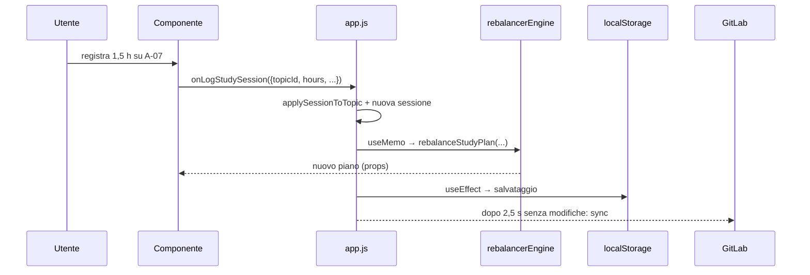

# 01 — Architettura

Questo documento descrive come è costruita l'applicazione: caricamento nel browser, pipeline di build, gestione dello stato, persistenza e modello dati. L'algoritmo di pianificazione è descritto in [02_REBALANCER_ENGINE.md](02_REBALANCER_ENGINE.md), i servizi e la sincronizzazione in [03_SERVICES_AND_SYNC.md](03_SERVICES_AND_SYNC.md).

---

## 1. Principi

| Principio | Conseguenza pratica |
| :--- | :--- |
| **Nessun backend** | Tutto il calcolo avviene nel browser. L'unico servizio esterno, opzionale, è l'API REST di GitLab usata come archivio. |
| **Nessun build tool JS** | Niente npm, Webpack o Vite: uno script Python concatena i moduli e Babel standalone transpila JSX nel browser. |
| **Local-first** | Ogni modifica è salvata subito in `localStorage`. Sync GitLab e file locale sono copie aggiuntive. |
| **Motore puro** | `rebalanceStudyPlan()` non ha effetti collaterali: dato lo stato restituisce il piano. La UI è una proiezione del suo output. |
| **Servizi testabili in Node** | Le regole di business stanno in moduli senza React (`src/services/`), coperti da `npm test`. |

---

## 2. Caricamento nel browser

`index.html` carica, in ordine:

1. `vendor/tailwindcss.js` — Tailwind in modalità runtime (fallback CDN se il file manca).
2. `vendor/react.production.min.js`, `vendor/react-dom.production.min.js` — React 18 UMD.
3. `vendor/xlsx.full.min.js` — SheetJS per Excel/ODS.
4. `vendor/babel.min.js` — Babel standalone.
5. `bundle.js` come `<script type="text/babel">`: Babel lo transpila e lo esegue.
6. La registrazione del Service Worker (`sw.js`).

Ogni script `vendor/` ha un `onerror` che ripiega sulla CDN corrispondente; in condizioni normali l'app non contatta reti esterne.

Durante l'avvio è visibile un loader. Un **watchdog** in `index.html` mostra un pulsante "Ricarica" se dopo 3,5 s il loader è ancora presente o se si verifica un errore globale prima del montaggio di React. Il bundle include inoltre un `ErrorBoundary` che, in caso di eccezione durante il rendering, mostra l'errore invece di una pagina vuota.

---

## 3. Pipeline di build

`scripts/build_bundle.py`:

1. Legge i file di `src/` in un **ordine fisso** (`files_order`): dati → icone → servizi → componenti → `app.js`. Un modulo può usare solo simboli definiti nei file precedenti.
2. Rimuove le righe `import …` e la parola chiave `export` (le dichiarazioni restano).
3. Antepone i global di React (`const { useState, useEffect, useMemo, useRef, useCallback } = React;`) e l'`ErrorBoundary`.
4. Accoda il codice di montaggio su `#root` e scrive `bundle.js`.

Conseguenze da tenere presenti:

- **Tutti i moduli condividono lo stesso scope.** Due funzioni o costanti top-level con lo stesso nome in file diversi rompono il bundle (`Identifier has already been declared`). Gli helper privati dei servizi hanno nomi specifici (`syncTs`, `comparableSyncPayload`, `sameTopicContent`, …).
- Un nuovo file in `src/` va aggiunto a `files_order` nella posizione giusta.
- `tests/bundle.test.mjs` transpila il bundle con la stessa Babel di `vendor/` in una sandbox Node: un errore di sintassi o una dichiarazione duplicata fa fallire `npm test`.

---

## 4. Stato globale (`src/app.js`)

`App` possiede tutto lo stato persistente e lo passa ai componenti tramite props.

| Stato | Contenuto | Note |
| :--- | :--- | :--- |
| `topics` | I 63 argomenti con progresso | Le modifiche dell'utente passano da `setTopics`, che marca `updatedAt` sugli argomenti cambiati (vedi §6.1). |
| `settings` | Parametri del modello (date, ore, soglie, buffer, giorni) | `currentSimulatedDate` è la "data attiva" ed è locale al dispositivo. |
| `customDayCapacities` | Override del Time Shifter `{ "YYYY-MM-DD": ore }` | Valori limitati a 0–12 h (`clampDayCapacity`). |
| `studySessions` | Registro delle sessioni | Fonte di verità delle ore registrate. |
| `deletedSessionIds` | ID delle sessioni cancellate (tombstone) | Impediscono al sync di farle ricomparire. |
| `syncMeta` | `settingsUpdatedAt`, `capacitiesUpdatedAt`, `mathBugsUpdatedAt` | Ora dell'ultima modifica locale di ogni sezione, usata dal merge. |
| `mathBugs` | Registro degli errori ricorrenti | |
| `gitlabConfig` | Configurazione e stato del sync | Contiene il token: resta solo in locale. |

Il piano non è memorizzato: viene ricalcolato con

```js
const rebalancedPlan = useMemo(
  () => rebalanceStudyPlan(topics, settings, customDayCapacities, studySessions),
  [topics, settings, customDayCapacities, studySessions]
);
```

### 4.1 Flusso di una modifica



Le regole sulle transizioni di stato degli argomenti (registrare, cancellare, spuntare) sono centralizzate in `topicStateService.js` e descritte in [03 §1](03_SERVICES_AND_SYNC.md#1-stato-degli-argomenti-topicstateservicejs).

### 4.2 Effetti principali

| Effetto | Quando | Cosa fa |
| :--- | :--- | :--- |
| Persistenza | A ogni cambio di una sezione | Scrive la chiave `localStorage` corrispondente. |
| Rollover della data | Al focus della finestra e ogni 60 s | Se la data reale ha superato `currentSimulatedDate`, la porta a oggi (entro l'intervallo della sessione). |
| `syncMeta` | Cambio di impostazioni (esclusa la data simulata), Time Shifter o bug tracker | Registra l'ora della modifica, a meno che il valore arrivi da un sync. |
| Sync GitLab | All'avvio, 2,5 s dopo l'ultima modifica, al rientro nell'app (max 1 ogni 30 s) | `runGitLabSync()`: pull → merge → push con controllo di concorrenza. |
| File locale | A ogni modifica, se un file è collegato | Riscrive il JSON tramite File System Access API. |
| Shortcut | `F2` | Apre e chiude il formulario. |

---

## 5. Persistenza

### 5.1 Chiavi `localStorage`

| Chiave | Tipo | Contenuto |
| :--- | :--- | :--- |
| `unimore_rebalancer_topics_v2` | `Topic[]` | Argomenti con progresso |
| `unimore_rebalancer_settings_v2` | `Settings` | Parametri del modello |
| `unimore_rebalancer_custom_capacities_v2` | `{ [data]: ore }` | Override del Time Shifter |
| `unimore_rebalancer_sessions_v2` | `StudySession[]` | Registro delle sessioni |
| `unimore_rebalancer_deleted_sessions_v1` | `string[]` | Tombstone delle sessioni cancellate |
| `unimore_rebalancer_sync_meta_v1` | `SyncMeta` | Timestamp di modifica per sezione |
| `unimore_rebalancer_math_bugs_v1` | `MathBug[]` | Registro degli errori ricorrenti |
| `unimore_rebalancer_gitlab_config_v1` | `GitLabConfig` | Configurazione sync (token incluso) |
| `unimore_rebalancer_pomodoro_v2` | `{ [topicId]: PomodoroState }` | Stato dei timer Pomodoro |
| `unimore_clarke9000_collapsed`, `unimore_clarke9000_muted` | `boolean` | Preferenze del companion CLARKE-9000 |

All'avvio gli argomenti salvati passano da `restoreOfficialNotes()`, che ripara i dati delle versioni precedenti in cui gli appunti personali avevano sovrascritto il campo `note` ufficiale.

### 5.2 Altri canali

- **Backup JSON** (Import / Sync): download e ripristino manuale di argomenti, impostazioni, Time Shifter e sessioni.
- **File locale collegato**: stesso formato del backup, riscritto automaticamente.
- **GitLab**: file JSON nel repository configurato (formato in [03 §4.2](03_SERVICES_AND_SYNC.md#42-formato-del-file-remoto)).

---

## 6. Modello dati

### 6.1 `Topic`

| Campo | Tipo | Descrizione |
| :--- | :--- | :--- |
| `id` | `string` | `A-01`…`A-32`, `G-01`…`G-31`. Determina l'ordine di studio. |
| `materia` | `string` | `"Analisi 1"` o `"Geometria"`. Ogni materia diversa da Analisi segue la coda di Geometria. |
| `capitolo`, `argomento` | `string` | Titoli. |
| `oreStimate` | `number` | Stima nominale in ore. |
| `oreEffettive` | `number` | Ore svolte: sessioni registrate + correzioni manuali (`±30m`) + ore presunte di una spunta. |
| `prioritaEsame`, `difficolta` | `1–5` | Usate solo per il buffer e per i badge. |
| `completato`, `isCompleted` | `boolean` | Sempre allineati (`withCompletion`). |
| `completedDate` | `string \| null` | Data di completamento (`YYYY-MM-DD`). |
| `autoFilledHours` | `number` | Ore aggiunte automaticamente spuntando un argomento senza ore: tolte se si toglie la spunta. |
| `note` | `string` | Focus didattico **ufficiale** del dataset (usato da simulatore e flashcard). Non va modificato dall'utente. |
| `scratchpadNotes` | `string` | Appunti personali. |
| `fonti` | `string` | Riferimenti a libri e dispense. |
| `feynmanChecklist` | `{ intuitive, formal, proof }` | Checklist a tre livelli. |
| `spacedReviews` | `{ r1, r2, r3 }` | Ripassi a +3, +7, +21 giorni svolti. |
| `updatedAt` | `number` (ms) | Ultima modifica dell'utente. Usato dal merge GitLab; assente nei dati più vecchi. |

### 6.2 `StudySession`

```json
{
  "id": "sess_1763452800000_k3x9qa",
  "topicId": "A-07",
  "date": "2026-11-18",
  "hours": 1.5,
  "completed": false,
  "note": "Esercizi su limiti notevoli",
  "timestamp": "2026-11-18T21:40:12.000Z"
}
```

### 6.3 `Settings`

| Campo | Default | Descrizione |
| :--- | :--- | :--- |
| `roadmapStartDate` | `2026-11-16` | Inizio della roadmap (primo giorno del calendario). |
| `targetExamDate` | `2027-01-10` | Giorno d'esame (escluso dall'allocazione). |
| `currentSimulatedDate` | oggi | Data attiva; non viene sincronizzata. |
| `weekdayStudyHours` | `2.5` | Budget delle sere feriali. `0` è un valore valido. |
| `weekendStudyHours` | `4.5` | Budget di sabato e domenica. `0` è un valore valido. |
| `criticalWeeklyHoursThreshold` | `25` | Soglia del ritmo settimanale oltre cui scatta l'allerta. |
| `highPriorityThreshold` | `4` | Soglia di priorità/difficoltà per il buffer. |
| `bufferMultiplier` | `1.2` | Moltiplicatore del buffer (`1.0` lo disattiva). |
| `studyDays` | vedi codice | Per ogni giorno della settimana: abilitato, weekend sì/no, materia preferita, fascia oraria. |

### 6.4 `SyncMeta`

```json
{ "settingsUpdatedAt": 1763469000000, "capacitiesUpdatedAt": 1763470100000, "mathBugsUpdatedAt": 1763380000000 }
```

---

## 7. PWA e Service Worker

`manifest.json` rende l'app installabile (Chrome/Edge: "Installa StudiPlanner"). `sw.js` gestisce la cache con tre regole:

| Richiesta | Strategia |
| :--- | :--- |
| Non-GET | Ignorata (passa alla rete). |
| Chiamate API (`/api/` nel percorso) o richieste con header `PRIVATE-TOKEN`/`Authorization` | **Sempre dalla rete**, mai in cache. |
| Stessa origine (app, bundle, vendor) | Network-first con ripiego sulla cache; per una navigazione offline restituisce `index.html`. |
| Altre origini (CDN di fallback) | Cache-first. |

La regola sulle API è essenziale: servire dalla cache le letture GitLab restituirebbe per sempre il primo stato scaricato. Quando si cambiano le regole di caching va incrementato `CACHE_NAME` (attualmente `studiplanner-v4`), così l'evento `activate` elimina le cache precedenti.

---

## 8. Componenti

```
App
├── Sidebar (lg+): sezioni, materie, strumenti (Formulario, Split PDF, Bug Tracker, Impostazioni), stato sync
├── Barra strumenti: giorni all'esame, data attiva (‹ Oggi: gg/mm ›, Oggi Reale), Registra studio
├── Tab bar iOS (mobile): Oggi, Settimana, + Studio, Storico, Catalogo, Sync
├── Tab
│   ├── Dashboard ── BurndownChart, NeuraDeckPromptGenerator, ExamSimulator
│   ├── WeeklyTodo ── Pomodoro, Time Shifter, Emergenza lavoro, Bootcamp, Ripasso express
│   ├── HistoryLog ── ActivityHeatmap
│   ├── TopicsTable
│   └── FileImporter ── import/export, file locale, GitLab
├── Modali: LogStudyModal, TopicDetailModal, SettingsModal, WeeklyRetrospectiveModal, MathBugTracker
├── Pannelli: MathFormulaDrawer (F2), PdfSplitView
└── Clarke9000Companion
```

I modali sono composti da un guscio che restituisce `null` quando il modale è chiuso e da un componente interno con gli hook, così le regole degli hook di React sono sempre rispettate. Dettagli dei singoli componenti in [04_UI_COMPONENTS.md](04_UI_COMPONENTS.md).
