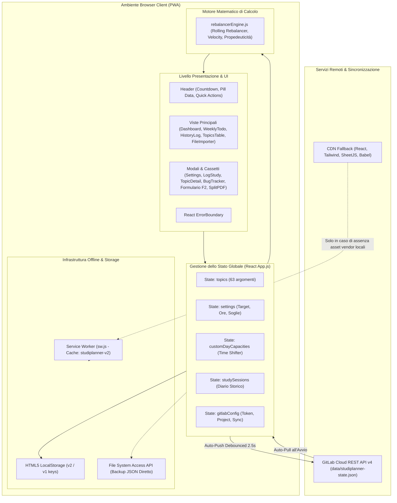
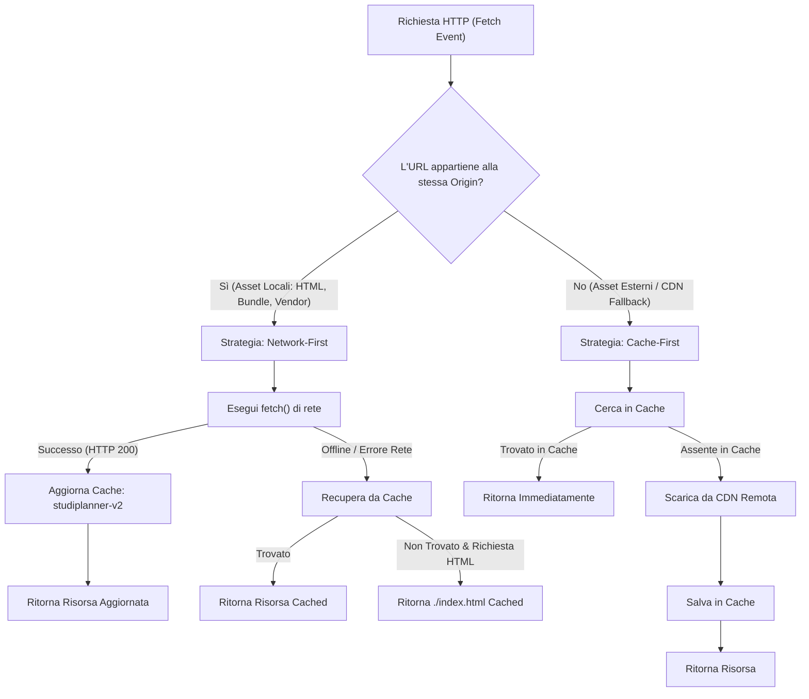
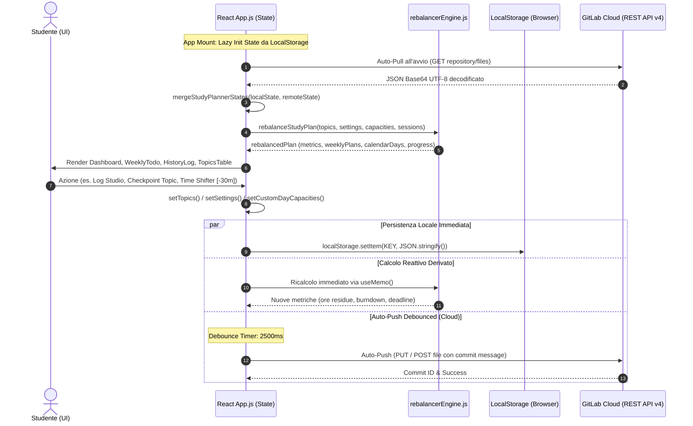

# 🏛️ 01 — Architettura di Sistema, PWA, Lifecycle & Schemi Dati
## StudiPlanner — Analisi 1 & Geometria (UNIMORE Ingegneria Informatica)

Questo documento costituisce la specifica tecnica e architetturale esaustiva dell'applicazione **StudiPlanner**. Descrive i principi di progettazione, lo stack tecnologico, la pipeline di consolidamento del bundle, il funzionamento offline tramite Service Worker e Web App Manifest, la modellazione dei dati persistiti e la propagazione reattiva dello stato globale.

---

## 1. Visione d'Insieme & Filosofia Architetturale

StudiPlanner è una **Single Page Application (SPA)** progettata per consentire a uno studente lavoratore full-time di gestire e ribilanciare in modo matematicamente rigoroso la preparazione di due esami universitari fondamentali: **Analisi Matematica 1** (32 argomenti) e **Geometria e Algebra Lineare** (31 argomenti), con scadenza d'esame fissata al **10 Gennaio 2027**.

### Principi Architetturali Cardine:
1. **Zero-Backend & Client-Side Sovereign:** L'applicazione non si appoggia ad alcun server applicativo centralizzato o backend proprietario. Tutta la logica di calcolo, simulazione, rebalancing ed elaborazione risiede nel browser del client.
2. **Offline-First & Local-First:** I dati primari persistono in [HTML5 LocalStorage](file:///c:/tmp/StudiPlanner/src/app.js#L40-L44). L'applicazione funziona al 100% in assenza di connessione internet grazie a un [Service Worker](file:///c:/tmp/StudiPlanner/sw.js#L1-L91) con pre-caching delle risorse statiche e dei runtime locali.
3. **Zero-Runtime-Build:** Nessuna dipendenza obbligatoria da pipeline Node.js pesanti in produzione (Webpack, Vite, Rollup o Turbo). Il codice sorgente modulare in `src/` viene compilato e concatenato tramite uno script Python deterministico ultra-rapido ([build_bundle.py](file:///c:/tmp/StudiPlanner/scripts/build_bundle.py)), ed eseguito nel browser via React 18 UMD e Babel Standalone.
4. **Sincronizzazione Cloud Indipendente (GitLab REST API v4):** Sincronizzazione multi-dispositivo (Desktop di lavoro, Laptop, Smartphone, Tablet) diretta tramite API standard di GitLab su repository privato dell'utente, senza intermediari o database terzi.
5. **Resilienza e Tolleranza ai Guasti:** Presenza di un Watchdog anti-schermo nero nell'[index.html](file:///c:/tmp/StudiPlanner/index.html#L85-L125) e di un `ErrorBoundary` globale di React nel bundle per catturare qualsiasi eccezione di rendering e offrire ripristino istantaneo senza perdita di dati.

---

## 2. Diagramma Architetturale Complessivo

Il seguente diagramma illustra l'interazione tra i livelli del sistema, dall'interfaccia utente fino ai livelli di storage locale e cloud remoto.



---

## 3. Stack Tecnologico & Decisioni Tecniche

La tabella seguente riassume le componenti tecnologiche adottate e le motivazioni ingegneristiche alla base di ciascuna scelta:

| Tecnologia | Versione / Modalità | Ruolo nel Sistema | Motivazione Ingegneristica |
| :--- | :--- | :--- | :--- |
| **React** | 18.2.0 (UMD Production) | UI Framework Reattivo | Gestione dichiarativa dello stato, component-driven UI, memoization efficiente tramite `useMemo` e `useCallback`. |
| **ReactDOM** | 18.2.0 (Client Root) | Rendering DOM | Montaggio sicuro tramite `ReactDOM.createRoot` con gestione del fallback. |
| **Babel Standalone** | 7.x (In-Browser Transpiler) | Transpilazione JSX | Permette l'esecuzione diretta del JSX e di sintassi ES moderna senza necessitare di compilatori Node.js installati. |
| **Tailwind CSS** | 3.x (Standalone CDN/Vendor) | Design System Utility-First | Palette cromatica Dark Mode nativa, responsive grid per desktop widescreen (1920px+) e mobile, zero CSS custom da manutenere. |
| **SheetJS (XLSX)** | Latest (UMD Standalone) | Import / Export Spreadsheet | Parsing e serializzazione multi-formato (`.xlsx`, `.ods`, `.csv`) con fuzzy-matching degli header delle colonne. |
| **Python** | 3.8+ (Standard Library) | Bundling & Local Server | Compilazione bundle deterministica (`scripts/build_bundle.py`) e webserver HTTP CORS/no-cache (`server.py`) a zero dipendenze esterne (solo `http.server`, `socketserver`). |
| **PWA Service Worker** | Cache API Standard | Caching & Offline App Shell | Architettura di rete ibrida (Network-First per asset locali, Cache-First per librerie vendor). |
| **GitLab REST API** | API v4 (Direct Browser Fetch) | Cloud Sincronizzazione Multi-Device | Permette l'archiviazione di backup versionati in un repository Git privato personale senza server middleware. |

---

## 4. Pipeline di Build & Packaging: `build_bundle.py`

Il repository adotta una struttura modulare in cui ciascun componente, servizio o set di dati risiede in file autonomi sotto la cartella `src/`. Tuttavia, per garantire la massima portabilità nel browser senza richiedere bundler complessi come Vite o Webpack, lo script [scripts/build_bundle.py](file:///c:/tmp/StudiPlanner/scripts/build_bundle.py) consolida i moduli in un unico artefatto runtime: [bundle.js](file:///c:/tmp/StudiPlanner/bundle.js).

### Flusso di Esecuzione del Bundler:
1. **Ordinamento Topologico dei File (`files_order`):**  
   I moduli vengono concatenati secondo un ordine di dipendenza rigoroso:
   - Dati predefiniti: `src/data/defaultData.js`
   - Iconografia SVG: `src/components/Icons.js`
   - Servizi di calcolo e I/O: `rebalancerEngine.js`, `parserService.js`, `gitlabSyncService.js`, `calendarExportService.js`
   - Componenti UI ausiliari e modali: `AlertBanner.js`, `NeuraDeckPromptGenerator.js`, `ExamSimulator.js`, `MathBugTracker.js`, `MathFormulaDrawer.js`, `Clarke9000Companion.js`, `BurndownChart.js`
   - Viste primarie: `Dashboard.js`, `ActivityHeatmap.js`, `WeeklyTodo.js`, `HistoryLog.js`, `TopicsTable.js`, `FileImporter.js`
   - Modali contestuali: `SettingsModal.js`, `LogStudyModal.js`, `TopicDetailModal.js`, `PdfSplitView.js`, `WeeklyRetrospectiveModal.js`
   - Entry point applicativo: `src/app.js`
2. **Rimozione degli Import/Export ES6:**  
   Tramite espressioni regolari mirate, vengono rimossi tutti gli enunciati `import ... from ...`, `export default`, ed `export const/function`, esponendo le variabili nello scope globale della sessione browser.
3. **Iniezione dell'ErrorBoundary Globale di React:**  
   Viene anteposta una classe `ErrorBoundary` derivata da `React.Component` per intercettare qualsiasi crash di rendering durante il ciclo di vita dei componenti, mostrando una schermata di recupero con log dell'errore e opzione di reset sicuro.
4. **DOM Root Mount Sicuro:**  
   In coda al bundle viene aggiunta la funzione `mountStudiPlannerApp()` che verifica l'avvenuto caricamento del DOM (`DOMContentLoaded`) o effettua un polling controllato a intervalli di 50ms prima di richiamare `ReactDOM.createRoot`.

> [!IMPORTANT]
> **Vincolo di Sviluppo:** Ogni modifica a qualunque file presente in `src/` richiede l'esecuzione immediata di:
> ```powershell
> python scripts\build_bundle.py
> python scripts\test_rolling_rebalance.py
> ```

---

## 5. PWA, Service Worker & Architettura Offline-First

StudiPlanner è una **Progressive Web App (PWA)** a tutti gli effetti, installabile sia su sistemi operativi desktop (Windows 10/11, macOS, Linux tramite Chrome/Edge) sia su dispositivi mobili (iOS, Android).

### 5.1 Il Web App Manifest ([manifest.json](file:///c:/tmp/StudiPlanner/manifest.json))
- **Display Mode:** `standalone` (apertura in finestra indipendente senza barre degli indirizzi o elementi del browser).
- **Theme Color & Background Color:** `#070b14` (palette scura uniforme sin dal primo frame di splash screen).
- **Icone:** Icone multi-risoluzione `192x192` e `512x512`, con supporto esplicito a `purpose: "any"` e `purpose: "maskable"` per la compatibilità con le icone adattive di Android e Windows.
- **Orientation:** `portrait-primary` con scalabilità reattiva orizzontale su widescreen.

### 5.2 Strategia di Caching del Service Worker ([sw.js](file:///c:/tmp/StudiPlanner/sw.js))
Il Service Worker implementa una strategia di caching differenziata a seconda della natura della risorsa:



#### Fasi del Ciclo di Vita del Service Worker:
- **`install`:** Apre la cache `studiplanner-v2` e pre-carica l'intero app shell e le librerie vendor (`./`, `./index.html`, `./bundle.js`, `./manifest.json`, librerie `vendor/*.js`). Invoca `self.skipWaiting()` per l'attivazione immediata.
- **`activate`:** Itera su tutte le chiavi di cache presenti ed elimina qualsiasi cache obsoleta non corrispondente a `studiplanner-v2`. Invoca `self.clients.claim()` per prendere immediatamente il controllo di tutti i client attivi.
- **`fetch`:** Applica la differenziazione Network-First / Cache-First descritta sopra, garantendo che lo studente possa avviare e usare StudiPlanner anche in modalità aereo o in aula studio senza segnale.

### 5.3 Watchdog Anti-Schermo Nero & Cattura Errori Globali
Nell'[index.html](file:///c:/tmp/StudiPlanner/index.html#L85-L125), prima ancora che React venga eseguito, è configurato un timer a 3.5 secondi. Se dopo 3500ms il loader iniziale `#initial-loader` non è stato rimosso o sostituito da React, viene automaticamente reso visibile un pulsante di emergenza (`#loader-watchdog`) con opzione di ricarica forzata (F5).  
In parallelo, un listener su `window.addEventListener('error')` intercetta qualsiasi eccezione non gestita a monte del framework.

---

## 6. Schemi Dati & Persistenza Locale (LocalStorage Schemas)

Tutti i dati dell'applicazione persistono in parallelo su **HTML5 LocalStorage** e all'interno dello snapshot unificato inviato al cloud GitLab o esportato via backup JSON.  
Di seguito vengono formalizzate le strutture dei dati e i relativi schemi TypeScript-equivalent.

### 6.1 Schema Argomenti: `unimore_rebalancer_topics_v2`
Memorizza l'elenco completo dei 63 argomenti d'esame ufficiali UNIMORE.

```typescript
interface Topic {
  id: string;               // Identificativo canonico: "A-01".."A-32" per Analisi, "G-01".."G-31" per Geometria
  materia: "Analisi 1" | "Geometria"; // Disciplina didattica
  capitolo: string;         // Macrogruppo didattico (es. "Limiti e Continuità", "Spazi Vettoriali")
  argomento: string;        // Descrizione dettagliata dei concetti didattici
  oreStimate: number;       // Ore nominali stimate da sillabo UNIMORE (es. 2.0, 2.5, 3.0)
  oreEffettive: number;     // Ore effettive di studio accumulate (float con supporto progressivo)
  difficolta: number;       // Grado di complessità concettuale (scala discreta 1 - 5)
  prioritaEsame: number;    // Frequenza e rilevanza statistica nelle prove d'esame (1 - 5)
  completato: boolean;      // Flag primario di completamento
  isCompleted?: boolean;    // Alias retrocompatibile con v1
  completedDate?: string | null; // Data di completamento in formato ISO "YYYY-MM-DD"
  fonti?: string;           // Riferimenti ai registri lezioni, dispense e libri di testo (es. Marcellini)
  note?: string;            // Note d'esame, passaggi critici e dimostrazioni obbligatorie
  feynmanChecklist?: {      // Checklist di autovalutazione del metodo Feynman
    intuitive: boolean;     // Spiegazione intuitiva a parole proprie
    formal: boolean;        // Definizione formale rigorosa (eps-delta, quantificatori)
    proof: boolean;         // Dimostrazione del teorema riprodotta a libro chiuso
  };
  scratchpadNotes?: string; // Appunti liberi persistiti all'interno della scheda dettaglio
  spacedReviews?: {         // Livelli completati di Spaced Repetition (Ripasso Spaziato)
    r1?: boolean;           // Ripasso +24h
    r2?: boolean;           // Ripasso +7 giorni
    r3?: boolean;           // Ripasso +21 giorni
  };
}
```

#### Esempio di Record JSON:
```json
{
  "id": "A-08",
  "materia": "Analisi 1",
  "capitolo": "Limiti e Continuità",
  "argomento": "Definizione formale di limite con intorni, limiti destri/sinistri e teoremi dei limiti",
  "oreStimate": 2.5,
  "oreEffettive": 3.0,
  "difficolta": 3,
  "prioritaEsame": 5,
  "completato": true,
  "isCompleted": true,
  "completedDate": "2026-11-20",
  "fonti": "Registro 3ª sett., Lezioni 7 e 8, Marcellini Cap. 4",
  "note": "Dimostrazione permanenza del segno per funzioni e unicità del limite",
  "feynmanChecklist": {
    "intuitive": true,
    "formal": true,
    "proof": true
  },
  "scratchpadNotes": "Attenzione ai casi di limite destro e sinistro distinti nelle funzioni a tratti.",
  "spacedReviews": {
    "r1": true,
    "r2": false,
    "r3": false
  }
}
```

---

### 6.2 Schema Impostazioni Globali: `unimore_rebalancer_settings_v2`
Configura il calendario accademico, gli orari base del lavoratore e i coefficienti del rebalancing engine.

```typescript
interface StudySettings {
  roadmapStartDate: string;             // Data di inizio ufficiale della roadmap ("2026-11-16")
  targetExamDate: string;               // Data limite imperativa dell'esame ("2027-01-10")
  currentSimulatedDate: string;         // Data virtuale di calcolo "Oggi" ("YYYY-MM-DD")
  criticalWeeklyHoursThreshold: number; // Soglia oraria settimanale di guardia (default: 25.0h)
  eveningStudyHours: number;            // Ore base disponibili la sera nei giorni feriali (default: 2.5h)
  weekdayStudyHours: number;            // Alias configurabile per le ore feriali
  weekendStudyHours: number;            // Ore base disponibili al sabato e alla domenica (default: 4.5h)
  highPriorityThreshold: number;        // Soglia di scatto del buffer (default: 4, per priorità/difficoltà >= 4)
  bufferMultiplier: number;             // Moltiplicatore di buffer temporale (default: 1.2, ossia +20%)
  interleaveSubjects: boolean;          // Alternanza automatica giornaliera Analisi 1 / Geometria (default: true)
  studyDays: {                          // Configurazione giorno per giorno della settimana (0: Dom, 1: Lun, ...)
    [dayOfWeek: number]: {
      name: string;                     // "Lunedì", "Martedì", ...
      enabled: boolean;                 // true se lo studio è pianificato in questo giorno
      isWeekend: boolean;               // true per Sabato (6) e Domenica (0)
      defaultSubject: "Analisi 1" | "Geometria" | "Misto";
      timeSlot: string;                 // Descrizione della fascia oraria (es. "Sera (19:30 - 22:00)")
    };
  };
}
```

---

### 6.3 Schema Override Orari Giornalieri (Time Shifter): `unimore_rebalancer_custom_capacities_v2`
Consente l'adattamento flessibile e puntuale della disponibilità oraria per specifiche date del calendario.

```typescript
type CustomDayCapacities = Record<string, number>;
```

#### Esempio JSON:
```json
{
  "2026-11-18": 3.0,
  "2026-11-19": 1.5,
  "2026-11-21": 6.0,
  "2026-11-22": 0.0
}
```
*Spiegazione:* Il 18 Novembre lo studente ha aggiunto uno slot di 30 minuti in pausa pranzo (+0.5h rispetto alle 2.5h standard); il 19 Novembre un imprevisto di lavoro ha ridotto lo studio serale a 1.5h; il 21 Novembre è stato attivato un blocco intensivo da 6.0h; il 22 Novembre la giornata è stata azzerata (riposo totale o straordinario). Il motore ridistribuisce all'istante il carico residuo.

---

### 6.4 Schema Sessioni Storiche: `unimore_rebalancer_sessions_v2`
Rappresenta il giornale di bordo cronologico e immutabile delle sessioni effettivamente svolte dallo studente.

```typescript
interface StudySession {
  id: string;          // Identificativo univoco generato: "sess_" + timestamp + "_" + randomHex
  topicId: string;     // ID dell'argomento oggetto della sessione (es. "A-12" o "G-05")
  date: string;        // Data di svolgimento in formato "YYYY-MM-DD"
  hours: number;       // Ore effettive dedicate (es. 1.5, 2.5)
  completed: boolean;  // Se la sessione ha portato alla chiusura definitiva del topic
  note?: string;       // Diario della sessione, difficoltà riscontrate, esercizi svolti
  timestamp: string;   // Timestamp ISO esteso di registrazione sul client
}
```

---

### 6.5 Schema Configurazione GitLab Sync: `unimore_rebalancer_gitlab_config_v1`
Memorizza i parametri di sincronizzazione con la REST API v4 di GitLab Cloud.

```typescript
interface GitLabConfig {
  enabled: boolean;          // Stato di attivazione generale della sincronizzazione cloud
  autoSync: boolean;         // Abilita auto-pull all'avvio e auto-push debounced sulle modifiche
  instanceUrl: string;       // Istanza GitLab (default: "https://gitlab.com")
  projectId: string;         // Percorso URL-encoded o numerico del repository (es. "username/studiplanner")
  branch: string;            // Ramo di destinazione dei commit (default: "main")
  filePath: string;          // Percorso del file JSON nello storage Git (default: "data/studiplanner-state.json")
  token: string;             // Personal Access Token di GitLab (con permessi read_repository / write_repository)
  lastSynced: string | null; // Orario dell'ultima sincronizzazione riuscita (es. "22:15:40")
  lastCommitId: string | null; // SHA-1 hash dell'ultimo commit effettuato sul branch
  syncStatus: "idle" | "syncing" | "success" | "error"; // Stato della telemetria UI
  errorMessage: string | null; // Eventuale messaggio di errore formattato per la visualizzazione
}
```

---

### 6.6 Schema Registro Errori Matematici: `unimore_rebalancer_math_bugs_v1`
Traccia gli errori algebrici e concettuali ricorrenti (es. forme indeterminate $0/0$, segni nel prodotto scalare, determinanti).

```typescript
interface MathBug {
  id: string;                // "bug_1", "bug_2", ...
  category: "Analisi 1" | "Geometria" | "Algebra Generale";
  title: string;             // Sintesi dell'errore (es. "Dimenticanza moltiplicazione per la derivata interna")
  description: string;       // Spiegazione dettagliata del meccanismo di errore
  preventiveRule: string;    // Regola aurea di controllo da applicare prima di passare al punto successivo
  frequencyCount: number;    // Contatore delle volte in cui l'errore è stato commesso nelle sessioni
  lastOccurredDate: string;  // Data dell'ultima occorrenza
}
```

---

## 7. Propagazione dello Stato Globale & Lifecycle Hooks

Il componente principale [src/app.js](file:///c:/tmp/StudiPlanner/src/app.js) orchestra l'intero flusso dati dell'applicazione. Non vi sono librerie esterne di state management (come Redux o Zustand); la propagazione si basa su pattern nativi di React: **Lazy State Initialization**, **Reactive Effects**, e **Memoized Derived Computation**.

### 7.1 Flusso Unidirezionale dei Dati



### 7.2 Dettaglio dei Principali Lifecycle Hooks in `App.js`:

1. **Lazy State Initialization (`useState(() => ...)`):**  
   All'avvio, i cinque stati primari (`topics`, `settings`, `customDayCapacities`, `studySessions`, `gitlabConfig`) leggono da `localStorage`. Se una chiave è assente o corrotta, intervengono i default deterministici ([defaultData.js](file:///c:/tmp/StudiPlanner/src/data/defaultData.js#L4) e `DEFAULT_SETTINGS`).
2. **Auto-Roll della Data Odierna (`useEffect` + Interval a 60s & Window Focus):**  
   Per garantire che lo studente lavoratore che lascia il tab del browser aperto la notte trovi al mattino il calendario aggiornato, un listener sull'evento `window.addEventListener("focus")` e un timer a intervalli di 60 secondi verificano se la data di sistema ha scavalcato la mezzanotte. In caso positivo, `currentSimulatedDate` viene aggiornata automaticamente alla nuova data reale senza ricaricare la pagina.
3. **Persistenza Reattiva su LocalStorage (`useEffect` dedicati):**  
   Ogni mutazione di `topics`, `settings`, `customDayCapacities`, `studySessions` o `gitlabConfig` attiva un rispettivo effetto collaterale isolato che scrive sul `localStorage`, aggiornando anche il timestamp visivo `lastSavedTime` mostrato nell'interfaccia.
4. **Ricalcolo Matematico Memorizzato (`useMemo`):**  
   Il rebalancing completo del calendario non viene mai calcolato ad ogni render casuale. È incapsulato in:
   ```javascript
   const rebalancedPlan = useMemo(() => {
     return rebalanceStudyPlan(topics, settings, customDayCapacities, studySessions);
   }, [topics, settings, customDayCapacities, studySessions]);
   ```
   Garantisce prestazioni a 60fps anche su dispositivi mobile o hardware a basso consumo.
5. **Debounced Cloud Auto-Push (`useEffect` con ref di skip mount):**  
   Un hook intercetta le modifiche dello stato globale. Attraverso una `useRef(true)` salta il primo render di montaggio per evitare commit a vuoto, quindi imposta un timer con ritardo di **2.5 secondi (2500ms)**. Se l'utente effettua più modifiche consecutive (es. segna 3 argomenti svolti o varia più volte le ore), il timer si resetta, raggruppando tutte le variazioni in un unico commit atomico su GitLab.
6. **File System Access API Auto-Save (`useEffect([topics, settings, ...])`):**  
   Se l'utente ha connesso un file locale tramite il pulsante "Connetti File JSON" ([FileImporter.js](file:///c:/tmp/StudiPlanner/src/components/FileImporter.js)), ad ogni cambiamento viene invocato `fileHandle.createWritable()` per sovrascrivere trasparentemente il file sul disco del computer.

---

## 8. Gerarchia e Relazioni dei Componenti UI

La struttura dei componenti React è modulare, gerarchica e orientata alla separazione delle responsabilità:

```mermaid
classDiagram
    class App {
        +State topics
        +State settings
        +State customDayCapacities
        +State studySessions
        +State gitlabConfig
        +rebalancedPlan
    }

    class Header {
        +NavTabs activeTab
        +DateSimulatorControls
        +CountdownBadge
        +PWAInstallPrompt
    }

    class Dashboard {
        +WeeklyVelocityTelemetry
        +SubjectProgressBars
        +ExamReadinessWidget
        +ActivityHeatmap
        +BurndownChart
    }

    class WeeklyTodo {
        +TimeShifterStepper
        +DayScheduleCards
        +SpacedReviewCheckers
        +TopicActionButtons
    }

    class HistoryLog {
        +PastDaysTimeline
        +SessionRollback
        +StudyJournalNotes
    }

    class TopicsTable {
        +FilterMateria
        +SearchFuzzy
        +FeynmanChecklistStatus
        +BatchActions
    }

    class FileImporter {
        +ExcelOdsCsvParser
        +JsonBackupExportImport
        +GitLabSyncManager
        +FileSystemApiConnector
    }

    class TopicDetailModal {
        +SyllabusTab
        +TheoremsAndProofsTab
        +FeynmanChecklistTab
        +SessionHistoryTab
    }

    class LogStudyModal {
        +TopicSelectorPicker
        +HourSliderStepper
        +CompletionToggle
        +SessionNotesArea
    }

    App *-- Header
    App *-- Dashboard
    App *-- WeeklyTodo
    App *-- HistoryLog
    App *-- TopicsTable
    App *-- FileImporter
    App *-- TopicDetailModal
    App *-- LogStudyModal
    App *-- SettingsModal
    App *-- MathBugTracker
    App *-- MathFormulaDrawer
    App *-- PdfSplitView
    App *-- WeeklyRetrospectiveModal
    App *-- Clarke9000Companion
```



---

## 9. Struttura dei File del Progetto & Mappa delle Responsabilità

```
c:\tmp\StudiPlanner\
├── index.html                           # Entry point PWA con pre-loader e fallback offline
├── manifest.json                        # PWA Web App Manifest (standalone, theme #070b14)
├── sw.js                                # Service Worker con pre-caching e routing cache-first/network-first
├── bundle.js                            # Bundle consolidato per l'esecuzione runtime client-side
├── server.py                            # Server locale Python multi-host (0.0.0.0:3000) con supporto LAN e CORS
├── start-app.bat                        # Launcher rapido a doppio clic su Windows
├── scripts/
│   ├── build_bundle.py                  # Script Python per la compilazione deterministica di bundle.js
│   ├── test_rolling_rebalance.py        # Suite di test unitari sul motore matematico di rebalancing
│   ├── export_to_excel.py               # Utility di esportazione dello stato in formato spreadsheet
│   └── test_rebalancer.py               # Test di regressione sui vincoli didattici
├── src/
│   ├── app.js                           # Root component React: stato globale, persistenza, GitLab sync
│   ├── data/
│   │   └── defaultData.js               # Dataset canonico dei 63 argomenti ufficiali UNIMORE
│   ├── services/
│   │   ├── rebalancerEngine.js          # Motore matematico del rolling rebalancer e modello di capacità
│   │   ├── parserService.js             # Parser client-side universale per XLSX, ODS e CSV con fuzzy-match
│   │   ├── gitlabSyncService.js         # Client REST API v4 per GitLab Cloud con auto-merge non distruttivo
│   │   └── calendarExportService.js     # Generatore standard di file iCalendar (.ics) per calendari esterni
│   └── components/
│       ├── Icons.js                     # Libreria icone SVG native zero-dependency
│       ├── Dashboard.js                 # Vista panoramica progressi, metriche KPI e telemetria
│       ├── WeeklyTodo.js                # Pianificazione operativa giorno per giorno con Time Shifter
│       ├── HistoryLog.js                # Timeline storica delle sessioni e diario di bordo
│       ├── TopicsTable.js               # Tabella interattiva e filtrabile dei 63 argomenti
│       ├── FileImporter.js              # Centro sincronizzazione, backup JSON e import spreadsheet
│       ├── TopicDetailModal.js          # Scheda immersiva con sillabo, teoremi d'esame e diario
│       ├── LogStudyModal.js             # Modale di registrazione rapida delle sessioni svolte
│       ├── SettingsModal.js             # Configurazione orari lavoratore e parametri di simulazione
│       ├── MathBugTracker.js            # Registro e tassonomia degli errori matematici ricorrenti
│       ├── MathFormulaDrawer.js         # Cassetto formulario rapido e scorciatoia [F2]
│       ├── PdfSplitView.js              # Visualizzatore affiancato (split-view) per dispense ed eserciziari
│       ├── BurndownChart.js             # Grafico burndown ore stimate vs ore residue
│       ├── ActivityHeatmap.js           # Matrice di intensità di studio in stile GitHub Contribution
│       ├── ExamSimulator.js             # Simulatore delle prove scritte d'esame UNIMORE
│       ├── WeeklyRetrospectiveModal.js  # Modale di analisi settimanale della velocity e retrospettiva
│       ├── AlertBanner.js               # Banner di avviso sovraccarico critico (>25h/settimana)
│       ├── NeuraDeckPromptGenerator.js  # Generatore di prompt AI per flashcard Anki / NotebookLM
│       └── Clarke9000Companion.js       # Assistente virtuale motivazionale e di guida
├── docs/                                # Documentazione tecnica completa del repository
│   ├── INDEX.md                         # Portale principale e indice generale della documentazione
│   ├── 01_ARCHITECTURE.md               # [Questo documento] Architettura, PWA, Lifecycle & Schemi Dati
│   ├── 02_REBALANCER_ENGINE.md          # Motore matematico del Rolling Rebalancer & Time Shifter
│   ├── 03_SERVICES_AND_SYNC.md          # GitLab Cloud Sync, Parser Spreadsheet & iCalendar
│   ├── 04_UI_COMPONENTS.md              # Design System Dark Mode, Componenti React & Modali
│   ├── 05_ACADEMIC_MODEL_AND_SYLLABUS.md# Modello Studente Lavoratore, Sillabo UNIMORE & Teoremi
│   └── 06_DEVOPS_AND_SCRIPTS.md         # Pipeline di Build, Test Playwright, Server Locale & Tray App
├── GEMINI.md                            # Standard di codifica, vincoli immutabili e linee guida agenti
├── AGENTS.md                            # Guida rapida e regole operative per agenti autonomi
└── GUIDA_APPLICAZIONE.md                # Manuale utente esaustivo per lo studente
```

---

## 10. Collegamenti & Riferimenti

- Per approfondire il funzionamento matematico dell'algoritmo di ribilanciamento e del Time Shifter: 👉 **[02_REBALANCER_ENGINE.md](file:///c:/tmp/StudiPlanner/docs/02_REBALANCER_ENGINE.md)**
- Per i dettagli sulla sincronizzazione GitLab Cloud, parser file e export iCal: 👉 **[03_SERVICES_AND_SYNC.md](file:///c:/tmp/StudiPlanner/docs/03_SERVICES_AND_SYNC.md)**
- Per l'analisi dei componenti React e del design system dark: 👉 **[04_UI_COMPONENTS.md](file:///c:/tmp/StudiPlanner/docs/04_UI_COMPONENTS.md)**
- Per il programma didattico ufficiale UNIMORE e la lista dei teoremi: 👉 **[05_ACADEMIC_MODEL_AND_SYLLABUS.md](file:///c:/tmp/StudiPlanner/docs/05_ACADEMIC_MODEL_AND_SYLLABUS.md)**
- Per la pipeline di compilazione, i test end-to-end e l'integrazione desktop Windows: 👉 **[06_DEVOPS_AND_SCRIPTS.md](file:///c:/tmp/StudiPlanner/docs/06_DEVOPS_AND_SCRIPTS.md)**
- Indice principale della documentazione: 👉 **[INDEX.md](file:///c:/tmp/StudiPlanner/docs/INDEX.md)**
