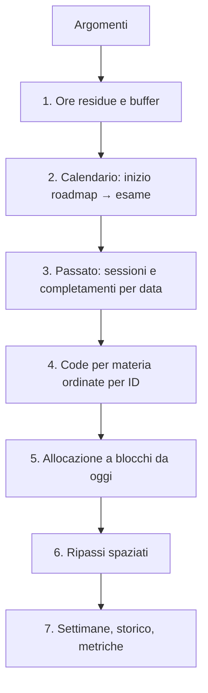

# 02 — Motore di ribilanciamento

`src/services/rebalancerEngine.js` trasforma lo stato dell'app (argomenti, impostazioni, budget giornalieri, sessioni) in un piano di studio completo e in un insieme di metriche. È una funzione pura: nessun accesso a DOM, `localStorage` o rete. È coperto da `tests/engine.test.mjs`.

```js
rebalanceStudyPlan(topics, settings, customDayCapacities, studySessions)
  → { metrics, weeklyPlans, currentWeekPlan, calendarDays, historyDays, studySessions, progress }
```

---

## 1. Invarianti

Ogni modifica al motore deve preservare queste proprietà (verificate dai test):

1. **Ordine sequenziale.** Per ogni materia gli argomenti vengono pianificati in ordine di ID (`A-01 → A-32`, `G-01 → G-31`). Priorità e difficoltà non cambiano mai l'ordine.
2. **Nessuna perdita.** Ogni argomento non completato compare nel piano futuro, anche se le ore spese hanno già raggiunto la stima.
3. **Budget rispettato.** Le ore pianificate in un giorno non superano il suo budget, salvo saturazione (§4.3), che è sempre segnalata.
4. **`A-32` solo nell'ultima settimana.** La prova generale non viene pianificata prima di `targetExamDate − 7 giorni`.
5. **Giorno d'esame libero.** Nessuno studio viene allocato in `targetExamDate`.
6. **Nessun doppio conteggio.** Le ore di una sessione registrata compaiono una sola volta nello storico, anche se l'argomento viene spuntato in un giorno diverso.

---

## 2. Pipeline



### 2.1 Ore residue e buffer

Per ogni argomento:

```
oreResidue    = completato ? 0 : max(0.5, oreStimate − oreEffettive)
hasBuffer     = prioritaEsame ≥ 4  oppure  difficolta ≥ 4      (highPriorityThreshold)
effectiveHours = hasBuffer ? oreResidue × 1.2 : oreResidue        (bufferMultiplier)
```

- Il buffer si applica alle ore **residue**: un argomento quasi finito riceve un buffer piccolo.
- Il minimo di 0,5 h (`MIN_OPEN_RESIDUE_HOURS`) garantisce che un argomento aperto abbia sempre un blocco di chiusura nel piano, anche dopo aver superato la stima.

### 2.2 Calendario

Il motore genera un giorno per ogni data da `roadmapStartDate` a `targetExamDate`. Per ogni giorno:

| Campo | Significato |
| :--- | :--- |
| `maxHours` | Budget: l'override del Time Shifter se presente (limitato a 0–12 h), altrimenti `weekdayStudyHours` o `weekendStudyHours`. |
| `standardHours` | Budget di default del giorno, senza override. |
| `preferredSubject` | Materia preferita dal `studyDays` (Lun/Mer/Ven Analisi, Mar/Gio Geometria, weekend "Misto"). |
| `isPast`, `isToday`, `isFuture` | Posizione rispetto a `currentSimulatedDate`. |
| `weekIndex` | Settimana della roadmap (1 = settimana di `roadmapStartDate`). |
| `dayStatus` | `completed`, `skipped`, `rest` (giorno disabilitato) o `scheduled`. |

Un budget di `0` (da impostazioni o Time Shifter) è un valore valido e significa "nessuno studio quel giorno".

### 2.3 Il passato

Per ogni giorno passato (e per oggi) vengono inseriti nel giorno:

1. le **sessioni registrate** in quella data, con le loro ore;
2. gli **argomenti completati** in quella data (`completedDate`) che non hanno già una sessione nello stesso giorno. Le loro ore sono quelle non ancora coperte da sessioni (`oreEffettive − ore registrate`), così un argomento studiato in sessioni e poi spuntato non viene contato due volte.

Un giorno passato abilitato senza nulla diventa `skipped`. Gli argomenti di un giorno saltato non vanno persi: essendo ancora aperti, rientrano nelle code del punto successivo e vengono ripianificati da oggi.

### 2.4 Code per materia

Gli argomenti aperti vengono divisi in due code, entrambe ordinate per numero di ID (`sortBySequentialId`):

- **Analisi**: materia che contiene "analisi";
- **Geometria**: tutte le altre materie (anche quelle importate con nomi diversi, che altrimenti sparirebbero dal piano).

---

## 3. Giorni pianificabili

Lo studio nuovo viene allocato sui giorni che sono **oggi o futuri, abilitati e precedenti al giorno d'esame**. Se non ce n'è nessuno (oggi è il giorno d'esame o la sessione è finita), si usa come ripiego il giorno attivo o l'ultimo del calendario, per non perdere argomenti.

Il budget libero di ogni giorno è `maxHours − allocatedHours`: le ore già registrate oggi riducono quanto resta da pianificare per oggi.

---

## 4. Allocazione a blocchi (`allocateSequentialChunks`)

### 4.1 Riempimento di un giorno

I giorni vengono visitati in ordine. Ognuno riceve un budget e lo riempie con la **testa** delle code:

| Materia preferita | Riempimento |
| :--- | :--- |
| Analisi 1 | Prima la coda di Analisi; l'eventuale avanzo va a Geometria. |
| Geometria | Prima Geometria; l'avanzo ad Analisi. |
| Misto (weekend) | Metà budget per materia; l'avanzo di una passa all'altra. Se una coda è vuota, tutto all'altra. |

Dalla testa della coda si prende `min(ore residue dell'argomento, budget)`:

- se l'argomento non entra tutto, la parte restante resta in testa e continua il giorno dopo → l'argomento risulta **diviso** in parti (`partIndex`/`partCount`, badge "Parte 2/3" nella UI);
- un avanzo di budget inferiore a 0,5 h non apre un nuovo argomento (`MIN_CHUNK_HOURS`), per evitare blocchi inutilmente piccoli;
- una coda residua sotto i 15 minuti viene assorbita nel giorno corrente invece di generare una parte minuscola;
- se la testa di Analisi è `A-32` e il giorno è prima dell'ultima settimana, la coda di Analisi si ferma e il budget passa a Geometria.

Ogni blocco pianificato riporta sia le ore del blocco (`effectiveHours`) sia le ore totali dell'argomento (`topicEffectiveHours`).

### 4.2 Esempio

Budget 2,5 h la sera, `A-09` con 4,8 h effettive (4 h + buffer), lunedì preferenza Analisi:

| Giorno | Blocchi |
| :--- | :--- |
| Lun | `A-09` parte 1/2 — 2,5 h |
| Mar (Geometria) | `G-04` — 2,5 h |
| Mer | `A-09` parte 2/2 — 2,3 h |

La sequenza è preservata: `A-10` non può iniziare prima della fine di `A-09`.

### 4.3 Saturazione (`capacityScale`)

Se con i budget impostati non tutti gli argomenti entrano prima dell'esame, il motore **non** ammassa il residuo sull'ultimo giorno. Cerca invece, per ricerca binaria, il fattore minimo `capacityScale > 1` per cui moltiplicando ogni budget giornaliero tutto il programma entra nel calendario:

- `metrics.capacityScale` — fattore applicato (1 = nessuna saturazione);
- `metrics.isScheduleSaturated` — `true` se il fattore è maggiore di 1.

La dashboard usa questi valori per segnalare che il piano richiede più ore di quelle disponibili. Se tutti i budget sono 0, il programma viene distribuito uniformemente sui giorni pianificabili. Solo come ultima rete di sicurezza, un residuo che non entra nemmeno così viene accodato in ordine all'ultimo giorno.

---

## 5. Ripetizione spaziata

`buildSpacedReviewSchedule(topic, currentDate)` genera i ripassi di ogni argomento completato con `completedDate`. Gli intervalli si adattano all'esito che lo studente dichiara a fine ripasso (`REVIEW_OUTCOMES`):

| Esito | Etichetta | Effetto sul ripasso successivo |
| :--- | :--- | :--- |
| `good` | Ricordavo bene | intervallo lungo: R2 a +7, R3 a +21 giorni dal ripasso precedente |
| `partial` | Incerto | intervallo corto: R2 a +4, R3 a +10 |
| `failed` | Non ricordavo | si riparte a +3 giorni |

Regole:

- **R1** cade sempre a `completedDate + 3`.
- Ogni livello successivo parte dalla **data del ripasso precedente**, se questo ha un esito. Altrimenti (ripasso non ancora fatto, oppure dato storico `true` senza esito) vale il calendario fisso +3 / +7 / +21 dal completamento.
- Un R3 o successivo `partial` o `failed` aggiunge **ripassi di recupero** R4…R6 (`MAX_REVIEW_LEVELS = 6`): +14 giorni dopo un esito buono, +7 dopo uno incerto, +3 dopo uno fallito. Ci si ferma al primo recupero andato bene.
- Lo stato si salva in `topic.spacedReviews.rN` come `{ done, outcome, date }`; `getReviewRecord` normalizza anche il vecchio valore `true`.

Un ripasso non svolto con data passata è *in ritardo* e compare nel giorno attivo; uno con data odierna è *in scadenza*. I ripassi non consumano budget: sono un promemoria separato (`day.spacedReviews`). `metrics.spacedRepetition` riporta `activeReviews`, `dueToday`, `overdue` e `failed`.

---

## 6. Metriche

### 6.1 Carico e ritmo

| Metrica | Formula |
| :--- | :--- |
| `totalRemainingBaseHours` | Σ ore residue degli argomenti aperti |
| `totalRemainingEffectiveHours` | Σ ore residue con buffer |
| `totalBufferHours` | differenza tra le due |
| `remainingDays`, `remainingWeeks` | da `currentSimulatedDate` a `targetExamDate` |
| `requiredWeeklyHours` | `totalRemainingEffectiveHours / (max(1, remainingDays) / 7)` |
| `nominalWeeklyCapacity` | `5 × weekdayStudyHours + 2 × weekendStudyHours` (21,5 h con i default) |
| `isCriticalOverload` | `requiredWeeklyHours > criticalWeeklyHoursThreshold` |
| `excessHours` | ore settimanali oltre la soglia |
| `capacityScale`, `isScheduleSaturated` | vedi §4.3 |

Il ritmo richiesto usa i giorni residui esatti: con meno di una settimana all'esame cresce correttamente invece di essere diviso per una settimana intera.

### 6.2 Storico

`pastDaysStudied`, `pastDaysSkipped`, `totalPastHours`, `historyCount`, più `historyDays` (giorni passati e oggi, dal più recente).

### 6.3 Streak (`calculateStudyStreak`)

`calculateStudyStreak(historyDays, date, sessions, { studyDays, jokersPerMonth })`. Un giorno conta per la serie se ha almeno **0,8 h** di studio reale (sessioni registrate o ore di argomenti completati in quel giorno). La serie si calcola all'indietro da oggi; oggi non interrompe la serie se non si è ancora studiato.

- **Giorno di riposo**: un giorno con `studyDays[x].enabled === false` è neutro. Non allunga e non interrompe la serie (`isRestDayToday`).
- **Jolly**: ogni mese fino a `streakJokersPerMonth` sere saltate non spezzano la serie. Un jolly si consuma solo se la serie continua davvero oltre la sera saltata; un buco all'inizio della serie non spreca jolly.

Il risultato include serie corrente, record, badge di resilienza e `jokersPerMonth`, `jokersUsedThisMonth`, `jokersLeftThisMonth`, `jokerDates`.

### 6.4 Previsione d'esame (`calculateExamReadinessAndGrade`)

Punteggio euristico di preparazione (10–98) a partire da 55:

| Fattore | Effetto |
| :--- | :--- |
| Ritmo richiesto | da +25 (≤ 18 h/sett.) a −35 (> 32 h/sett.) |
| Costanza (giorni studiati / giorni trascorsi) | da +20 (≥ 85%) a −20 (< 50%) |
| Completamento | fino a +25, proporzionale |
| Padronanza (esercizi senza appunti) | `(accuratezza − 0,6) × 40 × peso`, solo con almeno `MASTERY_MIN_ATTEMPTS = 5` esercizi. Il peso è la copertura degli argomenti completati, limitata a 0,5–1. |
| Temi d'esame | `(media recente − 0,6) × 40`, dove la media recente è quella degli ultimi due temi per materia |

Il punteggio è mappato su fasce di voto (`28 - 30 e Lode`, `24 - 27`, `18 - 23`, `sotto il 18, per ora`) e su una probabilità di superamento. Un ritmo richiesto di 0 (tutto completato) è un valore valido. Il risultato indica da dove arriva la stima (`masteryBased`, `masteryAccuracy`, `masteryAttempts`, `masteryCorrect`, `mockBased`, `mockRecentPct`), così la dashboard può dire se si basa su prove reali o solo sulle ore.

### 6.4-bis Padronanza (`calculateMasteryStats`)

Per ogni argomento si sommano gli esiti `exercises` delle sessioni (`normalizeExercises`):

- accuratezza = `(giusti + 0,5 × parziali) / tentativi`;
- padronanza = `0,8 × accuratezza + 0,2 × (fiducia − 1) / 4`, oppure la sola accuratezza se manca la fiducia.

`getMasteryLevel` la classifica: **Solida** ≥ 0,8, **Buona** ≥ 0,6, **Fragile** ≥ 0,4, **Da rifare** sotto, **Non verificato** senza esercizi. `weakTopics` elenca gli argomenti sotto 0,6 in ordine di padronanza crescente, a parità nell'ordine del syllabus. Il risultato è esposto in `metrics.mastery`.

### 6.4-ter Temi d'esame (`calculateMockExamStats`)

`MOCK_EXAM_SUBJECTS` fissa le durate: Analisi 120 minuti, Geometria 90. I temi settimanali partono `MOCK_EXAM_WEEKS_BEFORE_EXAM = 4` settimane prima dell'esame (`getMockExamStartDate`: 2026-12-13 per un esame il 2027-01-10). Per ogni materia la funzione restituisce punti del grafico, ultimo e migliore tema, delta rispetto al precedente, media recente, `doneThisWeek` e `isDueThisWeek`. Il risultato è esposto in `metrics.mockExams` (`rebalanceStudyPlan(..., mockExams)`).

### 6.5 Avanzamento per materia (`calculateSubjectProgress`)

Ore totali, ore completate, conteggi e percentuali per Analisi, Geometria e totale (`plan.progress`).

### 6.6 Finestra pre-esame

`metrics.isPreExamWindow` è vera negli ultimi 7 giorni prima dell'esame (`getPreExamWindowStart`). La vista settimanale la usa per la modalità "Ripasso express".

---

## 7. Funzioni di supporto esportate

| Funzione | Uso |
| :--- | :--- |
| `calculateBurndown({ totalHours, remainingHours, roadmapStartDate, targetExamDate, currentSimulatedDate })` | Dati del grafico burndown: linea ideale su un asse fisso inizio roadmap → esame, confrontando grandezze omogenee (ore stimate senza buffer). Restituisce `idealRemainingToday`, `isAheadOfSchedule`, `deltaHours`. |
| `calculateWeeklyRetrospective(week)` | Ore target (budget dei giorni trascorsi), ore reali (sessioni e completamenti, esclusi i blocchi solo pianificati), argomenti completati e residui, efficienza (max 150%). |
| `getNextWeekEveningBoost(weeklyPlans, activeWeek, extra)` | Override del Time Shifter "+30m la sera" per i giorni feriali della settimana **successiva**. |
| `getLocalTodayDateStr(start, end)` | Data reale locale, limitata all'intervallo della sessione. |
| `getPreExamWindowStart(exam)`, `getHolidayBootcampDates(exam)` | Finestra di ripasso express; date 24/12 – 6/1 relative all'anno d'esame. |
| `clampDayCapacity(h)`, `MAX_DAY_CAPACITY_HOURS` | Normalizza un budget giornaliero in 0–12 h. |
| `computeResidualHours`, `MIN_OPEN_RESIDUE_HOURS` | Regola delle ore residue (§2.1). |
| `getTonightFocus(todayPlan, targetExamDate)` | Una sola azione per stasera: `study` (primo blocco in ordine propedeutico), `exam`, `rest`, `done` o `none`. |
| `msUntilNextTime(nowMs, "HH:MM")`, `buildEveningReminder(focus)` | Pianificazione e testo del promemoria serale. |
| `calculateWeeklyDigest(week, sessions, topics, mockExams)` | Righe del "punto della domenica": ore, argomenti chiusi, esercizi senza appunti, ripassi, temi. |
| `DEFAULT_SETTINGS`, `DEFAULT_ROADMAP_START_DATE`, `DEFAULT_TARGET_EXAM_DATE` | Default del modello. Le date non vanno cablate altrove nel codice. |

---

## 8. Test

`tests/engine.test.mjs` verifica, tra l'altro:

- ordine sequenziale e assenza di argomenti persi;
- budget giornalieri rispettati e divisione in parti;
- `A-32` confinato all'ultima settimana e giorno d'esame libero;
- sequenza preservata anche con calendario saturo;
- nessun doppio conteggio delle ore tra sessioni e completamenti;
- weekend a 0 h rispettato;
- streak (giorno di riposo e jolly), previsione voto, burndown, retrospettiva e limite di 12 h del Time Shifter;
- padronanza dagli esercizi, intervalli adattivi dei ripassi, modalità Stasera, temi d'esame, promemoria e riepilogo domenicale.

Prima di modificare l'allocazione, eseguire `npm test` e controllare la vista settimanale con `python scripts\test_rolling_rebalance.py`.
