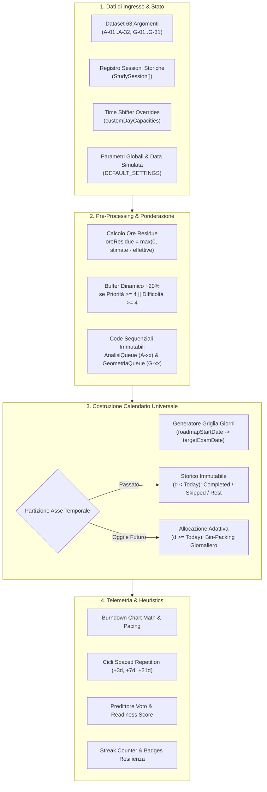
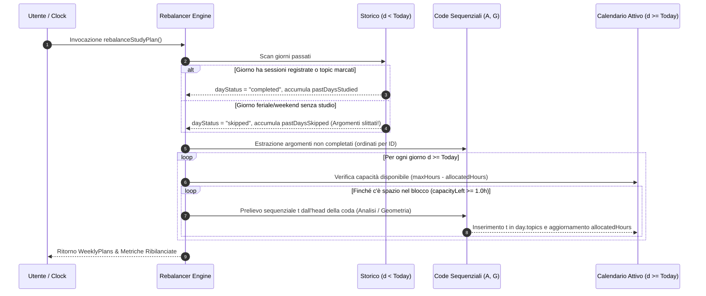
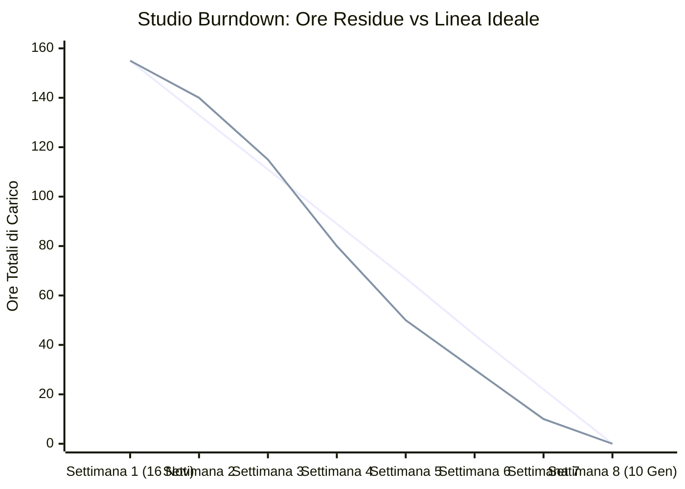

# ⚙️ Motore di Ribilanciamento Dinamico (Rebalancer Engine)
## Documentazione Architetturale, Algoritmica e Matematica — StudiPlanner

Il modulo `src/services/rebalancerEngine.js` costituisce il cuore computazionale e logico di **StudiPlanner**. Progettato specificamente per le esigenze didattiche e organizzative di uno studente lavoratore a tempo pieno (**Full-Time**) del corso di Laurea in Ingegneria Informatica presso l'**Università di Modena e Reggio Emilia (UNIMORE)**, il motore si fa carico di:
1. Modellare il percorso verso la sessione d'esame del **10 Gennaio 2027** per gli insegnamenti di **Analisi Matematica 1** (32 argomenti didattici) e **Geometria ed Algebra Lineare** (31 argomenti didattici).
2. Garantire in modo assoluto e non negoziabile la **propedeuticità matematica sequenziale** dei programmi.
3. Ribilanciare dinamicamente e senza soluzione di continuità il carico di studio futuro in base alle sessioni effettivamente svolte, ai giorni saltati o agli anticipi (*Rolling Rebalancer*).
4. Fornire telemetria in tempo reale (*Burndown Agile*, velocità di marcia, *Spaced Repetition* secondo Ebbinghaus e stima predittiva dell'esito d'esame).



---

## 1. Garanzia di Propedeuticità Sequenziale

### 1.1 Il Postulato Didattico dei Corsi Scientifici di Base
Nel manifesto degli studi di Ingegneria Informatica UNIMORE, i programmi di **Analisi Matematica 1** e **Geometria e Algebra Lineare** presentano una struttura strettamente deduttiva e incrementale:
- In Analisi 1, non è ammissibile affrontare lo studio di integrali impropri (`A-24`) o serie numeriche (`A-27`) senza aver interiorizzato limiti di successioni (`A-07`) e continuità (`A-09`).
- In Geometria, concetti come la diagonalizzabilità e la forma canonica di Jordan (`G-24`) presuppongono la piena padronanza di spazi vettoriali, basi, dimensioni (`G-09`..`G-12`) e autovalori (`G-21`).

> [!IMPORTANT]
> **REGOLA FONDAMENTALE DI ORDINAMENTO DIDATTICO:**  
> L'ordine degli argomenti didattici **NON deve mai essere alterato** da ordinamenti secondari basati su Priorità, Difficoltà, stime di durata o urgenza.  
> La sequenza rispetta invariabilmente l'identificatore naturale:
> $$\text{Analisi 1: } A\text{-}01 \to A\text{-}02 \to \dots \to A\text{-}32$$
> $$\text{Geometria: } G\text{-}01 \to G\text{-}02 \to \dots \to G\text{-}31$$

### 1.2 Dimostrazione Matematica dell'Invariante
Definiamo l'insieme ordinato di argomenti didattici per una materia $M$ come la $n$-upla ordinata:
$$S_M = \langle t_1, t_2, \dots, t_n \rangle \quad \text{con relazione di precedenza } t_i \prec t_j \iff i < j$$

Sia $U_M \subseteq S_M$ l'insieme degli argomenti non ancora completati dallo studente:
$$U_M = \{ t \in S_M \mid \neg t.\text{completato} \land t.\text{oreResidue} > 0 \}$$

Un classico scheduler orientato all'ottimizzazione pura (es. *Shortest Job First* o *Priority Max-Heap*) applicherebbe una funzione di scoring $f(\text{priorita}, \text{difficolta}, \text{ore})$ generando una permutazione $\pi(U_M)$ che violerebbe le dipendenze didattiche.

Il `rebalancerEngine` preserva rigorosamente l'invariante:
$$\forall u_a, u_b \in U_M, \quad u_a \prec u_b \implies \text{Posizione}(u_a, Q_M) < \text{Posizione}(u_b, Q_M)$$

### 1.3 Implementazione del Natural Sorting
L'ordinamento delle code di allocazione è governato dalla funzione `sortBySequentialId`:

```javascript
/**
 * Natural sequential ID comparator (e.g. A-01, A-02, ..., A-32 and G-01, G-02, ..., G-31)
 */
function sortBySequentialId(a, b) {
  const matchA = String(a.id || "").match(/\d+/);
  const matchB = String(b.id || "").match(/\d+/);
  const numA = matchA ? parseInt(matchA[0], 10) : 999;
  const numB = matchB ? parseInt(matchB[0], 10) : 999;
  if (numA !== numB) return numA - numB;
  return String(a.id || "").localeCompare(String(b.id || ""), undefined, { 
    numeric: true, 
    sensitivity: "base" 
  });
}
```

Questo approccio garantisce:
- Parsing della porzione numerica decimale (evitando anomalie alfanumeriche lessicografiche come `A-10` che precederebbe `A-2` in un ordinamento alfabetico standard).
- Collocazione deterministica dell'argomento finale `A-32` ("Simulazione e Prova Generale d'Esame") all'apice del percorso di Analisi.

---

## 2. Buffer Dinamico (+20%) e Calcolo del Progresso Parziale

### 2.1 Ponderazione Cognitiva dello Studente Lavoratore
Uno studente lavoratore che studia nelle fasce serali feriali (19:30 - 22:00) deve fare i conti con l'affaticamento cognitivo accumulato durante l'orario d'ufficio. Di conseguenza, gli argomenti d'esame caratterizzati da alta difficoltà teorica o frequenza elevata nelle prove scritte UNIMORE presentano un tasso di rallentamento fisiologico (necessità di consultare dimostrazioni, svolgere esercizi integrativi o analizzare controesempi).

I campi `prioritaEsame` ($\in [1, 5]$) e `difficolta` ($\in [1, 5]$) sono riservati **esclusivamente** a:
1. Applicazione del buffer protettivo temporale del **+20%**.
2. Evidenziazione cromatica e badge nei cruscotti utente.

### 2.2 Formulazione Matematica

Sia $t$ un argomento didattico e $\theta_{\text{buffer}} = 4$ la soglia di alta priorità configurata in `DEFAULT_SETTINGS.highPriorityThreshold`.

La funzione indicatrice del buffer è definita come:
$$\mathbb{I}_{\text{buffer}}(t) = \begin{cases} 
1 & \text{se } (\text{prioritaEsame}(t) \ge \theta_{\text{buffer}}) \lor (\text{difficolta}(t) \ge \theta_{\text{buffer}}) \\ 
0 & \text{altrimenti} 
\end{cases}$$

Il moltiplicatore di buffer è:
$$\beta = \text{settings.bufferMultiplier} = 1.20$$

### 2.3 Progresso Granulare Parziale (`oreResidue`)
Se lo studente registra una sessione parziale (ad esempio, ha studiato $1.5\text{h}$ su un argomento stimato $3.0\text{h}$ senza contrassegnarlo come concluso), l'algoritmo non deve rischedulare l'intero monte ore, ma unicamente il debito residuo:

$$\text{oreResidue}(t) = \begin{cases} 
0 & \text{se } t.\text{completato} = \text{true} \\ 
\max\left(0, \, \text{round}_2(t.\text{oreStimate} - t.\text{oreEffettive})\right) & \text{se } t.\text{completato} = \text{false} 
\end{cases}$$

Le ore di carico base da spalmare sul futuro sono:
$$\text{baseHours}(t) = \text{oreResidue}(t)$$

Le ore effettive di impegno allocato sono date da:
$$\text{effectiveHours}(t) = \begin{cases} 
\text{round}_2\left(\text{baseHours}(t) \times \beta\right) & \text{se } \mathbb{I}_{\text{buffer}}(t) = 1 \\ 
\text{baseHours}(t) & \text{se } \mathbb{I}_{\text{buffer}}(t) = 0 
\end{cases}$$

Il delta di sicurezza riservato al topic è:
$$\Delta_{\text{buffer}}(t) = \text{effectiveHours}(t) - \text{baseHours}(t)$$

### 2.4 Codice di Calcolo in `rebalancerEngine.js`

```javascript
const processedTopics = topics.map(t => {
  const isDone = Boolean(t.completato !== undefined ? t.completato : t.isCompleted);
  const oreStimate = Number(t.oreStimate) || 2.0;
  const oreEffettive = Number(t.oreEffettive || 0);
  
  // Formula progresso parziale granulare:
  const oreResidue = isDone ? 0 : Math.max(0, Number((oreStimate - oreEffettive).toFixed(2)));

  const isHighPriority = (t.prioritaEsame || 3) >= settings.highPriorityThreshold;
  const isHighDifficulty = (t.difficolta || 3) >= settings.highPriorityThreshold;
  const hasBuffer = isHighPriority || isHighDifficulty;

  const baseHours = oreResidue;
  const effectiveHours = hasBuffer
    ? Number((baseHours * settings.bufferMultiplier).toFixed(2))
    : baseHours;

  return {
    ...t,
    completato: isDone,
    isCompleted: isDone,
    oreStimate,
    oreEffettive,
    oreResidue,
    baseHours,
    effectiveHours,
    hasBuffer,
    bufferDelta: Number((effectiveHours - baseHours).toFixed(2))
  };
});
```

---

## 3. Algoritmo di Rolling Rebalancing Adattivo Continuo

### 3.1 Filosofia "Zero Guilt / Zero Degradation"
I piani di studio statici (ad esempio fogli Excel rigidi o calendari con date fisse) falliscono sistematicamente quando sopravviene un imprevisto lavorativo (straordinari, turni di reperibilità, stanchezza). Quando lo studente manca uno o due giorni, il piano statico genera frustrazione e accumulo ingestibile.

Il **Rolling Rebalancer** introduce il principio di conservazione del carico didattico:
1. **Nessun argomento viene mai cancellato o ignorato.**
2. **I giorni passati sono cristallizzati nella loro realtà storica.**
3. **Il carico residuo slitta automaticamente verso l'istante temporale attivo ("Oggi").**
4. **Qualsiasi anticipo sposta all'indietro gli argomenti a venire, liberando tempo nobile per il ripasso pre-esame.**

### 3.2 La Doppia Dimensione Temporale: Reale vs Simulata
L'applicazione traccia due concetti temporali distinti ma sincronizzati:
- **Data Odierna Reale (`getLocalTodayDateStr`):** Ricavata dal clock di sistema della macchina, con clamp di sicurezza nell'intervallo didattico (`2026-11-16` .. `2027-01-10`):
  ```javascript
  export function getLocalTodayDateStr() {
    const now = new Date();
    const year = now.getFullYear();
    const month = String(now.getMonth() + 1).padStart(2, "0");
    const day = String(now.getDate()).padStart(2, "0");
    const dateStr = `${year}-${month}-${day}`;
    if (dateStr < "2026-11-16") return "2026-11-16";
    if (dateStr > "2027-01-10") return "2027-01-10";
    return dateStr;
  }
  ```
- **Data Simulata Attiva (`currentSimulatedDate`):** Consente al lavoratore di effettuare proiezioni *what-if* (avanzando con `[▶]` o tornando indietro con `[◀]`) per valutare gli effetti di ferie future o di recuperi straordinari. Il pulsante **"Oggi Reale"** ripristina istantaneamente l'ancoraggio con il giorno corrente.

### 3.3 Partizione del Calendario
Per ogni giorno $d$ compreso tra $\text{roadmapStartDate}$ e $\text{targetExamDate}$:
$$\begin{cases} 
d < \text{currentSimulatedDate} & \implies \text{isPast} = \text{true} \quad (\text{Storico Immutabile}) \\ 
d = \text{currentSimulatedDate} & \implies \text{isToday} = \text{true} \quad (\text{Data Attiva / Inizio Ribilanciamento}) \\ 
d > \text{currentSimulatedDate} & \implies \text{isFuture} = \text{true} \quad (\text{Pianificazione Adattiva}) 
\end{cases}$$



### 3.4 Gestione dei Giorni Saltati (*Daily Drift*)
Nel passo 3 di `rebalanceStudyPlan`:
- Se per una data passata $d_{\text{past}}$ non risultano sessioni nel registro `studySessions` né argomenti con `completedDate === d.date`:
  - Se $d_{\text{past}}$ era un giorno di studio abilitato (`enabled: true`), il suo stato diviene:
    $$\text{dayStatus} = \text{"skipped"}$$
    ed il contatore `pastDaysSkipped` viene incrementato.
  - Gli argomenti che in precedenza erano previsti per quella data **non sono stati completati**, perciò risiedono ancora in $U_M$.
- Nel passo 4, quando l'algoritmo avvia la scansione dei giorni attivi a partire da **Oggi** ($d = \text{currentSimulatedDate}$), la coda preleva direttamente la testa di $U_M$.
- **Risultato:** I topic saltati si presentano immediatamente come prima priorità odierna, senza perdita di aderenza al programma.

### 3.5 Meccanica degli Anticipi (*Ahead-of-Schedule Pull*)
Quando lo studente conclude un argomento prima del previsto (o dedica ore extra registrando una sessione completata in anticipo):
1. Il topic viene contrassegnato con `completato: true`, `oreResidue: 0`.
2. Nel rebalancing cycle successivo, il topic viene escluso dal filtro:
   ```javascript
   const uncompletedToSchedule = processedTopics.filter(t => !t.completato && t.oreResidue > 0);
   ```
3. La testa della coda avanza istantaneamente ai topic successivi.
4. I giorni futuri "aspirano" gli argomenti seguenti anticipandone la data di schedulazione (`assignedDate`).
5. I giorni terminali prima dell'esame del 10 Gennaio 2027 si svuotano dal carico nuovo e diventano interamente disponibili per la revisione generale (*Pre-Exam Express Review Window*).

### 3.6 Regole di Alternanza Didattica (*Subject Interleaving*)
Per massimizzare la ritenzione della memoria a lungo termine ed evitare saturazione tematica, il motore applica un'alternanza tra Analisi e Geometria:
- **Lunedì, Mercoledì, Venerdì:** Priorità alla coda `analisiQueue`.
- **Martedì, Giovedì:** Priorità alla coda `geometriaQueue`.
- **Sabato, Domenica (Sessioni Intensive Weekend):** Modalità `Misto`. Gli slot giornalieri alternano gli argomenti internamente:
  - Primo argomento del blocco: Analisi 1.
  - Secondo argomento del blocco: Geometria.
- **Fallback di Coda:** Se la materia preferita della giornata ha esaurito i topic disponibili in coda, il motore attinge automaticamente dall'altra materia, garantendo saturazione ottimale del budget orario disponibile.

### 3.7 Regole di Saturazione Giornaliera (*Bin-Packing Thresholds*)
La saturazione della capacità oraria del giorno $d$ rispetta una doppia soglia:
```javascript
while (
  (day.topics.length === 0 && capacityLeft > 0.4) ||
  (day.topics.length > 0 && capacityLeft >= 1.0 && day.allocatedHours < day.maxHours)
) {
  // Assegnazione del topic ed incremento day.allocatedHours
}
```
- **Empty Day Rule:** Se il giorno non ha ancora nessun argomento assegnato, è sufficiente un residuo di capacità superiore a $0.4\text{h}$ (24 minuti) per allocare il primo topic in coda (evitando giornate vuote se c'è carico arretrato).
- **Multi-Topic Rule:** Un secondo o terzo argomento viene aggiunto alla giornata solo se residuano almeno $1.0\text{h}$ di tempo libero, prevenendo frammentazioni eccessive della sessione serale.

---

## 4. Time Shifter e Modulazione Dinamica della Capacità

### 4.1 Modello Base del Lavoratore Full-Time
Il profilo standard dello studente lavoratore prevede disponibilità asimmetriche tra giorni infrasettimanali e fine settimana:

| Tipologia Giorno | Finestra Oraria | Ore Standard ($C_{\text{std}}$) | Descrizione Operativa |
| :--- | :--- | :---: | :--- |
| **Feriale (Lun - Ven)** | 19:30 - 22:00 | **2.5 h** | Sessione serale post-ufficio focalizzata su teoria ed esercizi mirati |
| **Weekend (Sab - Dom)** | Mattina / Pomeriggio | **4.5 h** | Blocco intensivo diurno dedicato a prove d'esame e dimostrazioni lunghe |

La capacità nominale settimanale di base è pari a:
$$C_{\text{sett, nominale}} = (5 \times 2.5\text{h}) + (2 \times 4.5\text{h}) = 12.5 + 9.0 = 21.5\text{ h/settimana}$$

### 4.2 Sovrascritture Dinamiche (`customDayCapacities`)
La vita reale di un lavoratore non è uniforme: possono presentarsi giorni con permessi lavorativi, ferie, pause pranzo libere, oppure all'opposto serate con straordinari o impegni familiari inderogabili.

Il **Time Shifter** permette di sovrascrivere puntualmente la capacità di qualsiasi data attraverso la mappa di stato:
```typescript
type CustomDayCapacities = Record<string, number>; // es: { "2026-11-20": 4.0, "2026-11-25": 1.0 }
```

Nella UI del To-Do Settimanale, lo studente dispone di controlli stepper intuitivi per ogni giorno:
- `[- 30m]`: Riduce la capacità giornaliera di $0.5\text{h}$ (fino a $0.0\text{h}$ per dichiarare riposo forzato).
- `[+ 30m]`: Incrementa la capacità di $0.5\text{h}$ (attivando uno "Slot Extra").

Nel motore:
```javascript
const hasCustomOverride = Boolean(
  dayCapacities &&
  Object.prototype.hasOwnProperty.call(dayCapacities, dateStr) &&
  dayCapacities[dateStr] !== null &&
  dayCapacities[dateStr] !== undefined
);
const maxDayHours = hasCustomOverride 
  ? Math.max(0, Number(dayCapacities[dateStr])) 
  : fallbackHours;
```

### 4.3 Fabbisogno Settimanale e Soglia Critica di Sovraccarico
Il motore calcola il numero di settimane didattiche rimanenti alla data d'esame:
$$\Delta t_{\text{ms}} = \text{targetExamDate}_{\text{UTC}} - \text{currentSimulatedDate}_{\text{UTC}}$$
$$\text{remainingDays} = \max\left(1, \, \text{round}\left(\frac{\Delta t_{\text{ms}}}{1000 \times 60 \times 60 \times 24}\right)\right)$$
$$\text{remainingWeeks} = \max\left(0.1, \, \frac{\text{remainingDays}}{7}\right)$$

Il **Fabbisogno Settimanale Reale** ($P_{\text{req}}$) rappresenta le ore settimanali che lo studente *deve* sostenere per completare tutti gli argomenti residui entro il 10 Gennaio 2027:
$$P_{\text{req}} = \text{round}_1\left(\frac{W_{\text{effective, residuo}}}{\max(1, \text{remainingWeeks})}\right)$$

La soglia critica di sicurezza per uno studente lavoratore a tempo pieno è fissata in:
$$\Theta_{\text{critica}} = 25.0\text{ h/settimana}$$
*(Modulabile nelle impostazioni fino a 35h se lo studente attiva sistematicamente slot extra diurni o ferie studio).*

La condizione di allerta sovraccarico (*Critical Overload*) scatta quando:
$$\text{isCriticalOverload} = (P_{\text{req}} > \Theta_{\text{critica}})$$
$$\text{excessHours} = \max(0, \, P_{\text{req}} - \Theta_{\text{critica}})$$

Quando attiva, l'interfaccia utente colora i cruscotti di rosso ambrato (`rose-500`), mostra l'icona della fiamma 🔥 e suggerisce tempestivamente:
- L'attivazione di slot extra nel weekend tramite Time Shifter.
- La pianificazione di giorni di permesso retribuito / ferie studio a ridosso dell'esame.

---

## 5. Telemetria, Velocità e Previsione dell'Esame

### 5.1 Calcolo della Velocità e Pacing di Apprendimento
Nel modulo `src/components/Dashboard.js`, la funzione `getSubjectPacing` calcola la discrepanza tra la progressione temporale e il completamento delle materie:

$$\rho = \text{clamp}\left(0, \, 1, \, \frac{d_{\text{current}} - d_{\text{start}}}{d_{\text{target}} - d_{\text{start}}}\right)$$
$$H_{\text{attese}}(M) = \text{round}_1(H_{\text{totali}}(M) \times \rho)$$
$$\Delta H(M) = H_{\text{completate}}(M) - H_{\text{attese}}(M)$$

Lo stato operativo viene classificato in:
$$\text{Pacing} = \begin{cases} 
\text{"ahead"} & \text{se } \Delta H(M) \ge +0.8\text{h} \quad (\text{🚀 In Vantaggio}) \\ 
\text{"on\_track"} & \text{se } -1.5\text{h} \le \Delta H(M) < +0.8\text{h} \quad (\text{🎯 Al Passo / Allineato}) \\ 
\text{"behind"} & \text{se } \Delta H(M) < -1.5\text{h} \quad (\text{⚠️ In Ritardo}) 
\end{cases}$$

### 5.2 Matematica del Grafico Burndown (Scrum & Agile Study Tracking)
Il componente `BurndownChart.js` visualizza la traiettoria ideale di bruciatura del carico orario rispetto all'effettivo andamento:



- **Traiettoria Ideale (Dashed Line):** Retta che congiunge $(0, W_{\text{totale}})$ a $(N_{\text{settimane}} - 1, 0)$:
  $$Y_{\text{ideale}}(w) = W_{\text{totale}} \times \left(1 - \frac{w}{N_{\text{settimane}} - 1}\right)$$
- **Punto Attivo Corrente (Oggi):**
  $$w_{\text{oggi}} = \frac{D_{\text{passati, studiati}} + D_{\text{passati, saltati}}}{7}$$
  $$Y_{\text{reale}} = W_{\text{effective, residuo}}$$
- **Proiezione Futura:** Segmento che unisce il punto di Oggi con il punto finale a $0\text{h}$ al 10 Gennaio 2027.

### 5.3 Ripetizione Spaziata (*Spaced Repetition*) su Base Ebbinghaus
Per contrastare il fisiologico decadimento mnemonico teorizzato dalla curva dell'oblio di Ebbinghaus, ogni volta che un argomento viene completato con `completedDate` valida, il motore pianifica 3 cicli di ripasso rapido:

| Livello | Codice | Offset Temporale | Scopo Didattico |
| :---: | :---: | :---: | :--- |
| **R1** | `r1` | $+3\text{ giorni}$ | Consolidamento a breve termine dei teoremi e delle definizioni |
| **R2** | `r2` | $+7\text{ giorni}$ | Verifica delle capacità di risoluzione autonoma di esercizi tipo |
| **R3** | `r3` | $+21\text{ giorni}$ | Fissazione definitiva nella memoria a lungo termine |

Nel calendario:
- Se la data target del ripasso coincide con Oggi: `isDueToday = true`.
- Se la data target è anteriore a Oggi e il ripasso non è stato svolto: `isOverdue = true`.
- I ripassi in scadenza o arretrati vengono iniettati automaticamente nella vista del giorno corrente, segnalati con appositi tag viola (`curva di Ebbinghaus`).

### 5.4 Euristica di Predizione del Voto e Pass Probability
La funzione `calculateExamReadinessAndGrade(topics, metrics)` sintetizza le metriche aggregate in un indicatore predittivo di superamento e fascia di voto:

$$\text{ReadinessScore} = 55 \quad (\text{baseline base})$$

1. **Fattore Fabbisogno Settimanale ($F_W$):**
   $$F_W = \begin{cases} 
   +25 & \text{se } P_{\text{req}} \le 18\text{h} \\ 
   +15 & \text{se } P_{\text{req}} \le 22\text{h} \\ 
   +5 & \text{se } P_{\text{req}} \le 25\text{h} \\ 
   -12 & \text{se } P_{\text{req}} \le 28\text{h} \\ 
   -25 & \text{se } P_{\text{req}} \le 32\text{h} \\ 
   -35 & \text{se } P_{\text{req}} > 32\text{h} 
   \end{cases}$$

2. **Fattore Costanza Storica ($F_C$):**
   $$\text{ConsistencyRate} = \frac{D_{\text{passati, studiati}}}{\max(1, D_{\text{passati, studiati}} + D_{\text{passati, saltati}})}$$
   $$F_C = \begin{cases} 
   +20 & \text{se } \text{ConsistencyRate} \ge 0.85 \\ 
   +10 & \text{se } \text{ConsistencyRate} \ge 0.70 \\ 
   -5 & \text{se } \text{ConsistencyRate} \ge 0.50 \\ 
   -20 & \text{se } \text{ConsistencyRate} < 0.50 
   \end{cases}$$

3. **Bonus Completamento Effettivo ($F_P$):**
   $$F_P = \text{round}\left(\frac{N_{\text{topic completati}}}{N_{\text{totali}}} \times 25\right)$$

$$\text{ReadinessScore} = \text{clamp}(10, \, 98, \, 55 + F_W + F_C + F_P)$$

Dalla Readiness Score derivano la fascia di voto e la probabilità stimata:
$$\text{PassProbability} = \text{clamp}(15, \, 99, \, \text{round}(\text{ReadinessScore} \times 1.05))$$

| Readiness Score | Fascia di Voto Stimata | Livello di Rischio | Colore UI |
| :---: | :---: | :---: | :---: |
| $\ge 80$ | **28 – 30 e Lode** | Basso (Fascia Eccellenza) | `emerald` |
| $65 \le S < 80$ | **24 – 27 / 30** | Moderato (Fascia Sicurezza) | `cyan` |
| $48 \le S < 65$ | **18 – 23 / 30** | Attenzione (Fascia Minima) | `amber` |
| $< 48$ | **< 18 (Insufficienza)** | Critico (Rischio Bocciatura) | `rose` |

### 5.5 Streak Counter e Badge di Resilienza del Lavoratore
La funzione `calculateStudyStreak` calcola i giorni consecutivi in cui lo studente ha dedicato almeno **0.8h** (pari a 1 ciclo Pomodoro da 50 minuti di studio profondo).

Per mantenere alta la motivazione psicologica dopo le ore lavorative, il motore assegna badge di resilienza tematici:
- **🌱 Innesco Serale:** Da 1 giorno consecutivo (avvio dell'abitudine serale).
- **⚡ Ingegnere Notturno:** $\ge 3$ giorni consecutivi (ritmo costante nelle fasce 19:30 - 22:00).
- **🔥 Fiamma di Costanza:** $\ge 7$ giorni consecutivi (una settimana intera di studio dopo 8h d'ufficio).
- **🛡️ Resilienza Lavoratore d'Acciaio:** $\ge 14$ giorni consecutivi (abitudine granitica e blindata).
- **👑 Maestro della Disciplina UNIMORE:** $\ge 21$ giorni consecutivi (oltre 3 settimane di disciplina totale).

---

## 6. Casi Limite, Robustezza ed Error Handling

La tabella seguente riassume i principali casi limite gestiti analiticamente all'interno di `rebalancerEngine.js`:

| Caso Limite (*Edge Case*) | Condizione di Innesco | Strategia di Risoluzione Algoritmica |
| :--- | :--- | :--- |
| **Data Odierna Oltre Limiti** | Il clock di sistema o l'utente seleziona una data $< 2026-11-16$ o $> 2027-01-10$ | Clamping forzato in `getLocalTodayDateStr()` all'intervallo didattico valido, prevenendo indici di settimana negativi o overflow. |
| **Divisione per Zero Giorni** | $\text{targetExamDate} = \text{currentSimulatedDate}$ ($\text{diffMs} \le 0$) | `getCalendarMetrics` forza $\text{remainingDays} = \max(1, \dots)$ e $\text{remainingWeeks} = \max(0.1, \dots)$. `isPastExam = true` evita crash aritmetici. |
| **Topic con Ore Residue Negative** | Lo studente registra più ore effettive di quelle stimate (`oreEffettive > oreStimate`) | Applicazione di $\max(0, \text{oreStimate} - \text{oreEffettive})$: le ore residue non possono mai risultare negative. |
| **Arrotondamento Floating Point** | Somme ripetute di frazioni d'ora (es. $+0.8\text{h}$, $+0.33\text{h}$) | Normalizzazione sistematica con `Number((val).toFixed(2))` o `toFixed(1)` per eliminare l'imprecisione IEEE-754 (es. $0.30000000000000004$). |
| **Esaurimento Anticipato di una Coda** | Tutti gli argomenti di Analisi 1 sono completati mentre Geometria ha ancora argomenti aperti | Fallback automatico: se `day.preferredSubject === "Analisi 1"` ma `analisiQueue.length === 0`, il motore alloca da `geometriaQueue`. |
| **Saturazione Completa del Calendario** | Carico residuo molto elevato con tutte le giornate fino al 10 Gennaio al $100\%$ della capienza | Meccanismo di sicurezza (linee 598-609): i topic residui non assegnati vengono accodati agli ultimi giorni utili pre-esame, segnalando chiaramente il sovraccarico. |
| **Sessioni senza Topic di Riferimento** | Sessione registrata manualmente con un ID argomento inesistente o cancellato | Fallback object generato a runtime: `{ id, materia: "Studio", argomento: "Sessione di Studio", capitolo: "" }`. |
| **Sincronizzazione Spaced Repetition** | Topic completati senza una data esplicita (`completedDate === undefined`) | Il generatore di ripassi esclude argomenti privi di timestamp di completamento valido, prevenendo la creazione di date `NaN`. |

---

## 7. Verifica e Test Automatizzati

Il comportamento del motore e la sua conformità ai requisiti di *Rolling Rebalancing* sono convalidati tramite la suite di test Playwright in `scripts/test_rolling_rebalance.py`.

### 7.1 Punti di Controllo del Test
Il test esegue un'istanza headless del browser ed esegue le seguenti verifiche:
1. **Sincronizzazione Real-Time Data Odierna:** Verifica che l'applicazione identifichi automaticamente la data reale corrente.
2. **Avanzamento e Time Travel:** Verifica dell'avanzamento della data simulata (`18/11` $\to$ `19/11`) e del ripristino istantaneo tramite pulsante `"Oggi Reale"`.
3. **Identificazione Giorni Saltati:** Verifica che i giorni passati non studiati (es. Lunedì 16 e Martedì 17) vengano etichettati come `skipped` senza generare allarmi invasivi.
4. **Verifica della Sequenza nel To-Do:** Verifica che la data attiva (Mercoledì 18/11) esponga come primi argomenti didattici esattamente i primi topic non completati (`A-01` / `G-01`), dimostrando l'avvenuto scorrimento automatico in avanti del programma.
5. **Integrità LocalStorage:** Validazione della corretta serializzazione e persistenza delle chiavi `unimore_rebalancer_topics_v2` e `unimore_rebalancer_settings_v2`.

Esecuzione del comando di verifica:
```powershell
python scripts\test_rolling_rebalance.py
```
Output atteso:
```text
Starting Rolling Rebalance and History Verification...
Storico & Diario tab exists: True
App automatically synchronized with real today (Mercoledì 18/11): True
Simulated date advanced to Giovedì 19/11: True
Successfully returned to real today (18/11): True
Catch-up Banner hidden as default active behavior: True
Martedì 17/11 marked as skipped: True
Mercoledì 18/11 marked as OGGI: True
History timeline rendered: True
LocalStorage Topics saved successfully: True
LocalStorage Settings saved successfully: True
Screenshot saved to: C:\tmp\StudiPlanner\screenshot_history_tab.png
Rolling Rebalance and History Verification Passed Flawlessly!
```

---

## 8. Riepilogo dei Metodi Esportati da `rebalancerEngine.js`

| Funzione Esportata | Parametri | Tipo di Ritorno | Descrizione Sintetica |
| :--- | :--- | :--- | :--- |
| `getLocalTodayDateStr()` | Nessuno | `string` (`YYYY-MM-DD`) | Ritorna la data odierna locale nel fuso orario dell'utente, limitata ai confini della sessione. |
| `addDaysToDateStr(dateStr, days)` | `dateStr: string`, `days: number` | `string` (`YYYY-MM-DD`) | Addiziona o sottrae giorni in tempo UTC, preservando l'esatta continuità del calendario. |
| `calculateExamReadinessAndGrade(topics, metrics)` | `topics: Topic[]`, `metrics: Object` | `Object` | Calcola lo score di preparazione, la probabilità di successo e la fascia di voto prevista. |
| `getCalendarMetrics(startDateStr, endDateStr)` | `startDateStr: string`, `endDateStr: string` | `Object` | Ritorna giorni rimanenti, settimane rimanenti (arrotondate a 1 decimale) e flag `isPastExam`. |
| `calculateSubjectProgress(topics)` | `topics: Topic[]` | `Object` | Calcola ore totali, svolte, residue e percentuale di avanzamento per Analisi 1, Geometria e Totale. |
| `calculateStudyStreak(historyDays, currentSimulatedDate, studySessions)` | `historyDays: Day[]`, `currentSimulatedDate: string`, `studySessions: StudySession[]` | `Object` | Calcola streak corrente, miglior streak e badge di resilienza del lavoratore. |
| `rebalanceStudyPlan(topics, customSettings, customDayCapacities, studySessions)` | `topics: Topic[]`, `customSettings?: Object`, `customDayCapacities?: Object`, `studySessions?: StudySession[]` | `RebalancedPlan` | **Funzione Principale:** Esegue l'intero pipeline di partizione temporale, packing sequenziale e telemetria. |
