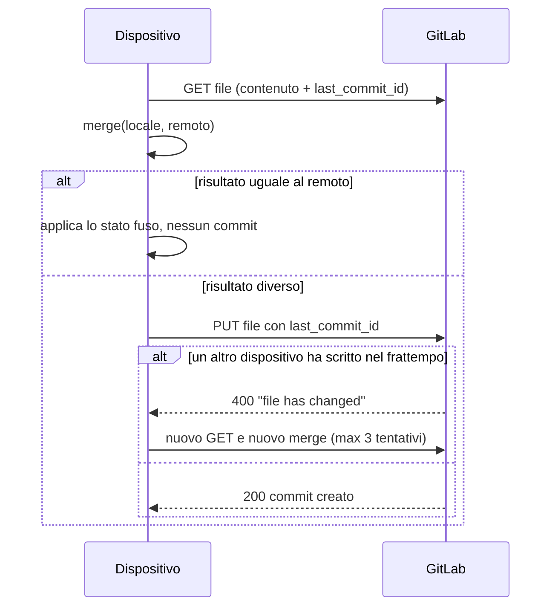

# 03 — Servizi e sincronizzazione

I servizi in `src/services/` contengono le regole di business senza dipendere da React. Sono moduli ES importabili direttamente da Node e coperti dai test in `tests/`.

| Modulo | Responsabilità | Test |
| :--- | :--- | :--- |
| `rebalancerEngine.js` | Piano e metriche ([02](02_REBALANCER_ENGINE.md)) | `engine.test.mjs` |
| `topicStateService.js` | Transizioni di stato degli argomenti | `topicState.test.mjs` |
| `parserService.js` | Import CSV/TXT/Excel e fusione con il progresso | `parser.test.mjs` |
| `calendarExportService.js` | Export iCalendar | `calendarExport.test.mjs` |
| `gitlabSyncService.js` | Sync GitLab: pull, merge, push | `gitlabSync.test.mjs` |

---

## 1. Stato degli argomenti (`topicStateService.js`)

Tutte le azioni che cambiano completamento e ore di un argomento passano da queste funzioni, così UI, import e sync applicano le stesse regole.

| Funzione | Regola |
| :--- | :--- |
| `isTopicDone(t)` | Legge `completato`, con `isCompleted` come ripiego. |
| `withCompletion(t, done, date)` | Imposta **entrambi** i campi di completamento e `completedDate` in modo coerente. |
| `applySessionToTopic(t, { hours, completed, date })` | Aggiunge le ore. `completed: true` completa con la data della sessione; `completed: false` **non toglie mai** un completamento esistente e non completa un argomento aperto; senza flag l'argomento si completa quando le ore raggiungono la stima. |
| `revertSessionFromTopic(t, session, otherSessions)` | Toglie le ore della sessione cancellata. Riapre l'argomento solo se era stata quella sessione a completarlo e nessun'altra sessione completata esiste; in quel caso il completamento resta con la data dell'altra sessione. Un argomento spuntato a mano resta completato. |
| `restoreOfficialNotes(topics, defaults)` | Migrazione: ripristina il campo `note` ufficiale dove le versioni precedenti lo avevano sovrascritto con gli appunti personali. |
| `stampChangedTopics(prev, next, now)` | Aggiunge `updatedAt` solo agli argomenti nuovi o con contenuto effettivamente cambiato. Usato da `setTopics` in `app.js`. |

Altre regole applicate in `app.js`:

- **Spunta manuale** di un argomento senza ore: si assume svolta la stima, memorizzata in `autoFilledHours`. Togliendo la spunta quelle ore vengono rimosse e l'argomento torna nel piano con le ore residue reali.
- **Completamento dal Pomodoro** (`handleMarkTopicCompleted`): idempotente, completa senza mai invertire lo stato.

---

## 2. Import (`parserService.js`)

### 2.1 CSV e TXT (`parseCSVString`)

- **Separatore** dedotto dalla prima riga: `,` di default, `;` o tabulazione se la virgola manca.
- **Virgolette**: solo `"` delimita un campo. Gli apostrofi (`dell'integrale`) sono testo normale.
- **Colonne** riconosciute per alias, senza distinzione di maiuscole:

| Campo | Alias |
| :--- | :--- |
| `id` | id, codice, slot, n. |
| `materia` | materia, corso, subject (altrimenti dedotta dal nome file: "analisi" / "geometria") |
| `capitolo` | capitolo, blocco, sezione, modulo |
| `argomento` | argomento, argomenti, teorici, nome, titolo, descrizione |
| `oreStimate` | ore_stimate, ore, stima, durata, hours (`2,5h` → 2.5; minimo 0,5) |
| `difficolta`, `prioritaEsame` | difficoltà/diff/difficulty, priorità/peso/priority (1–5, default 3) |
| stato | stato, status, completato, fatto, done |

- Lo stato viene letto **solo se esiste una colonna di stato**; i valori `completato`, `completata`, `fatto`, `done`, `si`, `yes`, `1`, `true`, `superato` completano l'argomento impostando entrambi i campi.

### 2.2 Fusione col catalogo (`mergeTopicsWithCsvRows`)

Reimportare un CSV non azzera il lavoro svolto:

- **Argomento esistente** (stesso ID): si aggiornano i metadati (titolo, stima, priorità, …) ma si conservano ore effettive, appunti, checklist, ripassi e completamento. Il file può aggiungere un completamento, mai toglierlo.
- **Argomento nuovo**: aggiunto con lo stato indicato dal file.

### 2.3 Excel e ODS (`parseExcelData`, `mergeTopicsWithExcelData`)

`parseExcelData` legge tutti i fogli con SheetJS e raccoglie le righe marcate come svolte (colonne stato/status/completato/fatto). `mergeTopicsWithExcelData` le applica al catalogo:

- **per ID**: solo corrispondenza esatta dopo normalizzazione (`a1`, `A 01`, `a_01` → `A-01`). Un ID generico come `1` non marca più `A-01`, `A-10`…`A-19` per sottostringa;
- **per testo**: titolo identico, oppure almeno 3 parole significative (> 3 lettere) in comune che coprano il 60% della voce del foglio;
- gli argomenti già completati restano invariati; quelli nuovi vengono completati con la data attiva (`completedSource: "Excel Sync"`).

---

## 3. Export calendario (`calendarExportService.js`)

`generateIcsCalendar(calendarDays)` produce un file iCalendar (RFC 5545) dai giorni del piano:

- un evento per ogni giorno **da oggi in poi** con blocchi pianificati (`getPlannedTopics`: esclude sessioni già registrate e argomenti completati). Il passato è nello Storico;
- **inizio** dalla fascia oraria del giorno (es. venerdì 19:00, sere 19:30, weekend 10:00); **durata** pari alle ore pianificate, con passaggio al giorno dopo se si supera la mezzanotte;
- titolo e descrizione elencano gli argomenti, con l'indicazione "Parte i/N" per quelli divisi;
- promemoria 15 minuti prima (`VALARM`);
- `UID` stabile per data (`studiplanner-YYYY-MM-DD@studiplanner.local`): reimportando il file, i calendari aggiornano gli eventi invece di duplicarli;
- testo con escape (`\`, `;`, `,`, a capo) e righe piegate a 75 ottetti (`foldIcsLine`), rispettando i caratteri UTF-8 multibyte.

`downloadIcsCalendar()` crea il file come Blob e ne avvia il download.

---

## 4. Sincronizzazione GitLab (`gitlabSyncService.js`)

### 4.1 Modello

Il browser parla direttamente con l'API REST v4 di GitLab, senza server intermedi. Lo stato condiviso è **un file JSON** in un repository (default `data/studiplanner-state.json` sul branch `main`). Ogni sincronizzazione è una sequenza **pull → merge → push**:



- **`last_commit_id`** (controllo di concorrenza ottimistico): GitLab accetta la scrittura solo se il file non è cambiato dall'ultima lettura. In caso contrario `pushToGitLab` lancia `GitLabConflictError` (HTTP 409, oppure 400 con "changed", "already exists" o "last_commit_id") e `syncWithGitLab` rilegge e rifonde. Due dispositivi aperti insieme non si sovrascrivono a vicenda.
- **Nessun commit a vuoto**: se lo stato fuso coincide con quello remoto (confronto con chiavi ordinate, escluse data di export e data simulata), non viene scritto nulla.
- **Codifica**: il contenuto scaricato è base64; viene decodificato come UTF-8 (`TextDecoder`) per non rovinare le lettere accentate. La scrittura usa `encoding: "text"`.
- **Cache**: le letture usano `cache: "no-store"` e il Service Worker non mette mai in cache le chiamate `/api/` (vedi [01 §7](01_ARCHITECTURE.md#7-pwa-e-service-worker)).

### 4.2 Formato del file remoto

`buildSyncPayload(state)`:

```json
{
  "exportDate": "2026-11-19T09:15:00.000Z",
  "settings": { "targetExamDate": "2027-01-10", "weekendStudyHours": 4.5, "...": "..." },
  "topics": [ { "id": "A-01", "oreEffettive": 2.5, "completato": true, "updatedAt": 1763540100000, "...": "..." } ],
  "customDayCapacities": { "2026-11-20": 3.5 },
  "studySessions": [ { "id": "sess_…", "topicId": "A-01", "date": "2026-11-18", "hours": 2.5 } ],
  "deletedSessionIds": [ "sess_…" ],
  "syncMeta": { "settingsUpdatedAt": 1763469000000, "capacitiesUpdatedAt": 1763470100000 },
  "mathBugs": [ "..." ]
}
```

`settings.currentSimulatedDate` **non** viene salvato: la data attiva è propria di ogni dispositivo.

### 4.3 Regole di fusione (`mergeStudyPlannerStates`)

| Dato | Regola |
| :--- | :--- |
| **Sessioni** | Unione per `id`, meno quelle presenti in `deletedSessionIds` su **uno qualsiasi** dei due lati (tombstone). Una sessione cancellata non ricompare. |
| **Tombstone** | Unione dei due elenchi. |
| **Stato dell'argomento** (completamento e data, checklist di Feynman, ripassi, appunti, ore presunte) | Vince il lato con `updatedAt` più recente. Così si propagano anche le azioni che "tolgono": togliere una spunta, svuotare un appunto. |
| **Ore effettive** | Ricalcolate: ore delle sessioni fuse **+** correzioni manuali (`oreEffettive − ore delle sessioni`) del lato più recente. Le ore registrate offline su due dispositivi si sommano. |
| **`note`** (focus ufficiale) | Separato da `scratchpadNotes`: gli appunti non lo sovrascrivono mai. |
| **Argomenti presenti solo sul remoto** | Aggiunti in coda (es. import fatto su un altro dispositivo). |
| **Time Shifter, impostazioni, bug tracker** | Vince la sezione con il timestamp più recente in `syncMeta`; un reset (es. Time Shifter vuoto) si propaga. |
| **Data simulata** | Resta sempre quella locale. |
| **Dati legacy** (nessun `updatedAt`/`syncMeta` su entrambi i lati) | Unione conservativa: completato se lo è su un lato, checklist in OR, ripassi uniti, ore manuali massime. Nessuna perdita, ma le rimozioni non si propagano finché non c'è un timestamp. |

La fusione è **idempotente**: fondere di nuovo il risultato con lo stesso remoto non cambia nulla. È questa proprietà a evitare cicli di sincronizzazioni e commit superflui.

### 4.4 Integrazione in `app.js`

| Elemento | Funzione |
| :--- | :--- |
| `setTopics` | Marca `updatedAt` sugli argomenti modificati dall'utente. Lo stato in arrivo dal sync usa `setTopicsRaw` e non viene rimarcato. |
| `deletedSessionIds` | Alimentato da `handleDeleteStudySession`. |
| `syncMeta` | Aggiornato da un effetto quando cambiano impostazioni (esclusa la data simulata), Time Shifter o bug tracker per mano dell'utente. |
| `runGitLabSync()` | Esegue un sync alla volta; una richiesta arrivata durante un sync in corso viene rimandata alla fine. Al termine rifonde il risultato con lo stato più recente, così le modifiche fatte durante la richiesta di rete non vanno perse. |
| `applyMergedState()` | Applica solo le parti che sono cambiate davvero. |

Quando parte un sync:

| Evento | Condizione |
| :--- | :--- |
| Apertura dell'app | `autoSync` attivo |
| 2,5 s dopo l'ultima modifica di argomenti, sessioni, tombstone, Time Shifter, impostazioni o bug tracker | `autoSync` attivo e configurazione completa |
| Ritorno alla finestra o alla scheda (focus, `visibilitychange`) | `autoSync` attivo; al massimo una volta ogni 30 s |
| Pulsante **Pull** | Manuale: scarica e fonde, senza scrivere |
| Pulsante **Push** | Manuale: sync completo con messaggio di commit personalizzato; se GitLab è già allineato non crea commit |

Il badge nell'header mostra lo stato (`syncing`, ultimo sync riuscito, errore).

### 4.5 Configurazione

| Campo | Default | Note |
| :--- | :--- | :--- |
| `enabled` | `false` | Attivato dal test di connessione riuscito |
| `autoSync` | `true` | Sync automatici (avvio, modifiche, rientro) |
| `instanceUrl` | `https://gitlab.com` | Anche istanze self-hosted |
| `projectId` | — | Percorso (`utente/repo`) o ID numerico |
| `branch` | `main` | |
| `filePath` | `data/studiplanner-state.json` | |
| `token` | — | Personal Access Token con scope `api` (o `read_repository` + `write_repository`) |

`testGitLabConnection()` verifica token e accesso al progetto (`GET /projects/:id`) e segnala in modo esplicito i casi 401 e 404.

### 4.6 Sicurezza e privacy

- Il token è salvato solo nel `localStorage` del dispositivo e inviato solo all'istanza GitLab configurata, nell'header `PRIVATE-TOKEN`.
- Il file di stato non è cifrato: usare un repository **privato** e un token con i permessi minimi.
- Chi ha accesso al profilo del browser ha accesso al token: su dispositivi condivisi meglio non attivare il sync.

### 4.7 Test

`tests/gitlabSync.test.mjs` usa un server GitLab finto (`fetch` simulato) e verifica: somma delle ore registrate offline, tombstone in entrambe le direzioni, propagazione di una spunta tolta, compatibilità con i dati legacy, separazione `note`/appunti, propagazione del reset del Time Shifter, argomenti presenti solo sul remoto, idempotenza, rilettura e fusione dopo una scrittura concorrente, nessun commit quando i dati sono già allineati, creazione del file se assente.
