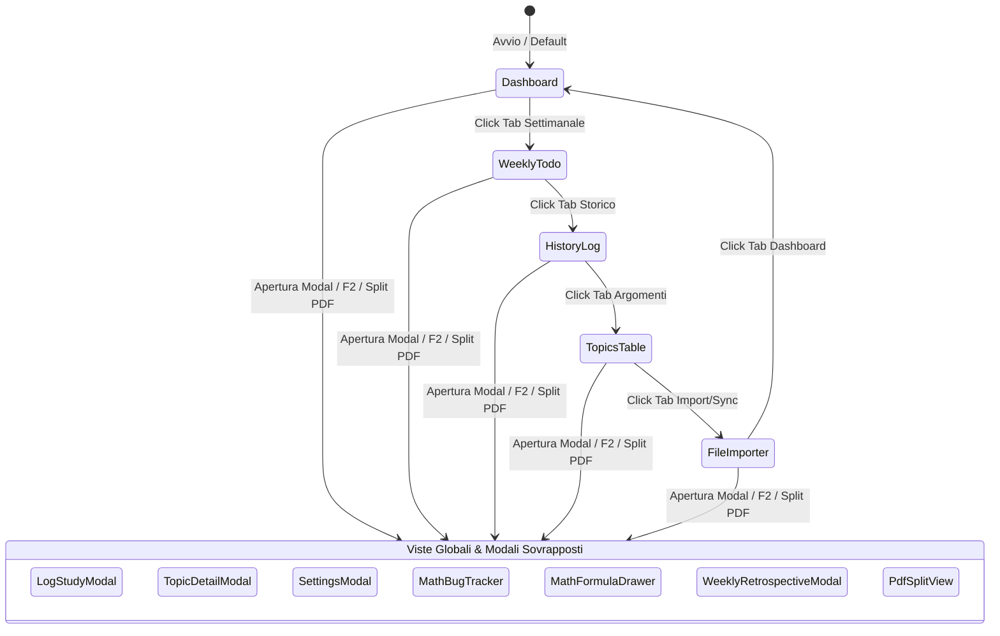
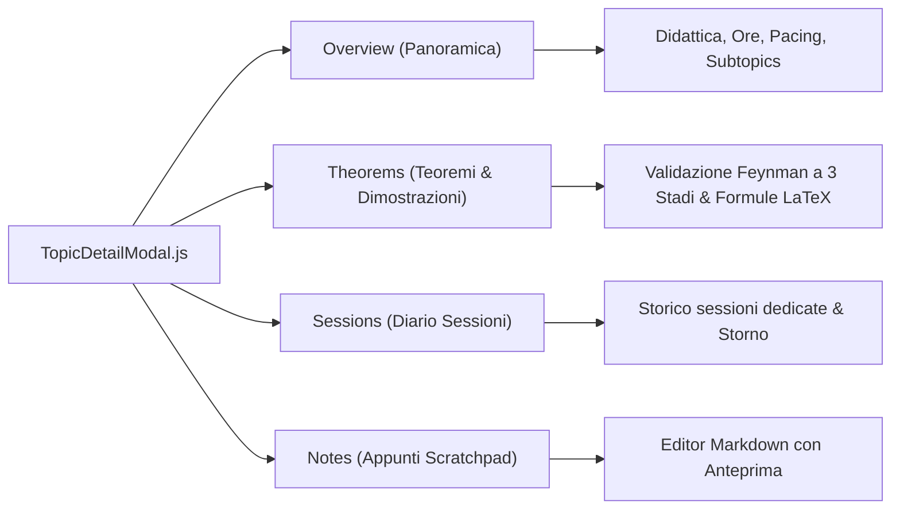
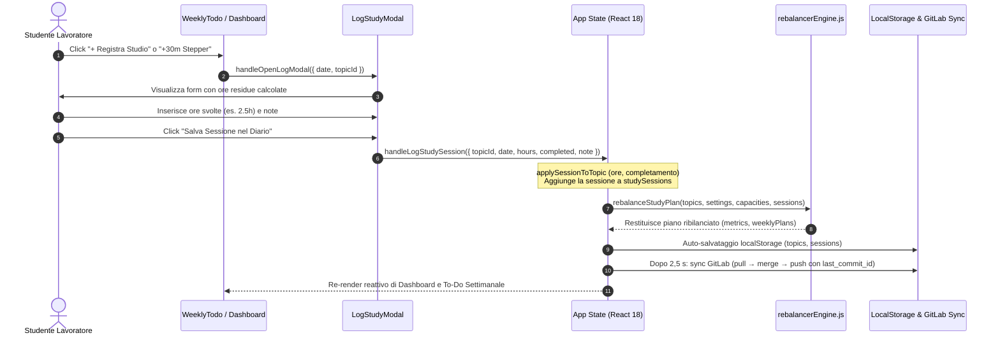
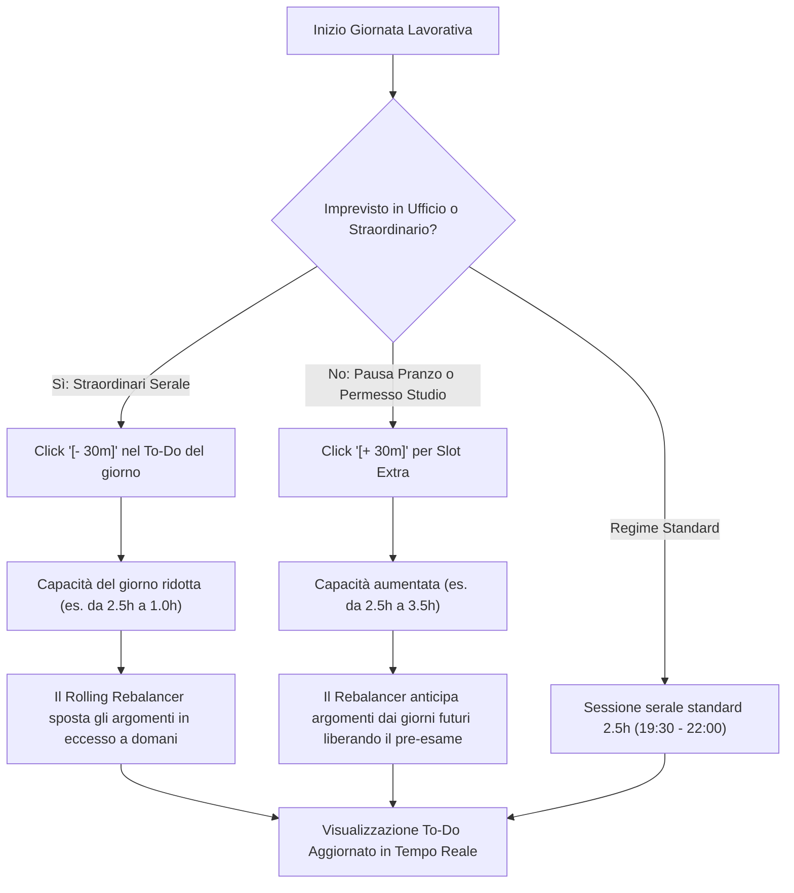

# 🖥️ Documentazione dell'Interfaccia Utente e dei Componenti React
## StudiPlanner — Ingegneria Informatica UNIMORE (Coorte 2021)

Questo documento fornisce una disamina tecnica, architetturale e stilistica esaustiva di tutti i componenti React residenti in `src/components/` e della loro orchestrazione all'interno di `src/app.js`.

---

## 1. Panoramica Architetturale dell'Interfaccia Utente

StudiPlanner è strutturato come una **Single Page Application (SPA)** autonoma, ad alte prestazioni e a zero dipendenze da complessi bundler server-side (Vite/Webpack), basata su **React 18** e compilata via script di build (`scripts/build_bundle.py`) in un unico file ottimizzato `bundle.js`.

L'interfaccia utente è interamente ottimizzata per il profilo di uno **studente lavoratore full-time** (fasce serali feriali 19:30 - 22:00 e sessioni intensive diurne nel weekend), garantendo un controllo visivo immediato su:
1. **Pacing di Studio Reale vs Atteso** per ciascuna materia (Analisi Matematica 1 e Geometria e Algebra Lineare).
2. **Modulazione Dinamica del Carico Orario (Time Shifter)** con stepper puntuali `[- 30m]` e `[+ 30m]`.
3. **Tracciamento Progressivo Granulare** (ore effettive parziali e completamento formale).
4. **Resilienza Psicologica e Motivazionale** tramite streak quotidiana, badge di maestria didattica e il companion di bordo interattivo `CLARKE-9000`.

### 1.1 Gerarchia dei Componenti (Component Tree)

```mermaid
flowchart TD
    App["App (src/app.js)"]
    
    %% Shell: sidebar, barra strumenti, tab bar
    Sidebar["Sidebar macOS (lg+)"]
    Toolbar["Barra strumenti (header sticky)"]
    App --> Sidebar
    App --> Toolbar
    App --> MainContainer["Main Container (Tabs & Split View)"]
    App --> BottomNav["Tab bar iOS (mobile e tablet)"]
    
    %% Tab Views
    MainContainer --> TabDash["Dashboard (activeTab == 'dashboard')"]
    MainContainer --> TabWeek["WeeklyTodo (activeTab == 'weekly')"]
    MainContainer --> TabHist["HistoryLog (activeTab == 'history')"]
    MainContainer --> TabTopics["TopicsTable (activeTab == 'topics')"]
    MainContainer --> TabImport["FileImporter (activeTab == 'import')"]
    MainContainer --> SplitPdf["PdfSplitView (isPdfSplitOpen)"]
    
    %% Dashboard Subcomponents
    TabDash --> DashTonight["TonightFocus (Stasera)"]
    TabDash --> DashMock["MockExamPanel (temi d'esame)"]
    TabDash --> DashBurn["BurndownChart (in Dettagli)"]
    TabDash --> DashSim["ExamSimulator (Modal)"]
    TabDash --> DashNeura["NeuraDeckPromptGenerator (Modal)"]
    
    %% History Subcomponents
    TabHist --> HistHeat["ActivityHeatmap"]
    
    %% Global Modals & Drawers
    App --> ModalSettings["SettingsModal (isSettingsOpen)"]
    App --> ModalLog["LogStudyModal (isLogModalOpen)"]
    App --> ModalDetail["TopicDetailModal (selectedTopicDetail)"]
    App --> ModalBugs["MathBugTracker (isBugTrackerOpen)"]
    App --> DrawerFormula["MathFormulaDrawer (isFormulaDrawerOpen / F2)"]
    App --> ModalRetro["WeeklyRetrospectiveModal (isRetroModalOpen)"]
    App --> Companion["Clarke9000Companion (Floating Widget)"]
    App -.-> StubAlert["AlertBanner (Stub Compatibilità)"]
```



---

## 2. Design System: "Calma, stile Apple"

Il tema è chiaro, con superfici bianche su fondo grigio caldo, colori di sistema Apple e tipografia di sistema (SF Pro su Apple, Segoe UI Variable su Windows, Inter come ripiego). Il riferimento visivo è il mockup "1b · Calma, stile Apple" sul canvas di design.

### 2.1 Come funziona il tema

Il tema vive interamente in `index.html`, nel blocco `tailwind.config` e nello `<style>` che lo segue:

- **Palette rimappata.** I componenti storici erano scritti per un tema scuro. Invece di riscriverli tutti, la configurazione di Tailwind rimappa le scale di colore:
  - `slate` (e `gray`, `zinc`, ...) è **invertita**: `slate-900` = card bianche, `slate-950` = fondo `#F5F5F7`, `slate-800`/`700` = separatori, `slate-100`–`300` = inchiostro.
  - `white` diventa l'inchiostro principale `#1D1D1F`, quindi `text-white` resta leggibile su fondo chiaro.
  - Le tinte accese diventano i colori di sistema Apple: `500`–`700` colore pieno, `50`–`400` inchiostro leggibile, `800`–`950` tinte chiare per badge e superfici. `cyan`/`blue` → blu `#0071E3`, `emerald`/`green` → verde, `amber` → arancione, `rose`/`red` → rosso, `indigo` → `#5E5CE6`, `teal` → `#0A9396`.
- **Testo bianco sui pieni.** Un piccolo script genera le regole che riportano il testo a bianco su `bg-{tinta}-500/600/700`.
- **Niente gradienti né bagliori.** I `bg-gradient-to-*` diventano superfici piatte col colore iniziale; le ombre colorate diventano ombre neutre.
- **Numeri tabulari.** `.font-mono` usa il font di sistema con cifre tabulari, senza l'aspetto "da terminale".

Il codice nuovo usa i **token semantici**: `ink` / `ink-2` / `ink-3`, `canvas`, `paper` (bianco vero), `surface`, `sidebar`, `fill`, `hair`, `accent` (con `-hover`, `-ink`, `-tint`), `analisi`, `geometria`, `ok`, `warn`, `danger`. Sono disponibili anche le ombre `shadow-card`, `shadow-float`, `shadow-seg` e le classi `.large-title`, `.eyebrow`, `.vibrancy`, `.tabular`.

### 2.2 Colori semantici

| Ambito | Colore | Classi | Uso |
| :--- | :--- | :--- | :--- |
| Fondo | `#F5F5F7` | `bg-canvas`, `bg-slate-950` | Corpo della pagina |
| Card | `#FFFFFF` | `bg-paper`, `bg-slate-900` | Card con raggio 16–20 px e `shadow-card` |
| Inchiostro | `#1D1D1F` / `#6E6E73` | `text-ink`, `text-ink-2` | Testo principale e secondario |
| Accento | `#0071E3` | `bg-accent`, `bg-accent-tint`, `text-accent-ink` | Azione principale, giorno attivo, link |
| Analisi I | `#5E5CE6` | `indigo-*`, `analisi` | Badge, barre e filtri di Analisi |
| Geometria | `#0A9396` | `teal-*`, `geometria` | Badge, barre e filtri di Geometria |
| Esito positivo | `#34C759` | `emerald-*`, `ok` | Completato, sincronizzato |
| Attenzione | `#FF9F0A` | `amber-*`, `warn` | Buffer +20%, giorni saltati, costanza |
| Critico | `#FF3B30` | `rose-*`, `danger` | Soglia superata, errori |

### 2.3 Micro-interazioni
- **Vetro smerigliato** (`.vibrancy`) su barra strumenti e tab bar mobile.
- **Controlli segmentati** con fondo `bg-fill` e pillola bianca selezionata (selettore della data).
- **Pressione** `active:scale-[0.97]` sui pulsanti principali.
- **Focus** visibile con anello blu a 3 px su tutti i controlli.

---

## 3. Navigazione, Tab & Routing Client-Side

L'architettura di navigazione gestisce il routing interamente nello stato React di `App.js` tramite la variabile di stato `activeTab`.

### 3.1 Flusso di Navigazione Desktop e Mobile
Le voci di navigazione sono definite una sola volta in `NAV_ITEMS` (`src/app.js`), con etichetta completa, etichetta breve e colore dell'icona.

1. **Sidebar macOS (`lg` e oltre, `sticky`, 248 px):**
   - Marchio StudiPlanner (`h1`).
   - **Sezioni** (`<nav>`): Dashboard, To-Do Settimanale, Storico & Diario, Catalogo Argomenti (con contatore `completati/totali`), Import / Sync. Ogni voce ha l'icona in un quadrato colorato.
   - **Materie:** Analisi I e Geometria con il conteggio degli argomenti chiusi; portano al catalogo.
   - **Strumenti:** Formulario (F2), interruttore "Dispense affiancate" (Split PDF), Errori ricorrenti (Bug Tracker), Impostazioni, Installa app (solo fuori dalla modalità standalone).
   - **Stato della sincronizzazione** in fondo: GitLab, file collegato o "Solo su questo dispositivo".
2. **Barra strumenti (`<header>` sticky, 52 px):**
   - Giorni all'esame (`metrics.remainingDays`).
   - Selettore della data attiva: `‹` / `Oggi: gg/mm` / `›`, più `Oggi Reale` quando la data è simulata.
   - Pulsante `Registra studio` (apre `LogStudyModal`).
   - Su mobile: marchio, Formulario e Impostazioni.
3. **Tab bar iOS (`fixed bottom-0 lg:hidden`):**
   - Oggi, Settimana, **+ Studio** (pulsante circolare centrale), Storico, Catalogo, Sync.
4. **Titoli grandi:** ogni scheda apre con un titolo grande (`PAGE_HEADINGS`); la Dashboard ha la propria intestazione con la data.



---

## 4. Analisi Dettagliata dei Componenti (Viste Tab)

### 4.1 `Dashboard.js` — Centrale Operativa e Telemetria

#### Scopo e Ruolo Architetturale
`Dashboard.js` è il centro direzionale dell'applicazione. Sintetizza lo stato globale della preparazione, confronta l'avanzamento reale rispetto alla traiettoria ideale verso il 10 Gennaio 2027, calcola la probabilità euristica di superamento dell'esame e fornisce l'accesso rapido a tutti gli strumenti di supporto didattico.

#### Props Ricevute
| Prop | Tipo | Descrizione |
| :--- | :--- | :--- |
| `progress` | `Object` | Oggetto con le percentuali e le ore per `analisi`, `geometria` e `global` |
| `metrics` | `Object` | Metriche generate dal motore di ribilanciamento (`remainingDays`, `remainingWeeks`, `requiredWeeklyHours`, `isCriticalOverload`, `examPrediction`, `studyStreak`, `spacedRepetition`, ecc.) |
| `onTabChange` | `Function` | Callback `(tabName) => void` per cambiare la vista principale (es. redirezione a `weekly`) |
| `topics` | `Array<Topic>` | Array completo dei 63 argomenti con stato di completamento e ore |
| `settings` | `Object` | Parametri attuali di studio (`currentSimulatedDate`, `targetExamDate`, ecc.) |
| `onOpenLogModal` | `Function` | Callback `(initialData) => void` per aprire il modal di registrazione studio |
| `onOpenTopicDetail` | `Function` | Callback `(topicOrId) => void` per aprire la scheda dettagliata dell'argomento |
| `onToggleSpacedReview` | `Function` | Callback `(topicId, levelKey, isDone, outcome) => void` per marcare un ripasso con il suo esito |
| `onLogStudySession` | `Function` | Callback `(session) => void` usata dalla card Stasera per registrare la serata a fine timer |
| `studySessions` | `Array<StudySession>` | Sessioni registrate, per il punto della domenica |
| `onOpenRetrospective` | `Function` | Apre la retrospettiva settimanale dalla card della domenica |
| `mockExams` | `Array<MockExam>` | Temi d'esame svolti |
| `onSaveMockExam`, `onDeleteMockExam` | `Function` | Salvano o cancellano un tema (`(exam) => void`, `(id) => void`) |
| `mathBugs` | `Array<Object>` | Lista dei trabocchetti matematici registrati nel Bug Tracker |
| `onOpenBugTracker` | `Function` | Callback per aprire il modal del Math Bug Tracker |
| `currentWeekPlan` | `Object \| null` | Settimana che contiene la data attiva (`rebalancedPlan.currentWeekPlan`), per l'anello "Settimana" |
| `todayPlan` | `Object \| null` | Giorno attivo del calendario (`calendarDays` con `isToday`), per il titolo "Oggi, N ore di studio" |

#### Stato Interno
- `isFlashcardsOpen` (`boolean`): Controlla l'apertura del generatore flashcard NeuraDeck.
- `isExamSimulatorOpen` (`boolean`): Controlla l'apertura del simulatore d'esame scritto cronometrato.
- `isDetailsOpen` (`boolean`): Sezione "Dettagli e strumenti" aperta o chiusa; chiusa di default, ricordata in `studiplanner_dashboard_details_open_v1`.

#### Ordine delle sezioni
La dashboard mostra per prime solo le cose che servono stasera. Il resto è a un clic:

1. Intestazione ("Oggi, N ore di studio").
2. **Il punto della domenica** (solo la domenica).
3. **Stasera** (`TonightFocus`), con il link compatto "N ripassi da fare →" verso la vista settimanale.
4. Anelli, conto alla rovescia e ritmo richiesto.
5. Costanza e previsione d'esame.
6. Temi d'esame a tempo (`MockExamPanel`).
7. **Dettagli e strumenti** (a scomparsa): avanzamento per materia, burndown, flashcard NeuraDeck, simulatore, bug tracker e barra di avanzamento globale.

#### Sezioni Interne & Logica di Calcolo
1. **Algoritmo di Pacing Didattico (`getSubjectPacing`):**
   Calcola per ciascuna materia lo scostamento orario tra le ore completate a oggi e quelle teoricamente previste in base al tempo trascorso tra il 16 Novembre 2026 e il 10 Gennaio 2027:
   $$\text{ProgressRatio} = \frac{\text{DataCorrente} - \text{DataInizio}}{\text{DataEsame} - \text{DataInizio}}$$
   $$\Delta_{\text{ore}} = \text{OreEffettuate} - (\text{OreTotaliMateria} \times \text{ProgressRatio})$$
   - $\Delta_{\text{ore}} \ge +0.8\text{h}$: Badge `🚀 In Vantaggio` (Emerald).
   - $-1.5\text{h} \le \Delta_{\text{ore}} < +0.8\text{h}$: Badge `🎯 Al Passo (Allineato)` (Cyan).
   - $\Delta_{\text{ore}} < -1.5\text{h}$: Badge `⚠️ In Ritardo` (Amber).
2. **Intestazione:** data attiva in maiuscoletto e titolo grande con le ore pianificate per oggi (oppure giorno di riposo, giorno d'esame o periodo concluso), più il pulsante `Registra ore di studio`.
3. **Il punto della domenica:** card con le righe di `calculateWeeklyDigest` (ore fatte su previste, argomenti chiusi, esercizi senza appunti giusti, ripassi fatti e da rifare, ultimi temi) e il pulsante "Prepara la prossima settimana", che apre la retrospettiva.
4. **Stasera:** vedi §4.1-bis.
5. **Anelli, conto alla rovescia e ritmo:**
   - *Anelli di attività:* **Settimana** (ore svolte sul budget della settimana, da `calculateWeeklyRetrospective`), **Costanza** (sere di fila verso il prossimo traguardo), **Programma** (percentuale di argomenti chiusi).
   - *All'esame:* giorni rimanenti, barra del tempo trascorso dall'inizio della roadmap e data dell'esame.
   - *Ritmo richiesto:* ore a settimana necessarie e ore residue con margine (+20%). Se si supera la soglia (25 h di default) la card diventa ambra con la dicitura "Ritmo alto": un avviso, non un allarme.
6. **Costanza e Previsione d'esame (due card affiancate):**
   - *Costanza:* sere consecutive, record, titolo attuale, avanzamento verso il prossimo titolo, jolly rimasti nel mese e giorno di riposo, citazione del giorno e traguardi sbloccati.
   - *Previsione d'esame:* voto stimato, probabilità di superamento, ritmo richiesto, sere attive e argomenti chiusi. Il riquadro "Esercizi giusti" mostra l'accuratezza senza appunti; i chip "Da consolidare" elencano gli argomenti con padronanza sotto 0,6 e aprono la loro scheda. Sotto il 18 il testo dice "sotto il 18, per ora".
7. **Temi d'esame:** vedi §4.1-ter.
8. **Dettagli e strumenti** (chiusi di default): card di avanzamento per materia con marcatore del target teorico (`pacing.expectedPercent`), `BurndownChart.js`, hub degli strumenti (NeuraDeck, Simulatore, Bug Tracker) e barra di avanzamento globale.

---

### 4.1-bis `TonightFocus.js` — Modalità Stasera

Una sola azione chiara per la serata, ricavata da `getTonightFocus(todayPlan, targetExamDate)`:

| `focus.kind` | Cosa mostra |
| :--- | :--- |
| `study` | Primo blocco del giorno in ordine propedeutico, ore previste e pulsante **Inizia** |
| `exam` | Giorno d'esame: nessuno studio |
| `rest` | Giorno di riposo |
| `done` | Studio di oggi già registrato |
| `none` | Nessun piano per oggi; pulsante "Registra studio" |

- **Timer:** basato sui timestamp e salvato in `studiplanner_tonight_timer_v1`, quindi sopravvive a ricariche e chiusure. Ogni 25 minuti suggerisce una pausa.
- **Chiusura della serata:** a fine timer chiede le ore (precompilate dal tempo trascorso, regolabili di ±0,25 h), se l'argomento è finito e gli esiti degli esercizi svolti senza appunti (`ExerciseOutcomeInput`: giusti, parziali, sbagliati e fiducia 1–5). Poi registra la sessione con `onLogStudySession`.
- **Ripassi:** se ci sono ripassi in scadenza o arretrati compare il link "N ripassi da fare →" (pallino ambra se ci sono arretrati), che porta alla vista settimanale.
- Esporta anche `ExerciseOutcomeInput`, riusato da `LogStudyModal`.

Props: `focus`, `settings`, `onLogStudySession`, `onOpenTopicDetail`, `onOpenLogModal`, `reviewsDue`, `reviewsOverdue`, `onOpenReviews`.

### 4.1-ter `MockExamPanel.js` — Temi d'esame a tempo

Un tema per materia a settimana nelle ultime 4 settimane (Analisi 120 minuti, Geometria 90), con i dati di `metrics.mockExams`:

- **Avvio:** pulsante per materia con conto alla rovescia; a tempo scaduto (o prima) si inserisce il voto su un massimo (30 di default) e una nota.
- **Grafico:** curva dei voti per materia in percentuale con la linea della sufficienza (18/30), legenda, etichette dirette sull'ultimo punto e tooltip al passaggio del mouse. Colori validati per daltonismo: Analisi `#5E5CE6`, Geometria `#0A9396`.
- **Riepilogo:** ultimo tema per materia con differenza rispetto al precedente, ed elenco dei temi svolti con la possibilità di cancellarne uno (tombstone sincronizzato).

Props: `stats`, `settings`, `mockExams`, `onSaveMockExam`, `onDeleteMockExam`. I nomi di primo livello del file hanno il prefisso `mock`/`MOCK_` per non collidere nello scope condiviso del bundle.

---

### 4.2 `WeeklyTodo.js` — Vista Operativa Giorno per Giorno

#### Scopo e Ruolo Architetturale
Costituisce il cuore dell'operatività quotidiana dello studente lavoratore. Visualizza il piano di studio dettagliato per ogni giorno della settimana selezionata, gestisce il Time Shifter, il timer Pomodoro 50/10 e la registrazione granulare delle ore.

#### Props Ricevute
| Prop | Tipo | Descrizione |
| :--- | :--- | :--- |
| `weeklyPlans` | `Array<WeekPlan>` | Piani settimanali generati dal Rebalancer con giorni, ore e argomenti |
| `calendarDays` | `Array<DaySchedule>` | Mappa di tutti i giorni dell'intero calendario per esportazione e telemetria |
| `onToggleComplete` | `Function` | Callback `(topicId) => void` per invertire lo stato di completamento del tema |
| `onMarkTopicCompleted` | `Function` | Callback `(topicId) => void` idempotente: completa senza mai invertire (usata dal Pomodoro) |
| `onUpdateTopicHours` | `Function` | Callback `(topicId, deltaOrNew, isDelta) => void` per aggiornare le ore parziali |
| `onLogStudySession` | `Function` | Callback per persistere formalmente una sessione di studio nel diario storico |
| `settings` | `Object` | Parametri globali di studio |
| `customDayCapacities` | `Object<string, number>` | Mappa degli override orari giornalieri del Time Shifter |
| `onUpdateDayCapacity` | `Function` | Callback `(dateStr, newHours) => void` per aggiornare il budget di una singola data |
| `onBatchUpdateDayCapacities` | `Function` | Callback `(updatesMap) => void` per aggiornamenti massivi (es. modalità straordinari) |
| `onOpenLogModal` | `Function` | Callback per aprire il modal di registrazione sessione con data preimpostata |
| `onOpenTopicDetail` | `Function` | Callback per aprire la scheda immersiva dell'argomento |
| `onToggleSpacedReview` | `Function` | Callback `(topicId, levelKey, isDone, outcome)` per chiudere un ripasso con il suo esito |
| `mathBugs` | `Array<MathBug>` | Errori ricorrenti, mostrati prima del ripasso dell'argomento a cui si riferiscono |
| `onOpenRetrospective` | `Function` | Callback per aprire la review settimanale della domenica sera |

#### Stato Interno
- `selectedWeekIndex` (`number`): Indice della settimana visualizzata (inizializzato sulla settimana che contiene la data "Oggi").
- `filterSubject` (`string`): Filtro per materia (`all`, `analisi`, `geometria`).
- `pomodoroAlert` (`string | null`): Messaggio temporaneo di notifica completamento ciclo Pomodoro.
- `isExpressReviewActive` (`boolean`): Attivazione del filtro d'emergenza pre-esame (sprint triage).
- `pomodoroMap` (`Object`): Stato persistente dei timer Pomodoro per argomento (`accumulatedSeconds`, `cycleRemaining`, `isRunning`, `isBreak`, `completedByTimer`), memorizzato in `unimore_rebalancer_pomodoro_v2`.

#### Meccaniche Chiave e Comportamenti Utente
1. **Week Selector Bar:**
   - Navigazione rapida fra settimane (`◀ Settimana Precedente`, `Settimana Successiva ▶`).
   - Badge descrittivi: `Settimana Attiva`, `Passata`, `>25h Sovraccarico`.
   - Monte ore totale allocato nella settimana.
   - Pulsanti di azione rapida:
     - *Modalità Straordinari (⚡):* Imposta le sere feriali a 1.0h e sposta il carico sul weekend.
     - *Bootcamp Natale (🎄):* Incrementa la capacità a 6.5h/giorno nel periodo 24 Dicembre - 6 Gennaio.
     - *Esporta .ics (📅):* Scarica il calendario iCalendar per Google Calendar/Apple Calendar.
     - *Review Domenica (📊):* Lancia la retrospettiva settimanale.
     - *Sprint Pre-Esame (🎯):* Filtra esclusivamente argomenti con Priorità $\ge 4$ o Difficoltà $\ge 4$ e prove generali (`A-32`, `G-31`). La finestra (ultimi 7 giorni) e le date del Bootcamp sono calcolate dalla data d'esame impostata.
2. **Time Shifter Stepper (`[- 30m]` / `[+ 30m]`):**
   Permette allo studente lavoratore di rimodulare il budget orario di ogni singolo giorno (da 0 h a 12 h a step di 0,5 h; il pulsante `+30m` si disattiva al limite). In caso di override attivo, compare il pulsante di ripristino `↺`.
3. **Card del Tema Didattico:**
   - Badge materia (`Analisi Matematica 1` in viola-indaco, `Geometria e Algebra` in verde acqua).
   - ID tema con pulsante rapido `ℹ Info` per aprire la scheda dettagliata.
   - Badge di completamento con data o badge `⏳ In Corso (xh svolte)`.
   - Badge `+20% Buffer Priorità` se Priorità $\ge 4$ o Difficoltà $\ge 4$.
   - Badge `Parte i/N` quando il motore ha diviso l'argomento su più giorni; le ore mostrate sono quelle del blocco del giorno.
   - Stepper rapido ore parziali: `[- 30m]`, `[+ 30m]`, `[+ 1h]`, `[+ Log]`.
   - Micro-barra di avanzamento percentuale basata sul rapporto tra ore effettive e stimate.
   - Pulsante dedicato di spunta completamento (`Completato ✓`).
4. **Ripassi attivi:** ogni ripasso si chiude con uno di tre esiti, "Ricordavo bene", "Incerto" o "Non ricordavo", che decidono la data del ripasso successivo ([02 §5](02_REBALANCER_ENGINE.md#5-ripetizione-spaziata)). Prima dei pulsanti compaiono gli errori aperti del Bug Tracker per quell'argomento. I ripassi in ritardo sono ambra, senza animazioni; anche il filtro "Ripasso express" è ambra.
5. **Striscia Pomodoro 50/10 Interattiva:**
   Ogni card argomento include un timer Pomodoro (50 minuti di focus alternati a 10 di pausa). Il tempo è calcolato dai timestamp, quindi resta corretto anche se la scheda va in background. A fine ciclo di focus il tempo non ancora registrato diventa **una sessione** nel diario (tramite `onLogStudySession`, che aggiorna anche le ore dell'argomento) e compare un avviso. Quando il focus accumulato raggiunge l'obiettivo del timer, l'ultima quota viene registrata, il timer si ferma e l'argomento viene completato con `onMarkTopicCompleted`. Il timer non inverte mai lo stato di completamento e non registra due volte lo stesso tempo. Lo stato è salvato in `unimore_rebalancer_pomodoro_v2`.

---

### 4.3 `HistoryLog.js` — Storico, Diario e Timeline

#### Scopo e Ruolo Architetturale
Rappresenta il registro retrospettivo dell'app. Permette di analizzare tutte le date passate a partire dall'inizio della roadmap (16 Novembre 2026), esaminare le sessioni di studio svolte, visualizzare come i giorni saltati sono stati gestiti dal motore rebalancer e cancellare o ripristinare singole sessioni storiche.

#### Props Ricevute
| Prop | Tipo | Descrizione |
| :--- | :--- | :--- |
| `historyDays` | `Array<HistoryDay>` | Lista dei giorni passati con sessioni, ore svolte e status (`completed` o `skipped`) |
| `calendarDays` | `Array<DaySchedule>` | Calendario globale per l'Activity Heatmap |
| `metrics` | `Object` | Statistiche su giorni studiati, giorni saltati, totale ore passate |
| `onAdvanceDate` | `Function` | Callback per simulare l'avanzamento al giorno successivo (`+1 gg`) |
| `onRetrocedeDate` | `Function` | Callback per simulare il ritorno al giorno precedente (`-1 gg`) |
| `onSetDate` | `Function` | Callback per impostare puntualmente la data attiva simulata |
| `onOpenLogModal` | `Function` | Callback per registrare ore su una data passata specifica |
| `onDeleteSession` | `Function` | Callback `(sessionId) => void` per eliminare una sessione e stornare le ore dal tema |
| `onOpenTopicDetail` | `Function` | Callback per aprire la scheda dell'argomento associato |

#### Componenti Interni
- **`ActivityHeatmap.js`:** Integrata nella parte superiore per visualizzare la griglia di contribuzione stile GitHub.
- **Timeline a Due Colonne (`grid-cols-1 xl:grid-cols-2`):** Elenca i giorni passati ordinati cronologicamente con filtri `Tutti i Giorni`, `Solo Studiati`, `Solo Saltati`. Ciascun blocco sessione include il pulsante cestino per l'eliminazione con conferma e ripristino immediato delle ore residue.

---

### 4.4 `TopicsTable.js` — Catalogo Completo degli Argomenti

#### Scopo e Ruolo Architetturale
Offre la visualizzazione tabellare esaustiva di tutti i 63 argomenti didattici ufficiali UNIMORE. Permette ricerche istantanee, filtraggi multi-criterio e operazioni batch di simulazione o azzeramento.

#### Props Ricevute
| Prop | Tipo | Descrizione |
| :--- | :--- | :--- |
| `topics` | `Array<Topic>` | Array dei 63 temi |
| `onToggleComplete` | `Function` | Inversione stato completato del tema |
| `onUpdateTopicHours` | `Function` | Aggiornamento granulare ore effettive |
| `onBatchUpdate` | `Function` | Aggiornamento massivo dell'intero array (reset o simulazione) |
| `onOpenTopicDetail` | `Function` | Apertura scheda argomento |

#### Filtri e Interazioni
- **Ricerca Full-Text:** Input reattivo che interroga contemporaneamente ID tema (es. `A-09`, `G-14`), titolo dell'argomento e nome del capitolo.
- **Filtro Materia:** Selettore a tendina (`Tutte`, `Analisi 1`, `Geometria`).
- **Filtro Stato Didattico:** Selettore (`Tutti gli Stati`, `Da Fare (0h)`, `In Corso (Parziale)`, `Solo Completati`).
- **Filtro Alta Priorità:** Tasto toggle che isola gli argomenti con Priorità $\ge 4$ o Difficoltà $\ge 4$ (quelli soggetti al buffer del +20%).
- **Batch Controls:** Link per resettare tutti i temi a "Da fare" o simulare il superamento delle prime 2 settimane didattiche a fini di test. Entrambi usano `withCompletion`, quindi `completato` e `isCompleted` restano sempre allineati.

---

### 4.5 `FileImporter.js` — Hub di Import, Export e Sincronizzazione Cloud

#### Scopo e Ruolo Architetturale
È il modulo centrale di persistenza, importazione dati e sincronizzazione cloud senza server proprietari intermedi. Gestisce il backup JSON locale, il parsing di fogli di calcolo Excel/CSV, la sincronizzazione continua tramite **GitLab REST API v4** e la **File System Access API** del browser.

#### Props Ricevute
| Prop | Tipo | Descrizione |
| :--- | :--- | :--- |
| `topics`, `settings`, `customDayCapacities`, `studySessions` | Vari | Stato globale dell'applicazione |
| `onTopicsUpdated`, `onSettingsUpdated`, `onCustomCapacitiesUpdated`, `onStudySessionsUpdated` | `Function` | Setter dello stato globale in React |
| `fsSyncStatus` | `Object` | Stato sincronizzazione File System (`active`, `fileName`, `lastSaved`, `isSaving`, `error`) |
| `onConnectFileSystem`, `onDisconnectFileSystem`, `onTriggerManualSave` | `Function` | Handler per connettere, disconnettere o forzare il salvataggio su file JSON locale |
| `gitlabConfig` | `Object` | Parametri di configurazione GitLab Cloud (`instanceUrl`, `projectId`, `token`, `branch`, `filePath`, `autoSync`, `syncStatus`, ecc.) |
| `onUpdateGitLabConfig`, `onGitLabPull`, `onGitLabPush` | `Function` | Handler per aggiornare la config GitLab, eseguire pull o push manuale |

#### Funzionalità Chiave
1. **Sincronizzazione GitLab Cloud (REST API v4):**
   - Campi configurabili: URL istanza (default `https://gitlab.com`), Project ID, Branch (default `main`), Path del file (`data/studiplanner-state.json`), Personal Access Token.
   - Pulsante *Verifica Connessione*: invia una `GET /api/v4/projects/:id` validando permessi e connettività.
   - Tasti di *Pull Manuale* (scarica e fonde, senza scrivere) e *Push Manuale* (sync completo con messaggio di commit personalizzato; nessun commit se GitLab è già allineato).
   - Toggle per l'Auto-Sync (sync all'avvio, 2,5 s dopo ogni modifica e al rientro nell'app). Ogni sync è pull → merge → push con `last_commit_id`: vedi [03 §4](03_SERVICES_AND_SYNC.md#4-sincronizzazione-gitlab-gitlabsyncservicejs).
2. **File System Access API (Chrome / Edge):**
   - Consente di collegare direttamente un file locale `studiplanner-backup.json` sul disco del computer dello studente.
   - Ogni modifica viene salvata in modo trasparente in background tramite `FileSystemWritableFileStream`.
3. **Backup Completo JSON:** Download di uno snapshot strutturato dell'intera applicazione e ripristino istantaneo via drag & drop o file picker.
4. **Import Fogli di Calcolo (Excel XLSX, ODS, XLS e CSV):**
   - Utilizza SheetJS (`XLSX`) caricata localmente (con fallback CDN).
   - Riconoscimento delle colonne per alias (`Argomento`, `Titolo`, `Ore_Stimate`, `Stima`, `Priorità`, `Difficoltà`, `Stato`, …).
   - Reimportare un CSV aggiorna i metadati degli argomenti esistenti **conservando** ore, appunti e completamenti.
   - Da Excel/ODS si importano solo i completamenti: corrispondenza esatta dell'ID normalizzato o del titolo (dettagli in [03 §2](03_SERVICES_AND_SYNC.md#2-import-parserservicejs)).
5. **Esportazione Calendario (.ics):** Generazione client-side di file iCalendar standard per l'importazione degli slot di studio serali su Google Calendar o smartphone.
6. **Reset Dati Canonici UNIMORE:** Pulsante di ripristino sicuro che reimposta i 63 argomenti ufficiali definiti in `src/data/defaultData.js`.

---

## 5. Analisi dei Modali, Drawer e Viste Specializzate

### 5.1 `TopicDetailModal.js` — Scheda Immersiva dell'Argomento Didattico

La scheda dettagliata dell'argomento si apre cliccando sull'ID di qualsiasi tema in qualunque sezione dell'app. È articolata in 4 schede interne:



1. **Tab Overview:**
   - Visualizza capitolo, materia, badge ore e barre percentuali.
   - Matrice di Difficoltà (1-5) e Priorità d'Esame (1-5) con spiegazione testuale del peso per lo scritto e l'orale UNIMORE.
   - Scomposizione analitica dei sotto-argomenti didattici.
2. **Tab Teoremi & Dimostrazioni (Feynman Checklist):**
   - Rileva automaticamente se il tema richiede dimostrazioni formali.
   - Fornisce la **Validazione a 3 Stadi della Tecnica di Feynman**:
     - *Stadio 1 (Comprensione Intuitiva):* Spiegare il concetto con parole semplici senza formalismi.
     - *Stadio 2 (Definizione Formale):* Scrivere enunciato, ipotesi e tesi con rigore matematico.
     - *Stadio 3 (Dimostrazione alla Lavagna):* Ricostruire i passaggi della dimostrazione a libro chiuso.
   - Sezione formule chiave con snippet matematici e notazione KaTeX/LaTeX.
3. **Tab Diario Sessioni:** Elenca tutte le registrazioni temporali collegate a questo specifico ID, con data, ore svolte, note descrittive e opzione di cancellazione.
4. **Tab Appunti Scratchpad:** Editor di testo rapido per formule e appunti con supporto a Markdown, modalità anteprima renderizzata e inserimento rapido di template (es. Teorema, Dimostrazione, Trabocchetto d'Esame). Il salvataggio scrive solo `scratchpadNotes`: il campo `note` (focus didattico ufficiale, usato da simulatore e flashcard) non viene mai sovrascritto.

---

### 5.2 `LogStudyModal.js` — Registrazione Sessioni di Studio

Aperto dal pulsante globale `+` o dai tasti `Registra Studio` posizionati sui giorni del to-do:
- **Topic Picker Reattivo:** Campo di selezione argomento con ricerca full-text integrata e filtri rapidi per materia (`Analisi 1`, `Geometria`) e stato (`Tutti`, `Solo Non Completati`).
- **Anti-Desync Protection:** Se l'utente applica un filtro che esclude il tema correntemente selezionato, il modal seleziona automaticamente il primo tema valido della lista filtrata, evitando incongruenze di stato.
- **Calcolo Dinamico delle Ore Residue:** Quando si seleziona un argomento, il campo ore viene precompilato con il residuo mancante ($T_{\text{stimato}} - T_{\text{effettivo}}$).
- **Preset Rapidi:** Pulsanti a selezione istantanea `+30m`, `+1h`, `+2h`, `🍅 Pomodoro (50m / 0.8h)`.
- **Completamento Automatico Intelligente:** Se le ore inserite portano il monte ore effettivo a pareggiare o superare la stima didattica, la casella "Segna come completato" si attiva automaticamente (lasciando comunque la possibilità di override manuale). Lasciare la casella vuota su un argomento già completato **non** lo riapre: una sessione può aggiungere ore o completare, mai togliere un completamento.
- **Esercizi senza appunti:** `ExerciseOutcomeInput` (condiviso con la card Stasera) registra giusti, parziali e sbagliati più la fiducia 1–5. Sono facoltativi e alimentano la padronanza.
- **Tab Sessioni Recenti:** Permette di ispezionare le ultime sessioni registrate ed eliminare eventuali inserimenti errati.

---

### 5.3 `SettingsModal.js` — Parametri di Ribilanciamento

Permette di personalizzare i vincoli orari del modello lavoratore:
- **Data Target Esame:** Default fisso al `2027-01-10`.
- **Data Odierna Simulata:** Campo data modificabile per simulare l'avanzamento temporale o giorni saltati, con tasto scorciatoia `Usa Oggi Reale` collegato all'orologio di sistema.
- **Quote Orarie di Studio Base:**
  - *Feriale Serale (Lun-Ven):* Default `2.5h/sera` (fascia 19:30 - 22:00).
  - *Weekend (Sab-Dom):* Default `4.5h/giorno` (sessioni intensive diurne).
- **Soglia Critica Settimanale:** Default `25.0h/settimana`. Se il fabbisogno calcolato dal rebalancer supera questa soglia, la UI attiva gli indicatori di allerta sovraccarico.
- **Giorno di riposo:** una sera della settimana senza studio, impostata disabilitando quel giorno (`studyDays[x].enabled = false`). Non rompe lo streak.
- **Jolly al mese:** 0–3 sere saltate al mese che non interrompono lo streak (default 1).
- **Promemoria serale:** casella e orario (default 19:15). Una notifica del browser ricorda l'argomento di stasera; parte una volta al giorno e solo se il permesso è concesso. Toccarla apre l'app.
- **Riepilogo Override Time Shifter:** Mostra il conteggio dei giorni che hanno un override orario personalizzato con pulsante di ripristino globale.
- **Salvataggio:** vengono applicati solo i campi modificati nel modale, sopra le impostazioni correnti, così non si ripristinano valori vecchi (es. la data simulata cambiata con le frecce mentre il modale era aperto). `0` ore e buffer `0%` sono valori accettati.

---

### 5.4 `WeeklyRetrospectiveModal.js` — Diagnostica Domenicale

Attivabile dalla barra settimanale (in particolare la domenica sera):
- **Metriche di Efficienza Settimanale:** Calcola (con `calculateWeeklyRetrospective`) il rapporto fra le ore realmente studiate nei giorni già trascorsi (sessioni e argomenti completati, esclusi i blocchi solo pianificati) e il budget di quegli stessi giorni:
  $$\text{Efficienza} = \min\left(150\%, \frac{\text{OreEffettive}}{\text{OreTarget}} \times 100\right)$$
- **Diagnostica Lavoratore a Tre Livelli:**
  - *Efficienza $\ge 95\%$ (Verde Smeraldo):* Settimana esemplare. Consiglio di preservare il riposo e mantenere il regime base di 2.5h.
  - *Efficienza $70\% - 94\%$ (Ciano):* Buon ritmo. Il rolling rebalancer ha assorbito il carico residuo senza picchi critici.
  - *Efficienza $< 70\%$ (Ambra):* Accumulo di carico dovuto a straordinari aziendali.
- **Pulsante di Boost Automatizzato (+30m):** Applica un incremento di +30 minuti su tutti i giorni feriali della **settimana successiva** a quella visualizzata (`getNextWeekEveningBoost` → `onBatchUpdateDayCapacities`). Se la settimana successiva non esiste (ultima settimana prima dell'esame) il pulsante è disattivato.

---

### 5.5 `MathBugTracker.js` — Registro Anti-Trabocchetto

Modal specializzato nel contrasto degli errori ricorrenti commessi durante le esercitazioni:
- **Dataset Precaricato di Bug Tipici UNIMORE:** Include le 6 trappole classiche d'esame (De L'Hôpital applicato senza forma indeterminata, ordine insufficiente dell'o-piccolo di Taylor, omissione del valore assoluto in $\int \frac{1}{x}dx$, scacchiera dei segni di Laplace, discussione del parametro $k$ in Rouché-Capelli, confusione tra molteplicità algebrica e geometrica).
- **Form di Inserimento Rapido:** Permette allo studente di registrare un nuovo trabocchetto indicando tema didattico, titolo, descrizione dell'errore, regola di correzione ("Fix Rule") e livello di gravità (`critico`, `comune`, `minore`).
- **Stato di Risoluzione:** Tasto per alternare lo stato da "Aperto" a "Padroneggiato ✓".
- **Filtri:** Per materia (`Analisi 1`, `Geometria`) e stato (`Tutti`, `Aperti`, `Risolti`).

---

### 5.6 `MathFormulaDrawer.js` — Formulario Rapido (Tasto F2)

Cassetto a comparsa laterale (Off-Canvas Drawer), accessibile in qualunque momento premendo il tasto **F2** o cliccando su `📐 Formulario [F2]` nell'header:
- Chiusura istantanea tramite tasto **Escape** o click all'esterno.
- **Ricerca Istantanea:** Filtra al volo formule, nomi e note esplicative.
- **Formulario Completo di Analisi 1:**
  - Sviluppi di Maclaurin fondamentali ($e^x$, $\sin x$, $\cos x$, $\ln(1+x)$, $(1+x)^\alpha$, $\tan x$, $\arctan x$) con condizioni di convergenza e ordine dell'o-piccolo.
  - Integrazione per parti con regola mnemonica **ALPET** (Arcotangente, Logaritmo, Polinomio, Esponenziale, Trigonometriche).
  - Integrali notevoli ricorrenti per la decomposizione in fratti semplici.
- **Formulario Completo di Geometria e Algebra Lineare:**
  - Formula di Grassmann per le dimensioni dei sottospazi vettoriali.
  - Teorema di Rouché-Capelli e dimensione dello spazio delle soluzioni $\infty^{n-r}$.
  - Criterio di diagonalizzabilità su $\mathbb{R}$ ($m_g(\lambda) = m_a(\lambda)$).
  - Inversione matrice con matrice aggiunta dei complementi algebrici.
  - Procedimento di ortogonalizzazione di Gram-Schmidt.
  - Equazione del piano nello spazio $\mathbb{R}^3$ e formula distanza punto-piano.
  - Classificazione metrica delle coniche tramite invarianti $I_1, I_2, I_3$.
- Pulsante per copiare la formula negli appunti con un solo click.

---

### 5.7 `PdfSplitView.js` — Visualizzatore Affiancato Dispense & Eserciziari

Pannello affiancato attivabile tramite il pulsante `📖 Split PDF` nell'header:
- **Layout a Griglia Flessibile:** Quando attivo, suddivide il viewport desktop (`xl:grid-cols-12`) allocando 7 colonne al flusso principale dell'applicazione e 5 colonne alla visualizzazione del documento PDF in modalità `sticky top-24`.
- **Preset Didattici Ufficiali:** Collegamenti rapidi a dispense teoriche ed eserciziari di Analisi 1 e Geometria.
- **Supporto File Locale (Blob URL):** Consente di caricare qualsiasi dispensa PDF memorizzata sul computer dello studente tramite `URL.createObjectURL(file)`, garantendo la consultazione offline ad alte prestazioni.

---

### 5.8 `ExamSimulator.js` — Simulatore d'Esame Cronometrato

Strumento per simulare l'appello d'esame scritto secondo gli standard del Dipartimento di Ingegneria "Enzo Ferrari" di UNIMORE:
- **Due Modalità Operative:**
  1. *Prova Scritta Cronometrata Live:*
     - 120 minuti per Analisi Matematica 1 (6 esercizi a risposta aperta, max 5 punti ciascuno).
     - 90 minuti per Geometria e Algebra Lineare (11 domande quiz/esercizi, max 3 punti ciascuno).
     - Timer interattivo con controlli Avvia, Pausa, Reset.
     - Griglia di autovalutazione passaggio per passaggio.
     - Calcolo in tempo reale del voto finale normalizzato in trentesimi (`/30`) con verdetto di superamento.
  2. *Generatore Traccia per Claude / ChatGPT:*
     - Compone un prompt formattato per i modelli di intelligenza artificiale con gli argomenti estratti, i vincoli di tempo e i parametri dell'insegnamento UNIMORE per generare compiti d'esame inediti con relative soluzioni.
- **Estrazione Casuale Vincolata:** I temi vengono estratti a sorte esclusivamente dal sottoinsieme degli argomenti con Priorità $\ge 3$, ordinati rigorosamente secondo la propedeuticità didattica sequenziale.

---

### 5.9 `BurndownChart.js` — Grafico Agile Burndown Ore Residue

Componente SVG reattivo integrato nella Dashboard:
- Asse delle ascisse **fisso** dall'inizio della roadmap al giorno d'esame (le etichette seguono le date impostate).
- Asse delle ordinate: ore **stimate** (senza buffer) totali e residue, così le due grandezze sono confrontabili. Mescolare ore con e senza buffer segnalava un ritardo inesistente.
- **Linea Ideale (Tratteggiata Grigia):** discesa costante da tutte le ore stimate a 0 ore nel giorno d'esame.
- **Linea Effettiva (Verde/Ambra):** ore residue reali. I calcoli sono in `calculateBurndown` (vedi [02 §7](02_REBALANCER_ENGINE.md#7-funzioni-di-supporto-esportate)).
- Badge di stato con calcolo del delta orario rispetto all'ideale (*In Anticipo* o *Lieve Ritardo*).

---

### 5.10 `ActivityHeatmap.js` — Mappa di Contribuzione Annuale

Griglia di visualizzazione dell'attività di studio ispirata al contribution graph di GitHub:
- Raggruppa i giorni in settimane (dal Lunedì alla Domenica).
- Scala cromatica basata sull'intensità delle ore di studio svolte:
  - `0h` (Giorno saltato): Bordo ambra su sfondo scuro.
  - `< 2h`: Verde smeraldo scuro (`bg-emerald-800/80`).
  - `2h - 3.9h`: Verde smeraldo intermedio (`bg-emerald-600`).
  - `≥ 4h` (Weekend intensivo): Verde brillante ad alto contrasto (`bg-emerald-400 text-slate-950`).
- Giorno odierno evidenziato da un anello ciano acceso (`ring-2 ring-cyan-400`).
- Tooltip dettagliato al passaggio del mouse e click sulla cella per selezionare e ispezionare il giorno.

---

### 5.11 `NeuraDeckPromptGenerator.js` — Generatore Flashcard per NotebookLM

Modulo dedicato all'integrazione con Google NotebookLM e all'esportazione verso l'app di flashcard NeuraDeck:
- Filtra automaticamente gli argomenti didattici completati nella finestra temporale prescelta (ultimi 7 giorni, ultimi 14 giorni o storico completo).
- Compone un prompt ottimizzato per NotebookLM istruendo l'AI ad estrarre definizioni, formule, teoremi e controesempi esclusivamente in formato CSV raw `Fronte,Retro`.
- Include il pulsante per il download diretto del file TSV compatibile con Anki (`#separator:tab`, `#html:true`).

---

### 5.12 `Clarke9000Companion.js` — Assistente di Bordo Flottante

Widget flottante posizionato nell'angolo inferiore destro, ispirato a HAL 9000 e alla figura di Arthur C. Clarke:
- **Occhio Ottico Animato:** Lente circolare rossa con riflessi concentrici, glow soffuso ed effetto di respirazione visiva (`animate-ping`).
- **Sintetizzatore Sonoro Web Audio API:** Genera bip sintetici discreti alla ricezione di notifiche o interazioni, silenziabile con un click.
- **Dizionario Esteso di Oltre 100 Citazioni:** Raccoglie aforismi categorizzati (Filosofia classica e stoicismo con Marco Aurelio e Seneca, Letteratura universale con Dante e Goethe, Esistenzialismo con Nietzsche e Camus, Disciplina del lavoratore, Scienza con Feynman e Turing, battute canoniche di HAL 9000).
- **Stato Collassabile:** Può essere ridotto ad una singola icona circolare o espanso per leggere i messaggi motivazionali e la telemetria di progresso verso il 10 Gennaio 2027.
- **Discreto di default:** parte chiuso e muto (chiavi `unimore_clarke9000_collapsed_v2` e `unimore_clarke9000_muted_v2`); si apre solo se lo si tocca.

---

### 5.13 `AlertBanner.js` — Stub di Compatibilità

Componente originariamente destinato alla notifica di allerte globali a tutto schermo:
- Come documentato nel sorgente, il banner è stato rimosso per eliminare ingombri visivi e restituire il massimo spazio utile all'interfaccia operativa.
- Le segnalazioni critiche (superamento soglia 25h/settimana, ripassi scaduti, allineamento orari) sono state integrate in forma compatta direttamente nelle card KPI della Dashboard e negli header della vista To-Do.
- Il file esporta una funzione React che restituisce `null`, preservando l'integrità delle importazioni nei vari moduli.

---

### 5.14 `Icons.js` — Libreria Iconografica SVG Zero-Dipendenze

Modulo autonomo contenente tutte le icone SVG vettoriali utilizzate dall'applicazione, esenti da librerie esterne pesanti (come FontAwesome o Lucide).

#### Icone Esportate
| Componente Icona | Dimensione Default | Rappresentazione Semantica |
| :--- | :--- | :--- |
| `IconCalendar` | `w-5 h-5` | Date, pianificazione, scadenze e calendario |
| `IconClock` | `w-5 h-5` | Fabbisogno orario, durate e timer |
| `IconCheckCircle` | `w-5 h-5` | Completamento con successo e verifiche superate |
| `IconAlertTriangle` | `w-5 h-5` | Avvisi di rischio e sovraccarico |
| `IconBookOpen` | `w-5 h-5` | Didattica, programmi di studio, dispense |
| `IconLayers` | `w-5 h-5` | Catalogo argomenti e livelli di astrazione |
| `IconBarChart` | `w-5 h-5` | Statistiche KPI, telemetria e grafici |
| `IconSettings` | `w-5 h-5` | Parametri di configurazione e preferenze |
| `IconUpload` / `IconDownload` | `w-5 h-5` | Importazione file e salvataggio backup |
| `IconFlame` | `w-5 h-5` | Streak di studio e carichi intensivi |
| `IconSearch` / `IconFilter` | `w-5 h-5` | Interrogazione e filtraggio argomenti |
| `IconBriefcase` | `w-5 h-5` | Vincoli lavorativi e orario d'ufficio (9:00 - 18:00) |
| `IconTomato` | `w-4 h-4` | Sessione timer Pomodoro (50m studio / 10m pausa) |
| `IconSparkles` | `w-5 h-5` | Strumenti AI (NeuraDeck / NotebookLM) |
| `IconDice` | `w-5 h-5` | Simulatore casuale d'esame |
| `IconBug` | `w-5 h-5` | Bug Tracker e trabocchetti matematici |
| `IconGitLab` | `w-5 h-5` | Integrazione e sincronizzazione cloud GitLab |
| `IconCloud` | `w-5 h-5` | Stato di connessione remoto |
| `IconTrash` | `w-4 h-4` | Eliminazione e rollback di sessioni di studio |

Tutte le icone accettano la prop `className`, consentendo un ridimensionamento e una colorazione contestuale fluida (es. `className="w-4 h-4 text-emerald-400"`).

---

## 6. Diagrammi di Flusso delle Interazioni Utente

### 6.1 Registrazione di una Sessione di Studio e Propagazione dello Stato



### 6.2 Flusso Operativo del Time Shifter (Rimodulazione Feriale)



---

## 7. Linee Guida per la Manutenzione e l'Estensione della UI

1. **Aderenza Rigorosa al Dark Mode:** Nessun componente deve utilizzare sfondi bianchi o chiari. Utilizzare sempre le costanti semantiche `#070b14`, `#0f172a` e le classi Tailwind `bg-slate-950`, `bg-slate-900`, `text-slate-100`.
2. **Preservazione dei Colori per Materia:**
   - **Analisi Matematica 1:** Esclusivamente tonalità smeraldo/teal (`emerald-400`, `emerald-500`, `teal-500`).
   - **Geometria e Algebra Lineare:** Esclusivamente tonalità indaco/viola (`indigo-400`, `indigo-500`, `purple-500`).
3. **Flusso Obbligatorio di Build:**
   Dopo qualsiasi modifica apportata a file in `src/components/` o `src/app.js`, è obbligatorio sincronizzare il bundle eseguendo:
   ```powershell
   python scripts\build_bundle.py
   npm test
   python scripts\test_rolling_rebalance.py
   python scripts\test_tonight_and_mock_exams.py
   ```
4. **Accessibilità e Responsive Design:** Verificare sempre che le card e i pulsanti siano fruibili sia su schermi desktop (1920px) sia su smartphone touch (360px - 414px) sfruttando le classi responsive di Tailwind (`hidden md:flex`, `grid-cols-1 md:grid-cols-2 xl:grid-cols-3`).
5. **Regole degli hook nei modali:** un modale si compone di un guscio (`if (!props.isOpen) return null;`) e di un componente interno che contiene tutti gli hook. Mai chiamare hook dopo un `return` condizionale: React lancia un errore al primo cambio di stato aperto/chiuso.
6. **Regole di business nei servizi:** completamento, ore e fusione dei dati passano dalle funzioni di `topicStateService.js` e `parserService.js`, non da logica duplicata nei componenti. Le date di default vengono da `DEFAULT_ROADMAP_START_DATE` / `DEFAULT_TARGET_EXAM_DATE` o dalle impostazioni, mai scritte a mano.
7. **Effetti collaterali fuori dagli updater:** dentro `setState(prev => ...)` solo calcoli puri. Registrazioni, notifiche e chiamate ad altri setter vanno fatte fuori (React può eseguire un updater due volte).
