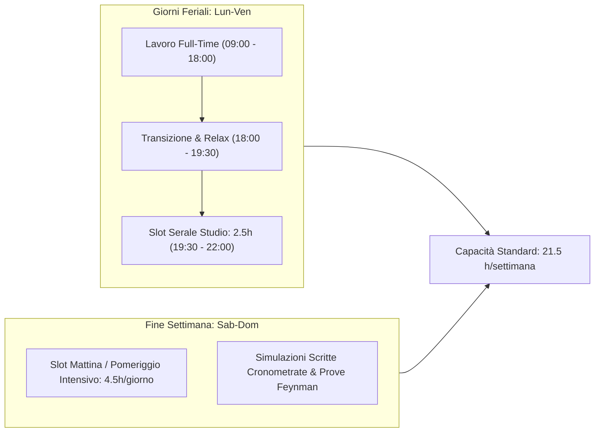
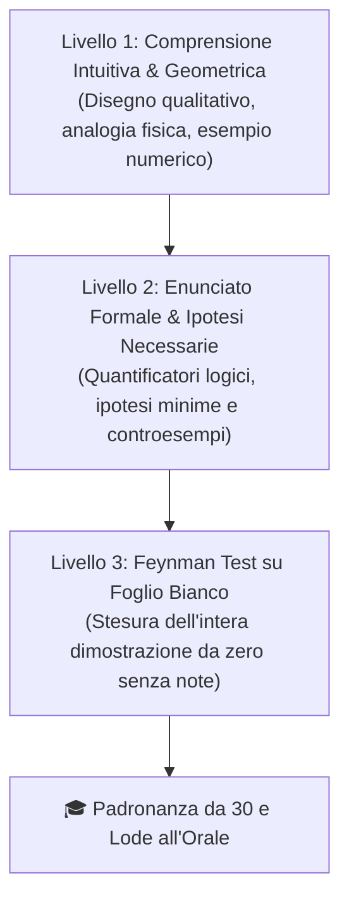
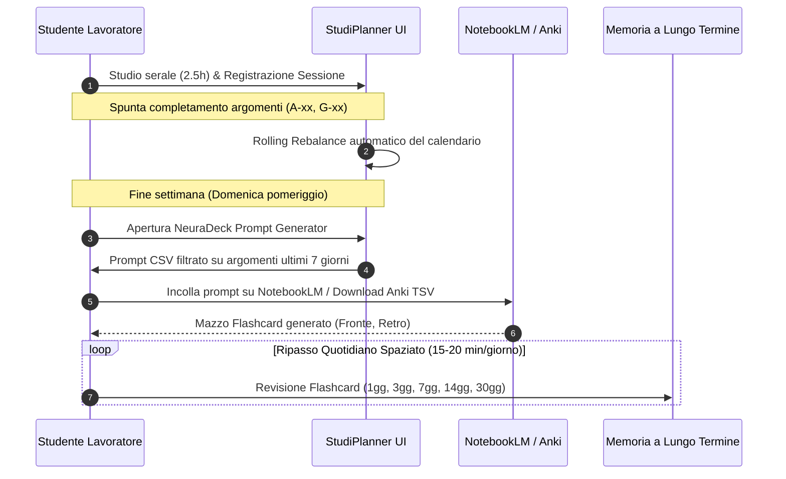

# 🎓 Modello Accademico, Syllabus UNIMORE e Metodologia di Studio
## Ingegneria Informatica — Coorte 2021 (Analisi Matematica 1 & Geometria e Algebra Lineare)

---

### Indice del Documento
1. [Profilo Studente-Lavoratore & Modello di Capacità Oraria](#1-profilo-studente-lavoratore--modello-di-capacità-oraria)
   - 1.1 [Inquadramento Professionale e Vincoli Operativi](#11-inquadramento-professionale-e-vincoli-operativi)
   - 1.2 [Modello di Allocazione Oraria Feriale e Weekend](#12-modello-di-allocazione-oraria-feriale-e-weekend)
   - 1.3 [Meccanica del Time Shifter (Slot Extra Dinamici)](#13-meccanica-del-time-shifter-slot-extra-dinamici)
   - 1.4 [Soglie di Sostenibilità, Sovraccarico e Sicurezza Cognitiva](#14-soglie-di-sostenibilità-sovraccarico-e-sicurezza-cognitiva)
2. [Curriculum Accademico Ufficiale UNIMORE](#2-curriculum-accademico-ufficiale-unimore)
   - 2.1 [Quadro d'Insieme della Coorte 2021](#21-quadro-dinsieme-della-coorte-2021)
   - 2.2 [Analisi Matematica 1: Pesi Didattici e Syllabus dei 32 Argomenti (A-01 -> A-32)](#22-analisi-matematica-1-pesi-didattici-e-syllabus-dei-32-argomenti-a-01---a-32)
   - 2.3 [Geometria e Algebra Lineare: Pesi Didattici e Syllabus dei 31 Argomenti (G-01 -> G-31)](#23-geometria-e-algebra-lineare-pesi-didattici-e-syllabus-dei-31-argomenti-g-01---g-31)
   - 2.4 [Il Vincolo Immutabile di Propedeuticità Sequenziale](#24-il-vincolo-immutabile-di-propedeuticità-sequenziale)
   - 2.5 [Buffer Dinamico Temporale (+20%)](#25-buffer-dinamico-temporale-20)
3. [Roadmap Strategica, Target Esame e Simulatore d'Esame](#3-roadmap-strategica-target-esame-e-simulatore-desame)
   - 3.1 [Target Esame: 10 Gennaio 2027](#31-target-esame-10-gennaio-2027)
   - 3.2 [Articolazione Temporale della Roadmap su 8 Settimane](#32-articolazione-temporale-della-roadmap-su-8-settimane)
   - 3.3 [Regolamento e Meccaniche d'Esame UNIMORE](#33-regolamento-e-meccaniche-desame-unimore)
   - 3.4 [Simulatore d'Esame Integrato (ExamSimulator.js)](#34-simulatore-desame-integrato-examsimulatorjs)
4. [Corpus dei Teoremi, Dimostrazioni "Cassaforte" e Formulario](#4-corpus-dei-teoremi-dimostrazioni-cassaforte-e-formulario)
   - 4.1 [Analisi 1: I 43 Teoremi "Cassaforte" per la Prova Orale e Scritta](#41-analisi-1-i-43-teoremi-cassaforte-per-la-prova-orale-e-scritta)
   - 4.2 [Geometria: L'Elenco Ufficiale delle Dimostrazioni Numerate](#42-geometria-lelenco-ufficiale-delle-dimostrazioni-numerate)
   - 4.3 [Algoritmi Fondamentali di Calcolo Operativo](#43-algoritmi-fondamentali-di-calcolo-operativo)
   - 4.4 [La Checklist a 3 Livelli (Metodo Feynman) per le Dimostrazioni](#44-la-checklist-a-3-livelli-metodo-feynman-per-le-dimostrazioni)
   - 4.5 [Math Bug Tracker & Formulario Matematico di Emergenza](#45-math-bug-tracker--formulario-matematico-di-emergenza)
5. [Integrazione Didattica: NotebookLM, NeuraDeck e Ripasso Spaziato](#5-integrazione-didattica-notebooklm-neuradeck-e-ripasso-spaziato)
   - 5.1 [Architettura dei Notebook e Knowledge Base](#51-architettura-dei-notebook-e-knowledge-base)
   - 5.2 [Generatore Flashcard NeuraDeck (NeuraDeckPromptGenerator.js)](#52-generatore-flashcard-neuradeck-neuradeckpromptgeneratorjs)
   - 5.3 [Esportazione Diretta Anki TSV](#53-esportazione-diretta-anki-tsv)
   - 5.4 [Protocollo di Spaced Repetition per Studente Lavoratore](#54-protocollo-di-spaced-repetition-per-studente-lavoratore)

---

## 1. Profilo Studente-Lavoratore & Modello di Capacità Oraria

### 1.1 Inquadramento Professionale e Vincoli Operativi
Il sistema didattico e il motore matematico di ribilanciamento di StudiPlanner sono calibrati specificamente sulle esigenze di uno studente universitario iscritto al Corso di Laurea in **Ingegneria Informatica** presso l'**Università di Modena e Reggio Emilia (UNIMORE)**, Coorte 2021, che svolge contemporaneamente un'attività lavorativa subordinata **Full-Time**.

I vincoli primari del profilo sono:
- **Orario di Lavoro:** 09:00 - 18:00, dal Lunedì al Venerdì.
- **Fascia di Pendolarismo / Reset Cognitivo:** 18:00 - 19:30.
- **Finestra Utile per lo Studio nei Giorni Feriali:** 19:30 - 22:30 (massimo 3 ore continuative per non compromettere il ciclo sonno-veglia e il rendimento lavorativo).
- **Sessioni Intensive del Weekend:** Sabato e Domenica dedicati all'approfondimento teorico, alla risoluzione di esercizi complessi e alle prove d'esame simulate cronometrate.

Come documentato in [GEMINI.md](file:///c:/tmp/StudiPlanner/GEMINI.md#L10-L20) e [AGENTS.md](file:///c:/tmp/StudiPlanner/AGENTS.md#L10-L15), il modello rifiuta approcci accademici ingenui che pretendano 6-8 ore di studio giornaliere infra-settimanali. L'architettura accetta come postulato una capacità limitata ma costante, compensata da una severa disciplina di tracciamento e riallocazione automatica dei ritardi.

---

### 1.2 Modello di Allocazione Oraria Feriale e Weekend
La pianificazione standard distribuisce il monte ore disponibile secondo il seguente schema base settimanale:

| Giorno della Settimana | Fascia Oraria Tipica | Ore Base Dedicate | Natura della Sessione Didattica |
| :--- | :--- | :---: | :--- |
| **Lunedì** | 19:30 – 22:00 | **2.5 h** | Teoria, definizioni formali ed esempi guida |
| **Martedì** | 19:30 – 22:00 | **2.5 h** | Esercizi applicativi guidati e calcolo algebrico |
| **Mercoledì** | 19:30 – 22:00 | **2.5 h** | Studio dimostrazioni e formulazione enunciati |
| **Giovedì** | 19:30 – 22:00 | **2.5 h** | Esercizi d'esame a blocchi tematici |
| **Venerdì** | 19:30 – 22:00 | **2.5 h** | Consolidamento, quiz veloci e preparazione weekend |
| **Sabato** | 09:00 – 13:30 (o diviso) | **4.5 h** | Prova intensiva, studio approfondito di dimostrazioni |
| **Domenica** | 14:30 – 19:00 | **4.5 h** | Simulazioni d'esame cronometrate, retrospettiva settimanale |
| **Totale Standard Settimanale** | — | **21.5 h** | **Capacità sostenibile a lungo termine** |



---

### 1.3 Meccanica del Time Shifter (Slot Extra Dinamici)
La vita professionale di un lavoratore non è uniforme: possono verificarsi giornate con straordinari imposti o, al contrario, giornate con ferie concordate, permessi retribuiti per esami (150 ore), ponti o pause pranzo estese.

Per gestire questa variabilità senza alterare i parametri globali del sistema, StudiPlanner integra il componente **Time Shifter**:
1. **Override Giornaliero Puntuale:** Attraverso l'oggetto di stato persistente `unimore_rebalancer_custom_capacities_v2`, ogni singola data del calendario può avere una capacità allocata specifica (ad es. `{"2026-11-20": 4.0, "2026-11-21": 1.0}`).
2. **Stepper Interattivo a Scatti di 30 Minuti:** L'interfaccia operativa in [WeeklyTodo.js](file:///c:/tmp/StudiPlanner/src/components/WeeklyTodo.js) offre pulsanti dedicati:
   - `[- 30m]`: Riduce la disponibilità in caso di emergenza lavorativa o stanchezza eccezionale (fino a 0h, marcando il giorno come riposo forzato).
   - `[+ 30m]`: Incrementa la capacità giornaliera sfruttando pause pranzo (slot 13:00 - 14:00) o sessioni pre-lavoro (slot 07:30 - 08:30).
3. **Impatto sul Rolling Rebalancer:** Qualsiasi incremento orario assorbe immediatamente il residuo dell'argomento in corso o anticipa lo studio del blocco successivo; qualsiasi decremento fa slittare fluidamente gli argomenti senza mai causare perdita di contenuti.

---

### 1.4 Soglie di Sostenibilità, Sovraccarico e Sicurezza Cognitiva
Per impedire il logoramento psicofisico (*burnout*) dello studente lavoratore, StudiPlanner calcola in tempo reale la telemetria di carico settimanale:

- **Soglia Standard (Verde / Safe Zone):** Tra **18 e 22 ore/settimana**. Il carico è equilibrato con gli impegni d'ufficio e garantisce costanza ed efficacia mnemonica.
- **Soglia di Allerta (Ambra / Warning Zone):** Tra **23 e 25 ore/settimana**. Il sistema segnala che il ritmo è serrato e richiede attenzione alla gestione del sonno.
- **Soglia Critica di Sovraccarico (Rosso / Danger Zone):** **Superiore a 25 ore/settimana** (configurabile fino a 35 ore in casi eccezionali di permessi studio intensivi).
- **Banner di Allarme Dinamico:** Quando la somma delle ore programmate in una settimana (incluse le ore residue slittate dal passato) eccede la soglia critica `criticalWeeklyHours` (default: 25h), compare l'alert persistente di sovraccarico che consiglia di utilizzare il Time Shifter per distribuire il carico o ripianificare la finestra d'esame.

---

## 2. Curriculum Accademico Ufficiale UNIMORE

### 2.1 Quadro d'Insieme della Coorte 2021
Il piano di studi del Corso di Laurea in Ingegneria Informatica (D.M. 270/04) dell'Università di Modena e Reggio Emilia prevede, al primo anno di corso, due insegnamenti matematici di base fondamentali e propedeutici a tutte le discipline successive (quali *Analisi Matematica 2*, *Calcolatori Elettronici*, *Ingegneria del Software* e *Ricerca Operativa*):
1. **Analisi Matematica 1** (9 CFU) — Docenti titolari: Prof.ssa Serena Guarino Lo Bianco e Prof.ssa Maria Manfredini. Testo di riferimento: *P. Marcellini, C. Sbordone — Analisi Matematica 1*, Liguori Editore.
2. **Geometria e Algebra Lineare** (6 CFU) — Docente titolare: Prof.ssa Maria Rita Casali; Esercitazioni: Dott.ssa Lucia Mazzali. Testo di riferimento: *M.R. Casali, C. Gagliardi, L. Grasselli — GEOMETRIA*, Esculapio Editore (4ª ed., 2022).

Come stabilito nel documento programmatico [PIANO_NOTEBOOKLM_Gemini.md](file:///c:/tmp/StudiPlanner/PIANO_NOTEBOOKLM_Gemini.md#L14-L45) e nel registro didattico [Analisi/Analisi.csv](file:///c:/tmp/StudiPlanner/Analisi/Analisi.csv), il dataset ufficiale di StudiPlanner include **63 argomenti canonici**:
- **32 argomenti per Analisi 1** (`A-01` fino a `A-32`)
- **31 argomenti per Geometria** (`G-01` fino a `G-31`)

> [!NOTE]
> **Esclusioni Didattiche Ufficiali:**
> Per disposizione esplicita delle docenti di Analisi 1, gli argomenti relativi alle *Equazioni Differenziali Ordinarie (EDO)* e alle *Funzioni di Più Variabili* (presenti nel testo Marcellini-Sbordone) **NON fanno parte del programma d'esame di Analisi 1** per Ingegneria Informatica a UNIMORE, essendo trattati estesamente nel corso di *Analisi Matematica 2*. Tutto il budget orario è pertanto concentrato su Limiti, Taylor, Studi di Funzione, Integrali di Riemann/Impropri e Serie.

---

### 2.2 Analisi Matematica 1: Pesi Didattici e Syllabus dei 32 Argomenti (A-01 -> A-32)

#### Ripartizione dei Pesi d'Esame per Analisi 1
- **Calcolo Differenziale e Studio di Funzione (25%):** Ricerca estremanti, teoremi del valor medio (Rolle, Lagrange, Cauchy), test di monotonia e convessità, asintoti obliqui e grafici completi.
- **Limiti e Sviluppi di Taylor-Maclaurin (22%):** Gerarchie degli infiniti, equivalenze asintotiche ($\sim$), algebra degli $o$-piccolo e arresto del polinomio di Taylor all'ordine corretto.
- **Calcolo Integrale (23%):** Teoria di Riemann, Teorema della Media, I e II Teorema Fondamentale (Torricelli), integrazione per parti, fratti semplici e criteri di convergenza per integrali impropri/generalizzati con parametri.
- **Serie Numeriche e Serie di Taylor (15%):** Serie geometrica, armonica generalizzata, criteri di convergenza per serie a termini positivi (rapporto, radice, integrale), serie a segno alterno (Leibniz) e convergenza assoluta.
- **Funzioni Continue e Teoremi Globali (7%):** Teorema degli Zeri (bisezione), Bolzano (valori intermedi) e Weierstrass.
- **Prerequisiti, Insiemi, Topologia e Induzione (5%):** Densità di $\mathbb{Q}$ in $\mathbb{R}$, estremi superiori/inferiori, principio d'induzione.
- **Numeri Complessi (3%):** Forma algebrica, trigonometrica, esponenziale, De Moivre e radici $n$-esime.

#### Tabella del Syllabus Ufficiale: Analisi Matematica 1 (A-01 -> A-32)
Dati tratti fedelmente da [defaultData.js](file:///c:/tmp/StudiPlanner/src/data/defaultData.js#L4-L389) e [Analisi.csv](file:///c:/tmp/StudiPlanner/Analisi/Analisi.csv):

| ID | Capitolo | Argomento Didattico Formale | Ore Stimate | Diff. (1-5) | Prio. (1-5) | Fonti Ufficiali UNIMORE | Deliverable Operativo & Obiettivo di Studio |
| :---: | :--- | :--- | :---: | :---: | :---: | :--- | :--- |
| **A-01** | Insiemi e Numeri | Insiemi numerici ($\mathbb{N}, \mathbb{Z}, \mathbb{Q}, \mathbb{R}$), densità di $\mathbb{Q}$ in $\mathbb{R}$, $\max, \min, \sup, \inf$ e principio di induzione | 2.5 h | 2 | 3 | Marcellini Cap. 1-2, Lez. 1, 4 | Definizione formale $\varepsilon$ di $\sup/\inf$ e dim. induzione somma geometrica |
| **A-02** | Funzioni Elementari | Proprietà funzioni (iniettività, suriettività, inversa, composta, monotonia), valore assoluto e intorni | 2.5 h | 2 | 3 | Marcellini Cap. 1, 5, Lez. 2 | Grafici funzioni elementari, inverse circolari e risoluzione domini |
| **A-03** | Numeri Complessi | Numeri Complessi: forma algebrica, piano di Gauss, forma trigonometrica, De Moivre e radici $n$-esime | 2.0 h | 2 | 2 | Marcellini Cap. 2 App. § 15 | Risoluzione equazioni algebriche in $\mathbb{C}$ e radici $n$-esime con angoli |
| **A-04** | Successioni | Successioni (Pt 1): Limite topologico ($\varepsilon$-$n_0$), unicità, limitatezza, permanenza segno, due carabinieri | 3.0 h | 3 | 4 | Marcellini Cap. 3 §§ 16-22, Lez. 4-5 | Dimostrazioni unicità, limitatezza e permanenza segno su foglio bianco |
| **A-05** | Successioni | Successioni (Pt 2): Operazioni limiti in $\overline{\mathbb{R}}$, forme indeterminate, successioni monotone | 2.5 h | 3 | 4 | Marcellini Cap. 3, Lez. 6 | Risoluzione forme indeterminate e dim. limite successioni monotone |
| **A-06** | Successioni | Successioni (Pt 3): Numero di Nepero $e$, Criterio rapporto, gerarchia infiniti, $o$-piccolo e asintotico ($\sim$) | 2.5 h | 4 | 4 | Marcellini Cap. 3 §§ 23-26, Lez. 7 | Algebra degli $o$-piccolo e stime asintotiche per successioni |
| **A-07** | Limiti di Funzioni | Limiti di Funzioni: Intorni forati, definizioni $\varepsilon$-$\delta$, limiti dx/sx, Teorema ponte e limiti notevoli | 2.0 h | 3 | 4 | Marcellini Cap. 4 §§ 29-32, Lez. 10 | Uso del Teorema Ponte e limiti notevoli trig/exp/log senza esitazioni |
| **A-08** | Continuità | Funzioni Continue: T. degli Zeri (bisezione), T. di Bolzano, T. di Weierstrass e discontinuità | 3.0 h | 3 | 4 | Marcellini Cap. 4 §§ 33-38, Lez. 10 | Dimostrazione costruttiva Zeri (bisezione) e analisi ipotesi Weierstrass |
| **A-09** | Formula di Taylor | Formula di Taylor: Resto di Peano (dim $n=1,2$) e sviluppi di Maclaurin fondamentali ($\exp, \sin, \cos, \ln, \dots$) | 2.5 h | 4 | 5 | Marcellini Cap. 6, 10, Lez. 13 | Memoria sviluppi Maclaurin e dim. Taylor con resto Peano per $n=2$ |
| **A-10** | Formula di Taylor | Formula di Taylor e Limiti: Scelta ordine, algebra $o$-piccolo nei prodotti, cancellazioni e limiti parametrici | 2.5 h | 4 | 5 | Marcellini Cap. 10, Lez. 14 | Risoluzione limiti complessi d'esame in meno di 6 minuti |
| **A-11** | Consolidamento | Simulazione I Parziale: Insiemi, successioni, limiti, continuità e Taylor a tempo | 2.0 h | 3 | 4 | Registro Correzione I prova | Zero dubbi operativi su limiti e stime asintotiche |
| **A-12** | Calcolo Differenziale | Calcolo Differenziale (Pt 1): Definizione derivata, retta tg, legame continuità-derivabilità, algebra derivate | 3.0 h | 3 | 5 | Marcellini Cap. 5, Lez. 17 | Dim. legame continuità-derivabilità + controesempio $|x|$ |
| **A-13** | Calcolo Differenziale | Calcolo Differenziale (Pt 2): Derivata composta e inversa ($\arcsin, \arccos, \arctan$) e limite della derivata | 2.5 h | 4 | 5 | Marcellini Cap. 5, Lez. 17 | Dim. derivata funzione composta e ricavo derivate funzioni inverse |
| **A-14** | Teoremi Differenziali | Teoremi del Differenziale: Teorema di Fermat, Rolle, Lagrange e Test di monotonia/derivata nulla | 2.5 h | 4 | 5 | Marcellini Cap. 6, Lez. 18 | Dim. rigorosa Fermat, Rolle, Lagrange e catena di corollari |
| **A-15** | Convessità e Asintoti | Convessità, Flessi e de L'Hôpital: Test convessità ($f'' \ge 0$), Teorema di Cauchy e de L'Hôpital ($0/0$) | 2.0 h | 4 | 5 | Marcellini Cap. 6, Lez. 18 | Dim. De L'Hôpital e test derivata seconda per concavità/convessità |
| **A-16** | Studio di Funzione | Studio Completo di Funzione: Grafico, asintoti obliqui, derivata prima e seconda, cuspidi, angolosi e flessi | 3.0 h | 4 | 5 | Marcellini Cap. 6, Temi d'esame | Grafico finale impeccabile e studio punti di non derivabilità in 35 min |
| **A-17** | Integrali Definiti | Integrali Definiti (Riemann): Somme sup/inf, definizione di Riemann, integrabilità e controesempio Dirichlet | 2.5 h | 3 | 5 | Marcellini Cap. 8 | Dim. CNS di Riemann ($S - s < \varepsilon$) e funzioni non integrabili |
| **A-18** | Teoremi Integrale | Teoremi Integrali: T. Media, Funzione Integrale, I e II T. Fondamentale del Calcolo Integrale (Torricelli) | 2.5 h | 4 | 5 | Marcellini Cap. 8-9 | Dim. integrale della media e I/II Teorema Fondamentale (Torricelli) |
| **A-19** | Metodi di Integrazione | Metodi di Integrazione: Integrazione per Parti, per Sostituzione e Funzioni Razionali Fratte | 2.0 h | 3 | 5 | Marcellini Cap. 9 | Dim. formule per parti e sostituzione; tecnica dei fratti semplici |
| **A-20** | Integrali Generalizzati | Integrali Generalizzati: Impropri notevoli $1/x^\alpha$, criteri confronto, asintotico e ass. convergenza | 3.0 h | 4 | 5 | Marcellini Cap. 9, Lez. 25 | Dim. convergenza $1/x^\alpha$ e criteri convergenza integrale con parametri |
| **A-21** | Serie Numeriche | Serie Numeriche (Pt 1): Condizione $a_n \to 0$, Serie geometrica/armonica, criteri termini non negativi | 2.5 h | 4 | 5 | Marcellini Cap. 11 | Dim. serie geometrica, armonica generalizzata e condizione necessaria |
| **A-22** | Serie Numeriche | Serie Numeriche (Pt 2): Criterio Rapporto, Radice, Integrale e Serie a segno alterno (Criterio di Leibniz) | 2.5 h | 4 | 5 | Marcellini Cap. 11 | Dim. criteri convergenza, stima del resto di Leibniz e assoluta convergenza |
| **A-23** | Serie di Taylor | Serie di Taylor: Sviluppabilità in serie e controesempio fondamentale funzione $C^\infty$ non analitica ($e^{-1/x^2}$) | 2.0 h | 3 | 3 | Marcellini Cap. 11 § 89 | Controesempio fondamentale all'orale e calcolo raggio di convergenza |
| **A-24** | Consolidamento | Simulazione II Parziale: Derivate, Studio Funzione, Integrali, Serie e Complessi | 3.0 h | 4 | 5 | Temi d'esame 2021-2024 | Simulazione a tempo con 5-6 problemi completi svolti per esteso |
| **A-25** | Simulazione & Ripasso | Simulazione Prova Scritta #1 e Ripasso Blocco 1 (Limiti e Taylor) | 2.5 h | 4 | 5 | Temi d'esame ufficiali | Focus su velocità nei limiti con Taylor ed eliminazione errori algebrici |
| **A-26** | Simulazione & Ripasso | Simulazione Prova Scritta #2 e Ripasso Blocco 2 (Studio Funzione) | 2.5 h | 4 | 5 | Temi d'esame ufficiali | Studio completo di funzione con parametri e raccordi di continuità |
| **A-27** | Simulazione & Ripasso | Clinica di Recupero Lacune: Integrali Impropri, Fratti Semplici e Serie numeriche | 2.0 h | 4 | 4 | Registro lacune e note | Consolidamento convergenza integrali impropri e serie parametriche |
| **A-28** | Simulazione & Ripasso | Simulazione Scritto #3 e Simulazione Interrogazione Orale (Derivate e Teoremi del Valor Medio) | 3.0 h | 4 | 5 | Lista 43 Teoremi Cassaforte | Esposizione orale fluida di Rolle, Lagrange, Fermat e De L'Hôpital |
| **A-29** | Simulazione & Ripasso | Simulazione Scritto #4 e Simulazione Interrogazione Orale (Integrali e Teorema di Torricelli) | 2.5 h | 4 | 5 | Lista 43 Teoremi Cassaforte | Esposizione orale delle 2 dimostrazioni fondamentali degli integrali |
| **A-30** | Simulazione & Ripasso | Simulazione Scritto #5 e Simulazione Interrogazione Orale (Serie e Teoremi) | 2.5 h | 4 | 5 | Lista 43 Teoremi Cassaforte | Collegamento concettuale tra Integrali Impropri e Serie numeriche |
| **A-31** | Simulazione & Ripasso | Ripasso Sistematico Esempi, Controesempi e Ipotesi dei Teoremi | 2.0 h | 3 | 4 | Registro Esempi fondamentali | Pronto 1 esempio e 1 controesempio per ciascuna ipotesi violata |
| **A-32** | Simulazione & Ripasso | PROVA GENERALE FINALE: Scritto completo a tempo + Orale globale random | 3.0 h | 5 | 5 | Tutte le fonti d'esame | Prontezza assoluta 100% per appello di Gennaio 2027 |

---

### 2.3 Geometria e Algebra Lineare: Pesi Didattici e Syllabus dei 31 Argomenti (G-01 -> G-31)

#### Ripartizione dei Pesi d'Esame per Geometria
- **Spazi Vettoriali e Trasformazioni Lineari (22%):** Basi, generatori, equazione dimensionale ($\dim V = \dim \operatorname{Ker} T + \dim \operatorname{Im} T$), matrici associate e iniettività/suriettività.
- **Sistemi Lineari e Rappresentazione di Sottospazi (18%):** Teorema di Rouché-Capelli, Algoritmo B di Gauss (riduzione a gradini), passaggio forma cartesiana $\leftrightarrow$ parametrica.
- **Geometria Euclidea nel Piano $E^2$ e nello Spazio $E^3$ (18%):** Posizioni reciproche tra rette e piani, condizioni di parallelismo e ortogonalità, distanze punto-retta e punto-piano.
- **Forme Canoniche, Autovalori, Autovettori e Diagonalizzazione (15%):** Polinomio caratteristico, molteplicità algebrica e geometrica, criteri di diagonalizzabilità e Teorema Spettrale.
- **Spazi Vettoriali Euclidei (12%):** Prodotti scalari, norma, disuguaglianza di Cauchy-Schwarz, basi ortonormali, ortonormalizzazione di Gram-Schmidt e complemento ortogonale $W^\bot$.
- **Teoria delle Coniche e Cenno alle Quadriche (10%):** Matrice associata, ampliamento proiettivo, classificazione affine/euclidea (invarianti metrici $I_1, I_2, I_3$), ricerca del centro, assi e asintoti.
- **Matrici, Determinanti e Strutture Algebriche (5%):** Operazioni algebriche, teorema di Laplace, teorema di Binet, matrice inversa con aggiunta, gruppi, campi e anelli.

#### Tabella del Syllabus Ufficiale: Geometria e Algebra Lineare (G-01 -> G-31)
Dati tratti fedelmente da [defaultData.js](file:///c:/tmp/StudiPlanner/src/data/defaultData.js#L391-L764) e [Geometria.txt](file:///c:/tmp/StudiPlanner/Geometria/Geometria.txt):

| ID | Capitolo | Argomento Didattico Formale | Ore Stimate | Diff. (1-5) | Prio. (1-5) | Fonti Ufficiali UNIMORE | Deliverable Operativo & Obiettivo di Studio |
| :---: | :--- | :--- | :---: | :---: | :---: | :--- | :--- |
| **G-01** | Matrici e Determinanti | Operazioni sulle matrici e tipologie | 2.0 h | 1 | 3 | Casali Cap. 1-2 | Operazioni elementari, prodotto righe per colonne e matrici speciali |
| **G-02** | Matrici e Determinanti | Determinante (Definizione, Proprietà, Laplace, Binet) | 3.5 h | 3 | 5 | Prop. 3.40, Teor. 3.41/3.42 | Calcolo determinante $3\times 3$ e $4\times 4$ senza errori di segno |
| **G-03** | Matrici e Determinanti | Matrice Inversa e Condizioni di invertibilità | 2.0 h | 2 | 4 | Teor. 3.45/3.46 | Formula con matrice aggiunta $(\operatorname{adj} A)^T$ e metodo Gauss-Jordan |
| **G-04** | Matrici e Determinanti | Rango di una matrice e trasformazioni elementari | 3.0 h | 3 | 5 | Casali Cap. 3, Algoritmo B | Riduzione a gradini e determinazione pivot in meno di 3 minuti |
| **G-05** | Spazi Vettoriali | Spazi vettoriali, sottospazi e chiusura lineare | 2.5 h | 2 | 3 | Casali Cap. 4 | Verifica assiomi di sottospazio vettoriale su insiemi definiti |
| **G-06** | Spazi Vettoriali | Combinazioni lineari, dipendenza e indipendenza lineare | 2.5 h | 2 | 4 | Casali Cap. 4 | Verifica indipendenza lineare e sistemi omogenei associati |
| **G-07** | Spazi Vettoriali | Sistemi di generatori, Base e Dimensione | 3.5 h | 3 | 5 | Teorema 4.26, Cap. 4 | Dim. Teorema della base e algoritmo di completamento a base |
| **G-08** | Spazi Vettoriali | Componenti di un vettore rispetto a una base ordinata | 2.0 h | 3 | 4 | Prop. 4.31, Cor. 4.32 | Dim. unicità delle coordinate rispetto a una base assegnata |
| **G-09** | Spazi Vettoriali | Somma, intersezione di sottospazi e Relazione di Grassmann | 3.0 h | 4 | 5 | Casali Cap. 4, Dim. Orale | Dim. Formula di Grassmann e verifica condizioni di somma diretta |
| **G-10** | Trasformazioni Lineari | Definizione di trasformazione lineare, Nucleo e Immagine | 3.5 h | 3 | 5 | Casali Cap. 5 | Calcolo esplicito di basi e dimensioni di $\operatorname{Ker} T$ e $\operatorname{Im} T$ |
| **G-11** | Trasformazioni Lineari | Iniettività, suriettività ed equazione dimensionale | 2.5 h | 3 | 4 | Teorema Nullità + Rango | Dim. $\dim V = \dim \operatorname{Ker} T + \dim \operatorname{Im} T$ e verifica isomorfismi |
| **G-12** | Trasformazioni Lineari | Matrici associate ed equazione matriciale | 3.5 h | 4 | 5 | Casali Cap. 5, Teor. 5.18 | Costruzione matrice associata rispetto a basi diverse arbitrarie |
| **G-13** | Trasformazioni Lineari | Matrici simili e loro proprietà | 2.0 h | 4 | 4 | Casali Cap. 5, 7, Teor. 5.38 | Invarianti di similitudine: traccia, determinante, rango, autovalori |
| **G-14** | Sistemi Lineari | Sistemi lineari e Teorema di Rouché-Capelli | 2.5 h | 3 | 5 | Prop. 6.7, Casali Cap. 6 | Dim. Rouché-Capelli e discussione di compatibilità con parametri $k$ |
| **G-15** | Sistemi Lineari | Spazio delle soluzioni, sistemi omogenei e Cramer | 3.0 h | 3 | 4 | Prop. 6.9, Casali Cap. 6 | Dim. struttura affine dello spazio soluzioni $V_0 + v_p$ |
| **G-16** | Sistemi Lineari | Rappresentazione cartesiana e parametrica di sottospazi | 3.0 h | 4 | 5 | Appunti Algoritmo B | Passaggio istantaneo da equazioni cartesiane a basi e viceversa |
| **G-17** | Autovalori & Autovettori | Polinomio caratteristico, autovalori, autovettori, autospazi | 3.5 h | 3 | 5 | Casali Cap. 7, Prop. 7.5 | Radici di $\det(A - \lambda I) = 0$ e ricerca basi autospazi $V(\lambda)$ |
| **G-18** | Autovalori & Autovettori | Molteplicità algebrica, geometrica e diagonalizzabilità | 3.5 h | 4 | 5 | Prop. 7.12, Dim. Orale | Verifica CNS diagonalizzabilità: radici reali e $m_g(\lambda) = m_a(\lambda)$ |
| **G-19** | Autovalori & Autovettori | Teorema Spettrale | 2.0 h | 4 | 4 | Casali Cap. 7, 8, Prop. 7.17 | Diagonalizzazione ortogonale di matrici simmetriche reali ($P^T A P = D$) |
| **G-20** | Spazi Vettoriali Euclidei | Prodotto scalare, norma, angolo e Disuguaglianza Schwarz | 3.0 h | 3 | 4 | Casali Cap. 8, Prop. 8.4 | Dim. Disuguaglianza di Cauchy-Schwarz e disuguaglianza triangolare |
| **G-21** | Spazi Vettoriali Euclidei | Basi ortogonali, ortonormali e Gram-Schmidt | 3.0 h | 4 | 5 | Casali Cap. 8, Prop. 8.16 | Algoritmo operativo di Gram-Schmidt e normalizzazione dei vettori |
| **G-22** | Spazi Vettoriali Euclidei | Complemento ortogonale | 2.5 h | 3 | 4 | Casali Cap. 8, Prop. 8.24/8.27 | Ricerca equazioni e base di $W^\bot$ impostando prodotti scalari nulli |
| **G-23** | Geometria Euclidea | Spazio euclideo, riferimenti cartesiani e vettori | 2.0 h | 2 | 3 | Casali Cap. 9, Prop. 9.7 | Vettori liberi, applicati e coordinate cartesiane nello spazio |
| **G-24** | Geometria Euclidea | Piano $E^2$: rette, mutue posizioni, parallelismo, distanze | 3.5 h | 3 | 4 | Casali Cap. 9, Prop. 9.40/9.42 | Fasci di rette, ortogonalità e formula della distanza punto-retta |
| **G-25** | Geometria Euclidea | Spazio $E^3$: rette, piani, coeff. direttori, posizioni, distanze | 4.0 h | 4 | 5 | Casali Cap. 9 | Rette sghembe vs complanari, distanza minima e piano per 3 punti |
| **G-26** | Geometria Euclidea | Prodotto vettoriale, misto, aree e volumi | 2.0 h | 2 | 3 | Casali Cap. 9 | Calcolo aree parallelogrammi ($||u \wedge v||$) e volumi tetraedri/parallelepipedi |
| **G-27** | Teoria delle Coniche | Ampliamento proiettivo, matrici associate, classificazione | 3.5 h | 4 | 5 | Casali Cap. 12, Prop. 12.30 | Classificazione affine/metrica tramite $\det(A)$ e $\det(A_{00})$ |
| **G-28** | Teoria delle Coniche | Centro, diametri, asintoti, assi e vertici | 3.5 h | 4 | 5 | Casali Cap. 12, Prop. 12.36/12.41 | Calcolo centro tramite sistema lineare e assi da autovettori di $A_{00}$ |
| **G-29** | Teoria delle Coniche | Riduzione in forma canonica | 2.5 h | 5 | 4 | Casali Cap. 12 | Rototraslazione e invarianti ortogonali $I_1, I_2, I_3$ |
| **G-30** | Teoria delle Coniche | Fasci di coniche e cenno alle quadriche | 2.0 h | 4 | 2 | Casali Cap. 12 | Punti base, coniche degeneri del fascio e quadriche in $E^3$ |
| **G-31** | Strutture Algebriche | Gruppi, anelli, campi e algebre di Boole | 1.5 h | 2 | 1 | Casali Cap. 1-2 | Definizioni formali e assiomi delle strutture algebriche di base |

---

### 2.4 Il Vincolo Immutabile di Propedeuticità Sequenziale

> [!IMPORTANT]
> **REGOLA ARCHITETTURALE FONDAMENTALE:**
> In StudiPlanner la sequenza di studio degli argomenti didattici **NON deve mai essere alterata** da ordinamenti basati su Priorità d'Esame o Livello di Difficoltà.

La matematica accademica è una disciplina a forte dipendenza concettuale cumulativa:
- Non è possibile comprendere la convergenza delle *Serie Numeriche* (`A-21`) senza padroneggiare la definizione e i criteri di convergenza delle *Successioni* (`A-04` - `A-06`).
- Non si può affrontare lo *Studio Completo di Funzione* (`A-16`) o la *Formula di Taylor* (`A-09`) senza conoscere il *Calcolo Differenziale* (`A-12` - `A-15`).
- Non si possono diagonalizzare matrici (`G-18`) o studiare le coniche (`G-27`) senza aver compreso gli *Spazi Vettoriali* (`G-07`), le *Applicazioni Lineari* (`G-10`) e i *Determinanti* (`G-02`).

Pertanto, gli argomenti avanzano sempre rigorosamente nell'ordine dell'identificativo:
$$\text{Analisi 1: } A\text{-}01 \longrightarrow A\text{-}02 \longrightarrow \dots \longrightarrow A\text{-}32$$
$$\text{Geometria: } G\text{-}01 \longrightarrow G\text{-}02 \longrightarrow \dots \longrightarrow G\text{-}31$$

---

### 2.5 Buffer Dinamico Temporale (+20%)
I campi `prioritaEsame` (scala 1–5) e `difficolta` (scala 1–5) svolgono due funzioni precise:
1. **Indicatori Visivi nella UI:** Determinano il colore dei badge (rosso/ambra/blu/ardesia) e gli indicatori di sbarramento.
2. **Buffer Dinamico di Apprendimento (+20%):** Il motore di calcolo orario in `rebalancerEngine.js` applica una maggiorazione cautelativa del $20\%$ sulle ore stimate dell'argomento:
   $$\text{Se } (\text{Priorità} \ge 4) \lor (\text{Difficoltà} \ge 4) \implies T_{\text{effettivo}} = T_{\text{stimato}} \times 1.20$$

Questo buffer assorbe la fisiologica frizione cognitiva dovuta all'esposizione a dimostrazioni ostiche (es. Formula di Taylor, Teorema di Torricelli, Teorema Spettrale, Coniche in forma canonica) ed evita che lo studente accumuli ritardi strutturali.

---

## 3. Roadmap Strategica, Target Esame e Simulatore d'Esame

### 3.1 Target Esame: 10 Gennaio 2027
La data target è fissata in modo rigido e inderogabile al **10 Gennaio 2027**, corrispondente all'apertura della sessione invernale d'esami UNIMORE (appello congiunto/ravvicinato di Analisi 1 e Geometria).
- **Data Inizio Sessione (Roadmap):** **16 Novembre 2026**.
- **Durata Complessiva:** 8 Settimane (56 giorni continuativi).

```mermaid
flowchart TD
    subgraph Fase1 [Fase 1: Apprendimento & Consolidamento | Sett. 1 - 6 (16 Nov - 27 Dic)]
        direction TB
        A1["Sett. 1-2: Insiemi, Successioni, Matrici, Spazi Vettoriali"]
        A2["Sett. 3-4: Limiti, Taylor, Calcolo Differenziale, Applicazioni Lineari, Diagonalizzazione"]
        A3["Sett. 5-6: Integrali Riemann/Impropri, Serie, Spazi Euclidei, Coniche"]
        A1 --> A2 --> A3
    end

    subgraph Fase2 [Fase 2: Final Review & Simulazioni Intensive | Sett. 7 - 8 (28 Dic - 10 Gen)]
        direction TB
        B1["Sett. 7: Simulazioni Scritte #1-#3 + Interrogazioni Orali (Derivate & Sistemi) + Clinica Errori"]
        B2["Sett. 8: Simulazioni Scritte #4-#5 + Esempi/Controesempi + Prova Generale Finale (A-32 & G-Final)"]
        B1 --> B2
    end

    Fase1 --> Fase2
    Fase2 --> Traguardo["🎯 10 Gennaio 2027: Appello Ufficiale UNIMORE"]
```

---

### 3.2 Articolazione Temporale della Roadmap su 8 Settimane

#### Settimane 1–6: Fase 1 (Copertura Completa del Syllabus)
- **Settimana 1 (16–22 Nov):**
  - Analisi 1: $A\text{-}01 \to A\text{-}04$ (Insiemi numerici, funzioni elementari, complessi, limiti di successioni pt 1).
  - Geometria: $G\text{-}01 \to G\text{-}04$ (Matrici, determinanti con Laplace, inversa, rango e riduzione a gradini).
- **Settimana 2 (23–29 Nov):**
  - Analisi 1: $A\text{-}05 \to A\text{-}08$ (Successioni pt 2-3 con Nepero e gerarchie, limiti di funzioni, continuità e Zeri/Bolzano/Weierstrass).
  - Geometria: $G\text{-}05 \to G\text{-}09$ (Spazi vettoriali, indipendenza lineare, basi, coordinate e formula di Grassmann).
- **Settimana 3 (30 Nov – 6 Dic):**
  - Analisi 1: $A\text{-}09 \to A\text{-}12$ (Formula di Taylor con resto Peano, limiti con Taylor, consolidamento parziale $A\text{-}11$, derivate pt 1).
  - Geometria: $G\text{-}10 \to G\text{-}13$ (Trasformazioni lineari, $\operatorname{Ker}$ e $\operatorname{Im}$, equazione dimensionale, matrici associate e matrici simili).
- **Settimana 4 (7–13 Dic):**
  - Analisi 1: $A\text{-}13 \to A\text{-}16$ (Derivata composta/inversa, Fermat, Rolle, Lagrange, convessità, de L'Hôpital e studio di funzione).
  - Geometria: $G\text{-}14 \to G\text{-}19$ (Rouché-Capelli con Algoritmo B, rappresentazione cartesiana, autovalori/autovettori, diagonalizzabilità e Teorema Spettrale).
- **Settimana 5 (14–20 Dic):**
  - Analisi 1: $A\text{-}17 \to A\text{-}20$ (Teoria di Riemann, Teorema della Media, I/II Torricelli, metodi di integrazione, integrali generalizzati).
  - Geometria: $G\text{-}20 \to G\text{-}26$ (Spazi vettoriali euclidei, Schwarz, Gram-Schmidt, complemento ortogonale, rette/piani in $E^2$ ed $E^3$, prodotti vettoriali).
- **Settimana 6 (21–27 Dic):**
  - Analisi 1: $A\text{-}21 \to A\text{-}24$ (Serie numeriche pt 1-2, serie di Taylor con controesempio $e^{-1/x^2}$, simulazione II parziale).
  - Geometria: $G\text{-}27 \to G\text{-}31$ (Ampliamento proiettivo, classificazione coniche, centro, assi, asintoti, forma canonica euclidea, strutture algebriche).

#### Settimane 7–8: Fase 2 (Final Review Week & Simulazioni Intensive)
- **Settimana 7 (28 Dic – 3 Gen):**
  - *Simulazione Scritto #1:* Verifica globale su Limiti con Taylor e Geometria $E^3$.
  - *Simulazione Scritto #2:* Studio di funzione e trasformazioni lineari con parametro $k$.
  - *Clinica Recupero Lacune (`A-27`):* Esercizi mirati su integrali impropri, fratti semplici e sistemi lineari non determinati.
  - *Simulazione Scritto #3 & Orale Derivate (`A-28`):* Esposizione a memoria su foglio bianco dei teoremi di Fermat, Rolle, Lagrange e Rouché-Capelli.
- **Settimana 8 (4–10 Gen):**
  - *Simulazione Scritto #4 & Orale Integrali (`A-29`):* Teorema della Media, Torricelli e Teorema Spettrale.
  - *Simulazione Scritto #5 & Orale Serie (`A-30`):* Criterio di Leibniz, convergenza assoluta e classificazione coniche.
  - *Ripasso Esempi e Controesempi (`A-31`):* Scheda controesempi per tutte le ipotesi violate dei teoremi cardine.
  - *PROVA GENERALE FINALE (`A-32`):* Simulazione completa a tempo reale (120m per Analisi, 90m per Geometria) più interrogazione orale globale randomizzata.

---

### 3.3 Regolamento e Meccaniche d'Esame UNIMORE

#### Specifiche Prova d'Esame — Analisi Matematica 1
- **Durata della Prova Scritta:** **120 minuti (2 ore)**.
- **Struttura del Compito:** **6 esercizi estesi** articolati su:
  1. Limite di funzione mediante sviluppi di Taylor-Maclaurin arrestati all'ordine corretto (5 pt).
  2. Studio completo del grafico di una funzione (dominio, limiti/asintoti, derivata prima, derivata seconda, flessi e tracciamento) (5 pt).
  3. Calcolo di un integrale indefinito/definito (per parti o fratti semplici) o studio convergenza integrale improprio parametrico (5 pt).
  4. Studio del carattere di una serie numerica (con parametro reale o a segno alterno con Leibniz) (5 pt).
  5. Esercizio sui numeri complessi (equazioni algebriche, forma esponenziale o radici $n$-esime) o quesiti teorici Vero/Falso (5 pt).
  6. Quesito teorico di dimostrazione o applicazione di un teorema cardine (5 pt).
- **Regola Aurea di Valutazione:** *"Il solo risultato (anche se corretto) non ha alcun valore. Vanno riportate le soluzioni giustificando adeguatamente ogni passaggio algebrico e analitico"*.
- **Prova Orale:** Obbligatoria per il conseguimento del voto finale. Verte su **almeno due domande teoriche complete** scelte dalla commissione dall'elenco ufficiale dei teoremi, da redigere per iscritto e discutere oralmente.

#### Specifiche Prova d'Esame — Geometria e Algebra Lineare
- **Durata della Prova Scritta:** **90 minuti (1 ora e mezza)**.
- **Struttura del Compito:** **11 quesiti a risposta multipla** (4 opzioni di risposta per quesito, 1 sola corretta):
  - **4 quesiti teorici:** Definizioni rigorose, proprietà degli invarianti, condizioni necessarie/sufficienti sulle proposizioni del testo *Casali-Gagliardi-Grasselli*.
  - **7 esercizi di calcolo numerico/geometrico:** Rango, sistemi con parametro $k$, nucleo/immagine, autovalori e diagonalizzabilità, rette e piani nello spazio $E^3$, coniche.
- **Sistema di Punteggio con Penalità Rigorosa:**
  - Risposta Corretta: **+3 punti**
  - Risposta Errata: **-1 punto** (penalità aggressiva contro il tirare a indovinare)
  - Risposta Omessa / Non Data: **0 punti**
  - Punteggio Massimo Teorico: **33/30**
  - Soglia Minima di Sbarramento per l'accesso all'Orale: **$\ge 15/33$**
- **Prova Orale:** Determinante per il voto finale. Verte rigorosamente sulle dimostrazioni numerate del testo ufficiale e sull'approfondimento dei quesiti errati o omessi nello scritto.

---

### 3.4 Simulatore d'Esame Integrato (ExamSimulator.js)
StudiPlanner include un simulatore d'esame dinamico completo implementato in [ExamSimulator.js](file:///c:/tmp/StudiPlanner/src/components/ExamSimulator.js):

1. **Modalità 1 — Prova Cronometrata Live:**
   - Timer decrescente in tempo reale sincronizzato sui parametri ufficiali (120m per Analisi 1, 90m per Geometria).
   - Estrazione casuale pesata di **6 argomenti per Analisi 1** o **11 argomenti per Geometria**, selezionati prioritariamente tra quelli con `prioritaEsame >= 3` e completati dallo studente.
   - Ordinamento vincolato strettamente secondo l'ID didattico propedeutico (`localeCompare` numerico).
   - Griglia di autovalutazione interattiva per ogni esercizio:
     - Analisi 1: Scala 0–5 punti per esercizio (massimo 30 punti).
     - Geometria: Scala 0–3 punti per quesito (normalizzato sui 30esimi).
   - Calcolo istantaneo del voto in trentesimi ($/30$) con salvataggio delle note di correzione.
2. **Modalità 2 — Generatore Traccia & Prompt AI:**
   - Genera prompt professionali ottimizzati per **Claude 3.5 Sonnet** o **ChatGPT (GPT-4o)**.
   - Istruisce il modello linguistico ad agire come docente ufficiale UNIMORE:
     - Redazione di un compito d'esame realistico con formule formattate in LaTeX.
     - Attribuzione dei punteggi massimi per quesito.
     - Generazione di soluzioni complete passo-passo con i criteri di correzione formale adottati dai professori UNIMORE.

---

## 4. Corpus dei Teoremi, Dimostrazioni "Cassaforte" e Formulario

### 4.1 Analisi 1: I 43 Teoremi "Cassaforte" per la Prova Orale e Scritta
Tratti dall'analisi incrociata del Registro delle Lezioni e del syllabus ufficiale (documentati in [Analisi/Agisci come un professore e tutor di Analisi Mate....md](file:///c:/tmp/StudiPlanner/Analisi/Agisci%20come%20un%20professore%20e%20tutor%20di%20Analisi%20Mate....md#L61-L121)):

#### Blocco A: Insiemi, Reali, Induzione e Complessi (Teoremi 1–5)
1. **Teorema di densità dei razionali $\mathbb{Q}$ e irrazionali $\mathbb{R} \setminus \mathbb{Q}$ in $\mathbb{R}$:** *[NO DIM]* Proprietà di separazione topologica.
2. **Caratterizzazione equivalente dell'estremo superiore ($\sup$) e inferiore ($\inf$):** *[CON DIM]* Dimostrazione della condizione $\forall \varepsilon > 0, \exists x \in A : x > M - \varepsilon$.
3. **Disuguaglianza triangolare per il valore assoluto ($|x+y| \le |x| + |y|$):** *[CON DIM]* Dimostrazione algebrica tramite elevamento al quadrato o discussione dei segni.
4. **Principio di Induzione e Applicazioni:** *[NO DIM principio; CON DIM per induzione le applicazioni]* Somma della serie geometrica finita $\sum_{i=0}^n q^i = \frac{1 - q^{n+1}}{1 - q}$, disuguaglianza di Bernoulli $(1+x)^n \ge 1+nx$ per $x > -1$, e somma dei primi $n$ quadrati.
5. **Formula di De Moivre e Formula delle radici $n$-esime in $\mathbb{C}$:** *[Enunciato e calcolo]* $[r(\cos \theta + i \sin \theta)]^n = r^n [\cos(n\theta) + i \sin(n\theta)]$ e $w_k = \sqrt[n]{r} [\cos(\frac{\theta + 2k\pi}{n}) + i \sin(\frac{\theta + 2k\pi}{n})]$.

#### Blocco B: Limiti di Successioni (Teoremi 6–15)
6. **Teorema di unicità del limite di una successione:** *[CON DIM]* Per assurdo, supponendo due limiti distinti $l_1 \ne l_2$ e scegliendo $\varepsilon = \frac{|l_1 - l_2|}{2}$.
7. **Teorema sulla limitatezza delle successioni convergenti:** *[CON DIM]* Se $a_n \to l$, allora $\exists M > 0 : |a_n| \le M, \forall n$. Dimostrazione con intorno $\varepsilon=1$ e max sui primi $n_0$ termini.
8. **Teorema: Le successioni divergenti ($a_n \to \pm \infty$) non sono limitate:** *[CON DIM]*.
9. **Teorema della permanenza del segno per le successioni:** *[CON DIM]* Se $a_n \to l > 0$, definitivamente $a_n > l/2 > 0$.
10. **Teorema del confronto (Due Carabinieri):** *[CON DIM]* Se $a_n \le b_n \le c_n$ definitivamente e $a_n \to l, c_n \to l$, allora $b_n \to l$.
11. **Teorema sul limite del valore assoluto:** *[CON DIM]* $a_n \to l \implies |a_n| \to |l|$; in particolare $a_n \to 0 \iff |a_n| \to 0$.
12. **Teorema sul limite della somma di successioni:** *[CON DIM]* Dimostrazione formale con la disuguaglianza triangolare $\varepsilon/2 + \varepsilon/2 = \varepsilon$.
13. **Teoremi sul limite del prodotto e del reciproco:** *[Enunciato e forme indeterminate]* Discussione di $[0 \cdot \infty]$ e $[\infty/\infty]$.
14. **Teorema sull'esistenza del limite per successioni monotone:** *[CON DIM]* Dimostrazione per successione monotona crescente non limitata superiormente: il limite coincide con $\sup\{a_n\} = +\infty$.
15. **Criterio del rapporto per successioni e Gerarchia degli infiniti:** *[CON DIM]* Se $\frac{a_{n+1}}{a_n} \to l < 1 \implies a_n \to 0$. Deduzione della scala $\ln n \ll n^\alpha \ll a^n \ll n! \ll n^n$.

#### Blocco C: Limiti di Funzioni e Funzioni Continue (Teoremi 16–20)
16. **Teorema Ponte (Legame tra limiti di funzioni e successioni):** *[Enunciato e uso]* $\lim_{x \to x_0} f(x) = l \iff \forall (x_n) \to x_0, f(x_n) \to l$. Applicazione per dimostrare la non esistenza di limiti (es. $\sin(1/x)$ per $x \to 0$).
17. **Teorema di esistenza del limite per funzioni monotone:** *[Enunciato]* Esistenza dei limiti laterali destro e sinistro.
18. **Teorema dell'esistenza degli zeri:** *[CON DIM]* Se $f \in C([a,b])$ e $f(a) \cdot f(b) < 0$, allora $\exists c \in (a,b) : f(c) = 0$. Dimostrazione costruttiva mediante **metodo di bisezione** e successioni di intervalli inscatolati.
19. **Teorema di Bolzano (dei Valori Intermedi):** *[CON DIM]* Se $f \in C([a,b])$, $f$ assume tutti i valori compresi tra $f(a)$ e $f(b)$. Dimostrato applicando il Teorema degli Zeri alla funzione ausiliaria $g(x) = f(x) - \gamma$.
20. **Teorema di Weierstrass:** *[NO DIM]* Se $f \in C([a,b])$ con $[a,b]$ chiuso e limitato (compatto), $f$ ammette massimo e minimo assoluti. Discussione dei controesempi quando cade la chiusura (es. $(0,1]$) o la limitatezza (es. $[0, +\infty)$).

#### Blocco D: Calcolo Differenziale e Formula di Taylor (Teoremi 21–33)
21. **Caratterizzazione della differenziabilità con l'$o$-piccolo:** *[CON DIM]* $f$ derivabile in $x_0 \iff f(x_0 + h) = f(x_0) + f'(x_0)h + o(h)$ per $h \to 0$.
22. **Legame tra continuità e derivabilità:** *[CON DIM]* $f$ derivabile in $x_0 \implies f$ continua in $x_0$. Controesempio fondamentale all'orale: $f(x) = |x|$ in $x = 0$ (continua ma non derivabile).
23. **Algebra delle derivate:** *[CON DIM]* Dimostrazione derivata della somma, del prodotto $(fg)' = f'g + fg'$ e del reciproco/quoziente.
24. **Derivata della funzione composta (Chain Rule):** *[CON DIM]* $(g \circ f)'(x_0) = g'(f(x_0)) \cdot f'(x_0)$.
25. **Derivata della funzione inversa:** *[Enunciato e calcolo]* $(f^{-1})'(y_0) = \frac{1}{f'(x_0)}$. Ricavo delle derivate di $\arcsin x$, $\arccos x$, $\arctan x$ e $\ln x$.
26. **Teorema del limite della derivata:** *[Enunciato e applicazione]* Se $f$ continua in $x_0$ e derivabile in un intorno forato con $\lim_{x \to x_0} f'(x) = l$, allora $f'(x_0) = l$.
27. **Formula di Taylor con resto di Peano:** *[CON DIM per $n=2$]* $f(x) = f(x_0) + f'(x_0)(x-x_0) + \frac{f''(x_0)}{2}(x-x_0)^2 + o((x-x_0)^2)$. Dimostrazione tramite regola di de L'Hôpital sul quoziente del resto.
28. **Teorema di Fermat per punti estremanti interni:** *[CON DIM]* Se $x_0 \in (a,b)$ è punto di max/min relativo e $f$ è derivabile in $x_0$, allora $f'(x_0) = 0$. Dimostrazione con segno del rapporto incrementale destro e sinistro.
29. **Teorema di Rolle:** *[CON DIM]* Se $f \in C([a,b])$, derivabile in $(a,b)$ e $f(a) = f(b)$, allora $\exists c \in (a,b) : f'(c) = 0$. Dimostrazione tramite Weierstrass e Fermat.
30. **Teorema del Valor Medio di Lagrange:** *[CON DIM]* Se $f \in C([a,b])$ e derivabile in $(a,b)$, $\exists c \in (a,b) : f'(c) = \frac{f(b) - f(a)}{b - a}$. Dimostrazione applicando Rolle alla funzione ausiliaria della corda $d(x) = f(x) - f(a) - \frac{f(b)-f(a)}{b-a}(x-a)$.
31. **Caratterizzazione delle funzioni a derivata nulla e Test di Monotonia:** *[CON DIM]* $f'(x) = 0 \iff f$ costante; $f'(x) \ge 0 \iff f$ crescente; $f'(x) > 0 \implies f$ strettamente crescente. Dimostrazione mediante applicazione di Lagrange su qualsiasi coppia di punti $x_1 < x_2$.
32. **Test di Convessità:** *[CON DIM]* Se $f$ derivabile due volte, $f$ è convessa su un intervallo $\iff f''(x) \ge 0$.
33. **Teorema di Cauchy e Teorema di de L'Hôpital:** *[CON DIM caso $0/0$]* $\lim \frac{f(x)}{g(x)} = \lim \frac{f'(x)}{g'(x)}$ tramite rapporto di Cauchy $\frac{f(x)-f(x_0)}{g(x)-g(x_0)} = \frac{f'(c)}{g'(c)}$.

#### Blocco E: Calcolo Integrale e Serie Numeriche (Teoremi 34–43)
34. **Condizione Necessaria e Sufficiente di Integrabilità secondo Riemann:** *[CON DIM]* $f$ integrabile su $[a,b] \iff \forall \varepsilon > 0, \exists P : S(P) - s(P) < \varepsilon$. Esempio fondamentale di funzione non integrabile: Funzione di Dirichlet $D(x)$ (1 su $\mathbb{Q}$, 0 su $\mathbb{R}\setminus\mathbb{Q}$).
35. **Teorema della Media Integrale:** *[CON DIM]* Se $f \in C([a,b])$, $\exists c \in [a,b] : \frac{1}{b-a}\int_a^b f(x)dx = f(c)$. Dimostrazione tramite disuguaglianze di limitatezza $m \le \frac{1}{b-a}\int f \le M$ e Bolzano.
36. **Primo Teorema Fondamentale del Calcolo Integrale (Derivabilità della Funzione Integrale):** *[CON DIM]* Se $f \in C([a,b])$, la funzione integrale $F(x) = \int_a^x f(t)dt$ è derivabile e $F'(x) = f(x)$. Dimostrazione tramite rapporto incrementale e Teorema della Media.
37. **Secondo Teorema Fondamentale del Calcolo Integrale (Formula di Torricelli-Barrow):** *[CON DIM]* Se $G(x)$ è una qualunque primitiva di $f$, allora $\int_a^b f(x)dx = G(b) - G(a)$.
38. **Teorema di Integrazione per Parti:** *[CON DIM]* $\int f(x)g'(x)dx = f(x)g(x) - \int f'(x)g(x)dx$, derivato dalla derivata del prodotto $(fg)'$.
39. **Teorema di Integrazione per Sostituzione:** *[CON DIM]* $\int_a^b f(\phi(t))\phi'(t)dt = \int_{\phi(a)}^{\phi(b)} f(x)dx$, derivato dalla regola della catena $(F \circ \phi)'$.
40. **Convergenza degli Integrali Impropri Notevoli:** *[CON DIM]* $\int_1^{+\infty} \frac{1}{x^\alpha}dx$ converge $\iff \alpha > 1$; $\int_0^1 \frac{1}{x^\alpha}dx$ converge $\iff \alpha < 1$. Criterio del confronto asintotico.
41. **Condizione Necessaria di Convergenza per le Serie:** *[CON DIM]* $\sum a_n \text{ converge} \implies a_n \to 0$. Dimostrazione con $a_n = S_n - S_{n-1}$. Somma della serie geometrica $\sum_{n=0}^{+\infty} q^n = \frac{1}{1-q}$ per $|q| < 1$.
42. **Criteri di Convergenza per Serie Numeriche:** *[Enunciati e dim. principali]* Criterio del confronto, rapporto, radice, integrale e Criterio di Leibniz per serie a segno alterno $\sum (-1)^n b_n$ (con verifica monotonia $b_{n+1} \le b_n$ e stima del resto $|R_n| \le b_{n+1}$).
43. **Sviluppabilità in Serie di Taylor e Controesempio Fondamentale:** *[Enunciato ed esempio]* Funzione regolarissima $C^\infty(\mathbb{R})$ non analitica (non sviluppabile in serie di Taylor nell'origine):
   $$f(x) = \begin{cases} e^{-1/x^2} & \text{se } x \ne 0 \\ 0 & \text{se } x = 0 \end{cases} \implies f^{(n)}(0) = 0 \; \forall n \in \mathbb{N}, \text{ ma } f(x) \ne 0 \text{ per } x \ne 0$$

---

### 4.2 Geometria: L'Elenco Ufficiale delle Dimostrazioni Numerate
Dalla lista d'esame ufficiale UNIMORE (testo *Casali-Gagliardi-Grasselli*), documentata in [Geometria/Agisci come un professore e tutor di Geometria e....md](file:///c:/tmp/StudiPlanner/Geometria/Agisci%20come%20un%20professore%20e%20tutor%20di%20Geometria%20e....md#L50-L107):

- **Capitolo 3 — Matrici e Determinanti:**
  - **Prop. 3.40:** Determinante di una matrice triangolare (prodotto degli elementi diagonali $\prod a_{ii}$).
  - **Teorema 3.42 (o 3.41):** Teorema di Laplace per lo sviluppo del determinante lungo una riga/colonna qualunque.
  - **Teorema 3.46 (o 3.45):** Invertibilità di una matrice quadrata: $A$ è invertibile $\iff \det(A) \ne 0$. Formula dell'inversa $A^{-1} = \frac{1}{\det A}(\operatorname{adj} A)^T$.
- **Capitolo 4 — Spazi Vettoriali:**
  - **Teorema 4.26:** Teorema della Base (esistenza di una base per qualsiasi spazio finitamente generato e invarianza della cardinalità).
  - **Prop. 4.31 e Corollario 4.32:** Componenti di un vettore rispetto a una base ordinata: esistenza e unicità dei coefficienti della combinazione lineare.
- **Capitolo 5 — Trasformazioni Lineari e Matrici Associate:**
  - **Prop. 5.5 (c, d):** Caratterizzazione di iniettività ($\operatorname{Ker} T = \{0\}$) e suriettività ($\operatorname{Im} T = W$).
  - **Prop. 5.6 (a):** Sistema di generatori dell'immagine: se $\{v_1, \dots, v_n\}$ genera $V$, $\{T(v_1), \dots, T(v_n)\}$ genera $\operatorname{Im} T$.
  - **Teorema 5.9:** Equazione dimensionale fondamentale (Teorema nullità più rango): $\dim V = \dim \operatorname{Ker} T + \dim \operatorname{Im} T$.
  - **Teorema 5.18:** Equazione matriciale di una trasformazione lineare: $[T(v)]_B = M_B^A(T) [v]_A$.
  - **Teorema 5.29:** Legame tra rango della matrice associata e dimensione dell'immagine: $\operatorname{rg}(M(T)) = \dim(\operatorname{Im} T)$.
  - **Teorema 5.38 (a) e Prop. 5.40:** Matrici simili $B = P^{-1} A P$ e invarianza di rango, traccia, determinante e polinomio caratteristico.
- **Capitolo 6 — Sistemi Lineari e Sottospazi:**
  - **Prop. 6.7:** Teorema di Rouché-Capelli: un sistema $Ax = b$ è compatibile $\iff \operatorname{rg}(A) = \operatorname{rg}(A|b)$.
  - **Prop. 6.9:** Struttura dello spazio delle soluzioni: se compatibile, l'insieme delle soluzioni è una varietà lineare di dimensione $n - \operatorname{rg}(A)$, traslata dello spazio delle soluzioni del sistema omogeneo associato ($V_0 + v_p$).
  - **Teorema 6.25:** Rappresentazione cartesiana di un sottospazio vettoriale tramite annullamento di minori o Algoritmo B.
- **Capitolo 7 — Autovalori, Autovettori e Diagonalizzazione:**
  - **Prop. 7.5:** Polinomio caratteristico $P_A(\lambda) = \det(A - \lambda I)$ e indipendenza dalla base.
  - **Prop. 7.12:** Relazione d'ordine fondamentale tra molteplicità: $1 \le m_g(\lambda) \le m_a(\lambda)$. Criterio di diagonalizzabilità (somma $m_a = n$ e $m_g = m_a$ per tutti gli autovalori).
  - **Osservazione 7.15 e Prop. 7.17:** Teorema Spettrale: ogni matrice reale simmetrica è diagonalizzabile mediante una matrice ortogonale ($P^{-1} = P^T$).
- **Capitolo 8 — Spazi Vettoriali Euclidei:**
  - **Prop. 8.4:** Disuguaglianza di Cauchy-Schwarz: $|\langle u, v \rangle| \le ||u|| \cdot ||v||$.
  - **Prop. 8.16 (b, c, d):** Proprietà delle basi ortonormali e calcolo immediato delle coordinate tramite prodotto scalare (coefficienti di Fourier).
  - **Prop. 8.24 (c) e Teorema 8.26 (a):** Proprietà del complemento ortogonale: $W \cap W^\bot = \{0\}$, $V = W \oplus W^\bot$ e $\dim W^\bot = \dim V - \dim W$.
  - **Prop. 8.27:** Algoritmo per la determinazione di una base del complemento ortogonale $W^\bot$.
- **Capitolo 9 — Geometria Euclidea nello Spazio $E^2$ ed $E^3$:**
  - **Prop. 9.7 e 9.40:** Componenti di vettori applicati e distanza euclidea tra due punti.
  - **Prop. 9.42:** Dimostrazione rigorosa della distanza punto-iperpiano / punto-piano nello spazio:
    $$d(P_0, \pi) = \frac{|a x_0 + b y_0 + c z_0 + d|}{\sqrt{a^2 + b^2 + c^2}}$$
- **Capitolo 12 — Teoria delle Coniche nel Piano Proiettivo ed Euclideo:**
  - **Prop. 12.30:** Classificazione delle coniche non degeneri mediante il segno del determinante della sottomatrice quadratica $\det(A_{00})$: Ellisse ($>0$), Iperbole ($<0$), Parabola ($=0$).
  - **Prop. 12.36:** Determinazione analitica delle coordinate omogenee e affini del centro di simmetria della conica.
  - **Prop. 12.41:** Ricerca degli assi di simmetria della conica a partire dalle direzioni degli autovettori di $A_{00}$.

---

### 4.3 Algoritmi Fondamentali di Calcolo Operativo
Oltre alle dimostrazioni formali, la prova scritta richiede l'esecuzione impeccabile di procedure computazionali:

1. **"Algoritmo B" di Gauss (Riduzione a Gradini):**
   - Utilizzo esclusivo delle mosse elementari di riga:
     - $T_1$: Scambio di due righe ($R_i \leftrightarrow R_j$).
     - $T_2$: Sostituzione di una riga con una combinazione lineare ($R_i \leftarrow R_i + k R_j$) per annullare gli elementi sotto il pivot.
   - Individuazione del rango contando i pivot non nulli e discussione dei casi critici parametrici ($\det A(k) = 0$).
2. **Procedimento di Ortonormalizzazione di Gram-Schmidt:**
   - Dati i vettori indipendenti $\{v_1, v_2, v_3\}$:
     $$u_1 = v_1$$
     $$u_2 = v_2 - \frac{\langle v_2, u_1 \rangle}{||u_1||^2} u_1$$
     $$u_3 = v_3 - \frac{\langle v_3, u_1 \rangle}{||u_1||^2} u_1 - \frac{\langle v_3, u_2 \rangle}{||u_2||^2} u_2$$
     $$e_i = \frac{u_i}{||u_i||} \quad (\text{Base ortonormale})$$
3. **Classificazione Coniche e Invarianti Metrici:**
   - Matrice completa simmetrica $3 \times 3$ ($A$) e sottomatrice dei termini di secondo grado $2 \times 2$ ($A_{00}$):
     - Invariante cubico: $I_3 = \det(A)$ (se $I_3 \ne 0$ conica non degenere; se $I_3 = 0$ degenere in rette).
     - Invariante quadratico: $I_2 = \det(A_{00})$:
       - $I_2 > 0$: **Ellisse** (reale se $I_1 \cdot I_3 < 0$, non reale se $I_1 \cdot I_3 > 0$). Circonferenza se $a_{11}=a_{22}$ e $a_{12}=0$.
       - $I_2 < 0$: **Iperbole** (equilatera se $I_1 = \operatorname{tr}(A_{00}) = a_{11} + a_{22} = 0$).
       - $I_2 = 0$: **Parabola**.

---

### 4.4 La Checklist a 3 Livelli (Metodo Feynman) per le Dimostrazioni
All'interno della scheda interattiva [TopicDetailModal.js](file:///c:/tmp/StudiPlanner/src/components/TopicDetailModal.js#L407-L490), ogni argomento didattico ad alta priorità integra una checklist basata sulla celebre Tecnica di Feynman per assicurare che lo studente non confonda la familiarità passiva con la reale padronanza:



1. **Livello 1 — Comprensione Intuitiva & Geometrica:**
   Lo studente sa spiegare il significato del teorema a parole semplici, disegnando un grafico qualitativo alla lavagna o proponendo un'analogia visiva (es. significato del rettangoloide di Riemann, interpretazione fisica della derivata come velocità o proiezione ortogonale come ombra).
2. **Livello 2 — Enunciato Formale & Ipotesi Necessarie:**
   Lo studente formula l'enunciato con rigore matematico inappuntabile (ipotesi, tesi, quantificatori $\forall, \exists$) ed è in grado di mostrare un controesempio specifico per ciascuna ipotesi qualora venisse rimossa (ad es. se cade la chiusura dell'intervallo in Weierstrass, $f(x)=1/x$ su $(0,1]$ non ha massimo).
3. **Livello 3 — Feynman Test su Foglio Bianco:**
   Lo studente chiude libri, slide e tablet, prende un foglio bianco intonso e scrive tutti i passaggi della dimostrazione formale senza alcuna esitazione, giustificando ogni passaggio algebrico e commentando i lemmi intermedi.

---

### 4.5 Math Bug Tracker & Formulario Matematico di Emergenza
In [MathBugTracker.js](file:///c:/tmp/StudiPlanner/src/components/MathBugTracker.js) e [MathFormulaDrawer.js](file:///c:/tmp/StudiPlanner/src/components/MathFormulaDrawer.js) sono codificati i 6 "Bug Matematici" più frequenti rilevati nelle prove d'esame UNIMORE, corredati dalla regola di correzione immediata:

| Bug ID | Materia | Descrizione dell'Errore Ricorrente | Regola Aurea di Correzione d'Emergenza |
| :---: | :---: | :--- | :--- |
| **bug-1** | Analisi 1 | **De L'Hôpital applicato senza forma indeterminata:** derivare numeratore e denominatore quando il limite non è $0/0$ o $\infty/\infty$. | Eseguire sempre prima la sostituzione diretta. Se il limite è finito, de L'Hôpital altera il risultato. |
| **bug-2** | Analisi 1 | **Troncamento insufficiente dell'ordine di Taylor:** arrestare lo sviluppo prima dell'ordine del denominatore, causando cancellazioni spurie. | Determinare prima l'ordine del denominatore (es. $x^4$); sviluppare tutti i termini del numeratore almeno fino all'ordine 4. |
| **bug-3** | Analisi 1 | **Omissione del valore assoluto nella primitiva di $1/x$:** scrivere $\int \frac{1}{x}dx = \ln(x)$ anziché $\ln|x|$. | La primitiva fondamentale è sempre $\ln|x| + c$; fondamentale negli integrali definiti con estremi negativi. |
| **bug-4** | Geometria | **Segno errato nel complemento algebrico di Laplace:** dimenticare il fattore $(-1)^{i+j}$ nel calcolo dei cofattori. | Disegnare la scacchiera dei segni ($+ - + / - + - / + - +$) prima di moltiplicare per i minori. |
| **bug-5** | Geometria | **Mancata discussione dei valori critici di $k$ in Rouché-Capelli:** calcolare il rango generico senza analizzare $\det A(k) = 0$. | Trovare i valori critici annullando il determinante; riscrivere la matrice e ridurla a gradini per ogni $k$ critico. |
| **bug-6** | Geometria | **Confusione tra molteplicità algebrica ($m_a$) e geometrica ($m_g$):** dare per scontata la diagonalizzabilità senza verificare $m_g = n - \operatorname{rg}(A - \lambda I)$. | Una matrice è diagonalizzabile $\iff$ tutti gli autovalori sono reali e per ciascuno $m_g(\lambda) = m_a(\lambda)$. |

---

## 5. Integrazione Didattica: NotebookLM, NeuraDeck e Ripasso Spaziato

### 5.1 Architettura dei Notebook e Knowledge Base
Come stabilito nei piani di organizzazione archivistica [PIANO_NOTEBOOKLM.md](file:///c:/tmp/StudiPlanner/PIANO_NOTEBOOKLM.md) e [PIANO_NOTEBOOKLM_Gemini.md](file:///c:/tmp/StudiPlanner/PIANO_NOTEBOOKLM_Gemini.md), il repository didattico dello studente è strutturato per alimentare istanze dedicate di **Google NotebookLM**:

```mermaid
flowchart TD
    subgraph Archiviazione [Repository Locale Appunti / Dispense UNIMORE]
        D1["Analisi 1/ (Slide Manfredini, Temi d'esame, Marcellini-Sbordone)"]
        D2["Geometria/ (Slide Casali-Mazzali, Testo Esculapio, Dimostrazioni)"]
    end

    subgraph NotebookLM [Istanze Cloud Google NotebookLM]
        N1["NotebookLM: Analisi Matematica 1 UNIMORE"]
        N2["NotebookLM: Geometria & Algebra Lineare UNIMORE"]
    end

    subgraph Client [StudiPlanner Frontend]
        GEN["NeuraDeckPromptGenerator.js"]
        ANKI["Esportatore Diretto Anki TSV"]
    end

    subgraph NeuraDeckApp [Mobile App NeuraDeck (Ionic / Angular)]
        FLASH["Deck Flashcard Revisionate (Fronte / Retro)"]
    end

    D1 --> N1
    D2 --> N2
    N1 & N2 -.-> GEN
    GEN -->|Prompt CSV Filtro Settimanale| N1 & N2
    GEN -->|Generazione Locale| ANKI
    N1 & N2 -->|Output CSV 'Fronte,Retro'| FLASH
    ANKI -->|Import Anki Desktop / Mobile| FLASH
```

1. **Isolamento per Disciplina:** Analisi 1 e Geometria risiedono in due notebook rigorosamente separati per garantire che l'AI recuperi riferimenti, dimostrazioni ed esempi specifici della cattedra di riferimento senza allucinazioni o commistioni metodologiche.
2. **Fonti Canoniche Caricate:**
   - Per Analisi 1: Slide lezioni Manfredini (Lezioni 1–27), indice tematico, compendio dimostrazioni, temi d'esame svolti e manuale Marcellini-Sbordone.
   - Per Geometria: Manuale *Casali-Gagliardi-Grasselli*, dispensa *Algoritmo B*, elenchi ufficiali delle dimostrazioni 2020–2024 e appunti su distanze in $E^3$ e coniche.

---

### 5.2 Generatore Flashcard NeuraDeck (NeuraDeckPromptGenerator.js)
Nel componente [NeuraDeckPromptGenerator.js](file:///c:/tmp/StudiPlanner/src/components/NeuraDeckPromptGenerator.js), StudiPlanner offre uno strumento automatizzato di sintesi attiva:

1. **Filtro Intelligente della Finestra Temporale:**
   - Estrae automaticamente solo gli argomenti contrassegnati come completati negli **ultimi 7 giorni** (o 14 giorni o selezione libera) rispetto alla data di riferimento (`currentSimulatedDate` o data odierna).
2. **Generazione del Prompt Strutturato per NotebookLM:**
   Il generatore costruisce un prompt con vincolo di ruolo docente e istruzioni rigide di formattazione:
   ```text
   Agisci da professore universitario di Ingegneria. Basandoti esclusivamente sulle fonti di questo notebook, generami delle flashcard di ripasso sui seguenti argomenti:
   • [A-09] Analisi 1 - Formula di Taylor: Resto di Peano (dim n=1,2) e sviluppi di Maclaurin fondamentali...
   • [G-14] Geometria - Sistemi Lineari: Sistemi lineari e Teorema di Rouché-Capelli...

   Restituisci l'output ESCLUSIVAMENTE in un blocco di codice CSV raw nel formato 'Fronte,Retro', ottimizzato per l'importazione massiva su NeuraDeck.
   ```
3. **Integrazione con NeuraDeck:**
   Il blocco CSV generato da NotebookLM viene copiato con un clic e importato direttamente in **NeuraDeck** (la web/mobile app autonoma in Ionic/Angular realizzata dallo studente), rendendo le flashcard fruibili su smartphone durante i tempi morti e i tragitti casa-lavoro.

---

### 5.3 Esportazione Diretta Anki TSV
Oltre all'integrazione con NotebookLM, [NeuraDeckPromptGenerator.js](file:///c:/tmp/StudiPlanner/src/components/NeuraDeckPromptGenerator.js#L141-L182) include la funzionalità nativa di esportazione diretta in formato compatibile con **Anki** (`.tsv`):

- **Header Metadati Anki:** `#separator:tab`, `#html:true`, `#tags column:3`.
- **Generazione Doppia Card Intelligente:**
  - **Card 1 (Concetto & Definizione Formale):**
    - *Fronte:* `[ID] Materia — Definire ed enunciare: Argomento`
    - *Retro:* Capitolo, deliverable operativo e fonti bibliografiche UNIMORE.
    - *Tag:* `UNIMORE Analisi1/Geometria ID`
  - **Card 2 (Dimostrazione d'Esame & Prova Feynman):**
    - Generata automaticamente se l'argomento ha `prioritaEsame >= 4` o menziona esplicitamente un teorema/dimostrazione.
    - *Fronte:* `[ID] Prova d'Esame / Dimostrazione — Quali sono i passaggi della dimostrazione o le condizioni necessarie e sufficienti per: Argomento?`
    - *Retro:* Priorità esame, punti critici della dimostrazione e promemoria della verifica Feynman a tre stadi (Intuitiva $\to$ Formale $\to$ Foglio bianco).
    - *Tag:* `UNIMORE Analisi1/Geometria Dimostrazione ID`

---

### 5.4 Protocollo di Spaced Repetition per Studente Lavoratore
Per massimizzare la ritenzione a lungo termine in vista dell'appello del 10 Gennaio 2027, la routine di studio adotta il seguente ciclo settimanale:



1. **Giorno 0 (Apprendimento Primario):** Sessione serale da 2.5h (teoria + esercizi d'aula + verifica Feynman Livello 1 e 2).
2. **Giorno +1 (Primo Consolidamento):** Ripasso rapido delle flashcard (10 minuti) durante la pausa pranzo o il viaggio di ritorno.
3. **Giorno +3 (Recupero Attivo):** Esecuzione di 2 esercizi d'esame tratti dal tema d'esame relativo all'argomento.
4. **Giorno +7 (Fine Settimana):** Generazione del mazzo settimanale NeuraDeck/Anki e test di scrittura dimostrazioni su foglio bianco (Feynman Livello 3).
5. **Giorno +14 e +30 (Mantenimento Continuo):** Revisione automatica cadenzata dall'algoritmo di spaced repetition (SM-2 di Anki o algoritmo NeuraDeck) per azzerare la curva dell'oblio prima della *Final Review Week* di Gennaio 2027.
