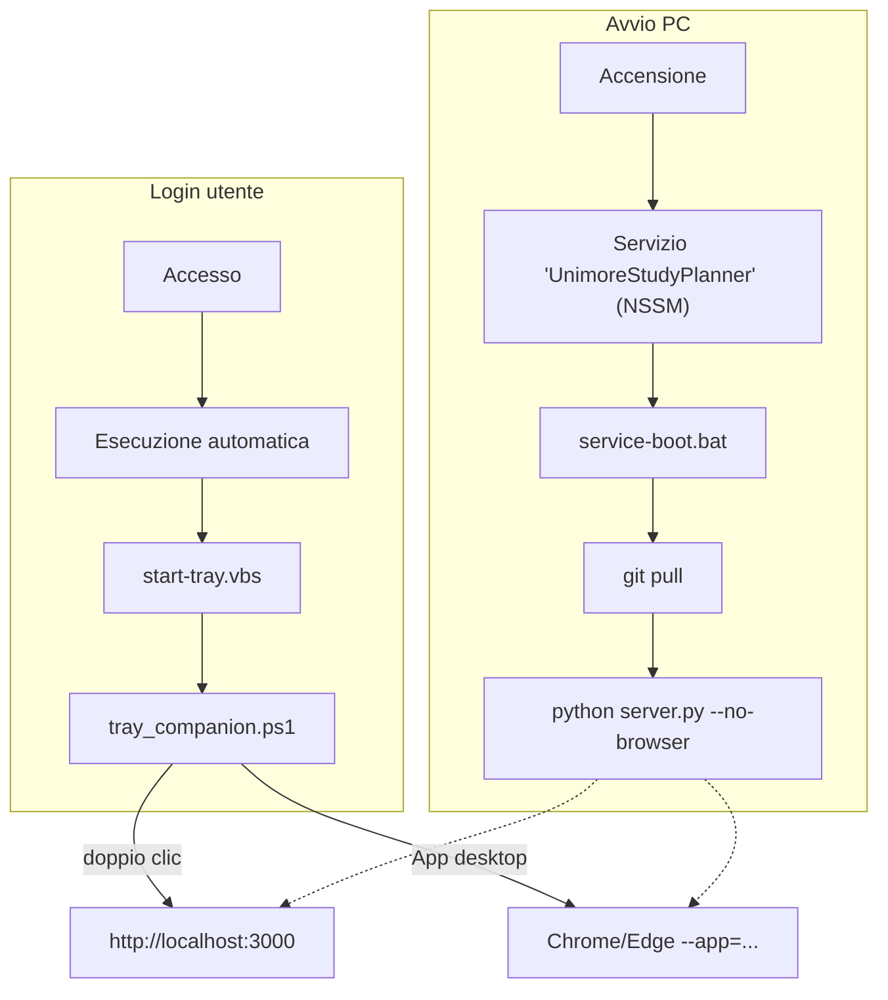

# 06 — Build, test, server e integrazione Windows

Guida operativa per chi sviluppa o installa StudiPlanner: come si genera il bundle, come si testa, come gira il server locale e come si integra l'app in Windows.

---

## 1. Ciclo di sviluppo

```powershell
python scripts\build_bundle.py
```

```powershell
npm test
```

```powershell
python scripts\test_rolling_rebalance.py
```

```powershell
python scripts\test_tonight_and_mock_exams.py
```

| Passo | Cosa verifica | Requisiti |
| :--- | :--- | :--- |
| `build_bundle.py` | Controlla i nomi di primo livello duplicati e rigenera `bundle.js` da `src/` | Python 3 |
| `npm test` | Test unitari dei servizi + transpilazione del bundle | Node ≥ 16 (nessuna `npm install`) |
| `test_rolling_rebalance.py` | E2E: data reale, simulazione giorni, To-Do, Storico, persistenza | `pip install playwright` + `playwright install chromium` |
| `test_tonight_and_mock_exams.py` | E2E: timer e chiusura di Stasera, temi d'esame (voto, curva, cancellazione) | come sopra |

Regole:

- Dopo ogni modifica in `src/` ricompilare il bundle e committarlo insieme ai sorgenti: `index.html` esegue solo `bundle.js`.
- Non modificare `bundle.js` a mano.
- Lavorare su un branch (`fix/…`, `feature/…`, `refactor/…`), mai direttamente su `main`.

---

## 2. Pipeline di build (`scripts/build_bundle.py`)

Il progetto non usa un bundler JavaScript. Lo script:

1. controlla che nessun nome di primo livello sia dichiarato in due file (o due volte nello stesso file) e, se succede, si ferma indicando i file in conflitto;
2. concatena i file elencati in `files_order` (dati → icone → servizi → componenti → `app.js`);
3. elimina le righe `import` e la parola chiave `export`;
4. antepone `const { useState, useEffect, useMemo, useRef, useCallback } = React;` e un `ErrorBoundary` che mostra gli errori di rendering;
5. accoda il montaggio su `#root` e scrive `bundle.js` con fine riga LF.

Il browser transpila il risultato con Babel standalone (`<script type="text/babel" src="bundle.js">`). Babel segnala che il file supera i 500 KB e "deottimizza lo styling": è un avviso innocuo.

**Scope condiviso.** Tutti i file finiscono nello stesso scope: due dichiarazioni top-level con lo stesso nome in moduli diversi rompono l'app. Usare nomi specifici per gli helper privati e aggiungere ogni nuovo file a `files_order` dopo le sue dipendenze. Il controllo di `build_bundle.py` cerca le dichiarazioni che iniziano a colonna 0 (`function`, `class`, `const`/`let`/`var`, destrutturazioni): le dichiarazioni annidate sono indentate e non contano. `tests/bundle.test.mjs` fa da seconda rete, transpilando il bundle completo.

**Fine riga.** `.gitattributes` impone LF per tutti i file di testo e CRLF solo per i batch di Windows (`.bat`, `.cmd`), che con LF possono leggere male etichette e commenti `::`. `.editorconfig` dà le stesse regole agli editor. Il bundle è scritto sempre in LF, quindi una build senza modifiche ai sorgenti non lascia file modificati.

---

## 3. Test

### 3.1 Test unitari (`npm test`)

`tests/run-tests.mjs` importa tutti i file `tests/*.test.mjs` ed esegue i test registrati con il mini-harness `tests/harness.mjs` (compatibile con Node 16, dove `node:test` non è disponibile). Termina con codice 1 se un test fallisce.

| File | Copertura |
| :--- | :--- |
| `bundle.test.mjs` | `bundle.js` transpilato con `vendor/babel.min.js` in una sandbox `vm`; servizi importabili come moduli ES |
| `engine.test.mjs` | Allocazione, sequenza, budget, `A-32`, giorno d'esame, metriche, streak, burndown, retrospettiva, Time Shifter |
| `topicState.test.mjs` | Registrazione/cancellazione sessioni, completamento, migrazione note, marcatura `updatedAt` |
| `parser.test.mjs` | CSV (apostrofi, stato, reimport), matching Excel per ID e testo |
| `calendarExport.test.mjs` | Eventi ICS, orari, durata, piegatura delle righe |
| `gitlabSync.test.mjs` | Regole di merge e sync completo contro un GitLab simulato |

Per aggiungere un test:

```js
import assert from "assert";
import { test } from "./harness.mjs";
import { rebalanceStudyPlan } from "../src/services/rebalancerEngine.js";

test("descrizione del comportamento atteso", () => {
  const plan = rebalanceStudyPlan(topics, { currentSimulatedDate: "2026-11-19" });
  assert.strictEqual(plan.metrics.isScheduleSaturated, false);
});
```

I servizi sono importabili da Node perché `package.json` dichiara `"type": "module"`. Un servizio che usa API del browser (es. `XLSX`, `fetch`) va testato simulandole su `globalThis`, come fa `gitlabSync.test.mjs` con `fetch`.

### 3.2 Test end-to-end (Playwright)

Ogni script `scripts/test_*.py` avvia un server HTTP temporaneo su una porta dedicata, apre l'app in Chromium headless e interagisce con la UI.

`test_rolling_rebalance.py` è il test di riferimento. Calcola le date attese a runtime (oggi reale limitato all'intervallo della sessione) e termina con codice 1 se un controllo fallisce:

- l'app parte dalla data reale; avanzamento simulato e ritorno con "Oggi Reale";
- giorno attivo marcato OGGI e giorni passati della settimana segnalati come saltati;
- timeline dello Storico;
- argomenti e impostazioni salvati in `localStorage`.

Salva `screenshot_history_tab.png` (ignorato da git).

`test_tonight_and_mock_exams.py` copre i due flussi serali. Fissa l'orologio del browser a lunedì 14/12/2026 alle 20:00 (`page.clock.set_fixed_time`, fuso Europe/Rome) e lo sposta in avanti per simulare il tempo passato, senza attese reali:

- **Stasera:** avvio del timer, 50 minuti che sopravvivono a una ricarica, chiusura con esiti degli esercizi e fiducia, sessione salvata (0,75 h, data, argomento proposto), ore dell'argomento aggiornate e timer azzerato;
- **Temi d'esame:** avvio del tema di Analisi, conto alla rovescia, consegna dopo 100 minuti, voto obbligatorio, salvataggio con `updatedAt`, curva e riepilogo, persistenza dopo una ricarica, cancellazione con tombstone in `unimore_rebalancer_deleted_mock_exams_v1`;
- nessun errore JavaScript nella pagina.

Altri script E2E coprono singole funzionalità: `test_time_shifter.py`, `test_partial_progress.py`, `test_log_study_session.py`, `test_topic_detail_modal.py`, `test_gitlab_sync_ui.py`, `test_point*_*.py` (una funzionalità ciascuno), `check_sequence.py` (ordine propedeutico nella vista settimanale). Alcuni di questi script stampano i risultati senza terminare con errore: leggere l'output.

`scripts/test_engine.mjs` è un benchmark storico del motore; i test unitari aggiornati sono in `tests/`.

---

## 4. Server locale (`server.py`)

Server statico basato su `http.server` della libreria standard.

| Aspetto | Comportamento |
| :--- | :--- |
| Binding | `0.0.0.0`: raggiungibile da `localhost` e dalla LAN (iPad, portatile, telefono). |
| Porta | `3000`; se occupata prova fino a `3009`. |
| Header | `Cache-Control: no-cache, no-store, must-revalidate` (ogni ricarica prende il bundle aggiornato) e `Access-Control-Allow-Origin: *`. |
| File nascosti | Ogni percorso con un segmento che inizia per `.` (anche codificato, es. `%2Egit`) risponde 404: `.git`, `.claude`, `.gitignore`, … non sono mai esposti sulla LAN. |
| Browser | Apre `http://localhost:<porta>` all'avvio, salvo con `--no-browser`. |
| Log | stdout/stderr forzati in UTF-8 (necessario quando gira come servizio). |
| IP LAN | Rilevato con un socket UDP verso un indirizzo esterno (nessun pacchetto inviato) e mostrato nei log. |

```powershell
python server.py
```

```powershell
python server.py --no-browser
```

> Il server serve l'intera cartella del repository a chiunque sia sulla stessa rete. Usarlo solo su reti fidate.

---

## 5. Integrazione Windows



### 5.1 Collegamento desktop (`create_taskbar_shortcut.ps1` / `.bat`)

Cerca Chrome o Edge nel registro (`App Paths`) e crea `StudiPlanner.lnk` sul Desktop e nel menu Start, con argomento `--app="http://localhost:3000"` e icona `icons/app.ico`. Dal collegamento si può poi scegliere "Aggiungi alla barra delle applicazioni".

```powershell
powershell -ExecutionPolicy Bypass -File create_taskbar_shortcut.ps1
```

### 5.2 Icona nella system tray (`tray_companion.ps1`)

Applicazione Windows Forms (`NotifyIcon`) avviata senza finestra da `start-tray.vbs`. Il menu contestuale offre:

- stato del servizio (in esecuzione, arrestato, in pausa) con porta e IP LAN;
- apertura nel browser o come app desktop, copia dell'URL LAN;
- avvio, arresto e riavvio del servizio (con elevazione UAC se serve) e `git pull` del repository;
- apertura e pulizia dei log, verifica della regola firewall, `services.msc`, cartella del progetto;
- attivazione dell'avvio automatico.

L'icona riceve un badge colorato in base allo stato (verde in esecuzione, rosso arrestato, ambra in pausa, grigio non installato), aggiornato ogni 4 secondi.

Per avviarla automaticamente al login (`-Uninstall` per rimuoverla):

```powershell
powershell -ExecutionPolicy Bypass -File install_tray_startup.ps1
```

### 5.3 Servizio Windows (`setup_windows_service.ps1`)

Registra il server come servizio `UnimoreStudyPlanner` tramite NSSM (`tools/nssm.exe`, non versionato: lo script lo cerca anche nel `PATH` e nelle cartelle note):

1. si rilancia con privilegi di amministratore se necessario;
2. crea o aggiorna la regola firewall in ingresso **"Study Planner App"** (TCP 3000);
3. registra il servizio con avvio automatico, directory di lavoro del repository, `service-boot.bat` come comando;
4. redirige i log in `logs/service-stdout.log` e `logs/service-stderr.log` con rotazione a 1 MB;
5. imposta `PYTHONUTF8=1` e `PYTHONIOENCODING=utf-8`.

`service-boot.bat` imposta la codepage UTF-8, esegue `git -c safe.directory=* pull` (se la rete manca usa la versione locale), individua Python e avvia `server.py --no-browser`.

| Opzione | Effetto |
| :--- | :--- |
| `-UseLocalSystem` | Esegue come `LocalSystem`: nessuna password, compatibile con Windows Hello/PIN. Consigliata. |
| (nessuna) | Esegue con l'account utente; chiede la password. Utile se il `git pull` richiede le credenziali dell'utente. |
| `-StartService` | Avvia il servizio dopo l'installazione. |
| `-Uninstall` | Arresta e rimuove il servizio e la regola firewall. |

```powershell
powershell -ExecutionPolicy Bypass -File setup_windows_service.ps1 -UseLocalSystem -StartService
```

```powershell
powershell -ExecutionPolicy Bypass -File setup_windows_service.ps1 -Uninstall
```

> Il servizio esegue `git pull` a ogni avvio e quindi esegue automaticamente il codice presente sul branch remoto. Usarlo solo con un repository sotto il proprio controllo.

---

## 6. Prontuario

| Obiettivo | Comando |
| :--- | :--- |
| Avviare l'app | `python server.py` oppure `start-app.bat` |
| Rigenerare il bundle | `python scripts\build_bundle.py` (o `npm run build`) |
| Test unitari | `npm test` |
| Test E2E di riferimento | `python scripts\test_rolling_rebalance.py` e `python scripts\test_tonight_and_mock_exams.py` |
| Collegamento desktop | `powershell -ExecutionPolicy Bypass -File create_taskbar_shortcut.ps1` |
| Tray all'avvio | `powershell -ExecutionPolicy Bypass -File install_tray_startup.ps1` |
| Servizio Windows | `powershell -ExecutionPolicy Bypass -File setup_windows_service.ps1 -UseLocalSystem -StartService` |
