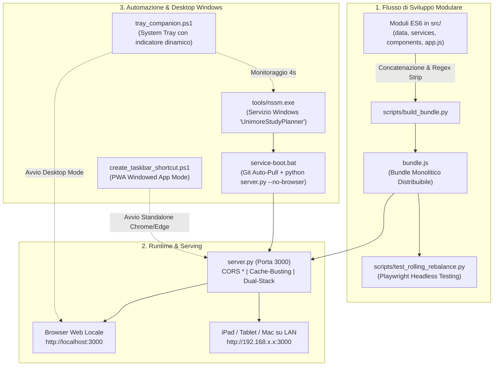
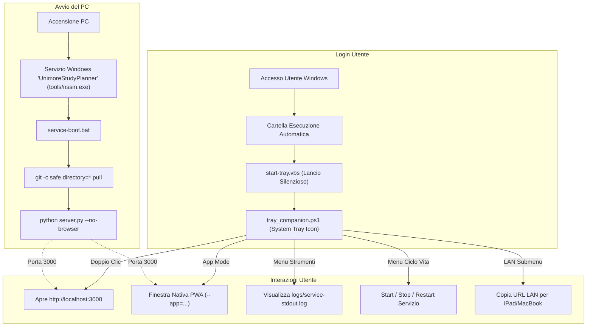

# 🛠️ DevOps, Script di Build e Automazione Windows — StudiPlanner
### *Guida Tecnica ai Processi di Build, Testing End-to-End, Server Locale e Integrazione Windows Desktop*
**Corso di Laurea:** Ingegneria Informatica, UNIMORE  
**Sessione di Riferimento:** Invernale 2026/2027 (Analisi 1 & Geometria)  
**Percorso Documento:** `docs/06_DEVOPS_AND_SCRIPTS.md`

---

## 📑 Indice dei Contenuti
1. [Introduzione e Panoramica Architetturale](#1-introduzione-e-panoramica-architetturale)
2. [Pipeline di Build (`scripts/build_bundle.py`)](#2-pipeline-di-build-scriptsbuild_bundlepy)
   - [Motivazione Architetturale: Zero-Dependency Build](#motivazione-architetturale-zero-dependency-build)
   - [Ordine Rigoroso di Concatenazione dei Moduli](#ordine-rigoroso-di-concatenazione-dei-moduli)
   - [Trasformazioni Regex (Strip di Import/Export)](#trasformazioni-regex-strip-di-importexport)
   - [Iniezione Globals ed ErrorBoundary di Sicurezza](#iniezione-globals-ed-errorboundary-di-sicurezza)
   - [Mounting Sicuro nel DOM (`mountStudiPlannerApp`)](#mounting-sicuro-nel-dom-mountstudiplannerapp)
   - [Regola di Compilazione Obbligatoria](#regola-di-compilazione-obbligatoria)
3. [Testing Automatizzato e QA (`scripts/test_rolling_rebalance.py`)](#3-testing-automatizzato-e-qa-scriptstest_rolling_rebalancepy)
   - [Harness di Test con Playwright Sync API](#harness-di-test-con-playwright-sync-api)
   - [Server HTTP Effimero Multi-Thread](#server-http-effimero-multi-thread)
   - [Casi di Test e Verifiche E2E nel Rolling Rebalancer](#casi-di-test-e-verifiche-e2e-nel-rolling-rebalancer)
   - [Validazione Persistenza LocalStorage e Regressione Visiva](#validazione-persistenza-localstorage-e-regressione-visiva)
   - [Suite Completa di Test in `scripts/`](#suite-completa-di-test-in-scripts)
4. [Development Server Locale (`server.py`)](#4-development-server-locale-serverpy)
   - [Architettura di Rete e Dual-Stack Binding (`0.0.0.0`)](#architettura-di-rete-e-dual-stack-binding-0000)
   - [Risoluzione Dinamica Porte e LAN IP Detection](#risoluzione-dinamica-porte-e-lan-ip-detection)
   - [Header HTTP: CORS e Cache-Busting Totale](#header-http-cors-e-cache-busting-totale)
   - [Risoluzione MIME Types e Robustezza UTF-8](#risoluzione-mime-types-e-robustezza-utf-8)
   - [Modalità Headless (`--no-browser`)](#modalit-headless---no-browser)
5. [Integrazione Desktop Windows e Automazione](#5-integrazione-desktop-windows-e-automazione)
   - [Pannello System Tray (`tray_companion.ps1` & `start-tray.vbs`)](#pannello-system-tray-tray_companionps1--start-trayvbs)
   - [Generazione Dinamica dell'Icona con Badge di Stato](#generazione-dinamica-dellicona-con-badge-di-stato)
   - [Avvio Automatico al Login Utente (`install_tray_startup.ps1` / `.bat`)](#avvio-automatico-al-login-utente-install_tray_startupps1--bat)
   - [Collegamento Desktop e Taskbar in Modalità PWA (`create_taskbar_shortcut.ps1` / `.bat`)](#collegamento-desktop-e-taskbar-in-modalit-pwa-create_taskbar_shortcutps1--bat)
   - [Gestione come Servizio Windows Nativo (`setup_windows_service.ps1`, `service-boot.bat` e `tools/nssm.exe`)](#gestione-come-servizio-windows-nativo-setup_windows_serviceps1-service-bootbat-e-toolsnssmexe)
6. [Flusso Operativo dello Sviluppatore (Cheatsheet)](#6-flusso-operativo-dello-sviluppatore-cheatsheet)

---

## 1. Introduzione e Panoramica Architetturale

L'infrastruttura di StudiPlanner è stata progettata per garantire **tre principi fondamentali**:
1. **Zero Attrezzatura Pesante (Zero-Tooling Overhead):** Nessuna installazione elefantiaca di Node.js, Webpack, Vite o centinaia di megabyte in cartelle `node_modules`. Tutto il sistema gira in modo ultra-reattivo tramite Python standard (già presente sull'ambiente di sviluppo) e browser moderni.
2. **Determinismo Matematico e Affidabilità:** Ogni singola modifica al motore algoritmico o ai componenti grafici è validata da test end-to-end con browser headless (Playwright) per assicurare che la propedeuticità matematica (`A-01 -> A-32`, `G-01 -> G-31`) e la redistribuzione del carico non subiscano mai regressioni.
3. **Esperienza Utente Desktop di Livello Nativo su Windows 10/11:** Il server locale può essere avviato con un doppio clic, eseguito come servizio di background persistente (NSSM) con avvio al boot del PC prima del login, controllato dall'Area di Notifica (System Tray) con pallino di stato dinamico, e fruito sia sul PC sia da iPad/tablet in rete locale (LAN).



---

## 2. Pipeline di Build (`scripts/build_bundle.py`)

### Motivazione Architetturale: Zero-Dependency Build

Nel file principale [index.html](file:///c:/tmp/StudiPlanner/index.html), StudiPlanner include **React 18** e **Babel Standalone** via CDN.  
Se si tentasse di caricare decine di file modulari direttamente nel browser tramite tag `<script type="text/babel">` separati o con `import` dinamici su protocollo `file://` o HTTP puro, si incorrerebbe in:
- Errori CORS e restrizioni di sicurezza stringenti su percorsi locali.
- Lentezza nel parsing Babel client-side causata da round-trip di rete multipli.
- Complessità di sincronizzazione delle dipendenze asincrone prima del mounting dell'albero React.

Per preservare contemporaneamente la **massima manutenibilità del codice** (separato modularmente in `src/services/`, `src/components/`, `src/data/`) e la **leggerezza di distribuzione**, il progetto adotta [scripts/build_bundle.py](file:///c:/tmp/StudiPlanner/scripts/build_bundle.py).  
Questo script Python autonomo (circa 140 righe di codice standard) compila l'intero sorgente modulare in un unico file ottimizzato: [bundle.js](file:///c:/tmp/StudiPlanner/bundle.js).

### Ordine Rigoroso di Concatenazione dei Moduli

In JavaScript/Babel senza un module loader a runtime, l'ordine di dichiarazione determina la disponibilità dei simboli. Le costanti dati e le icone devono precedere i servizi, i quali devono precedere i componenti atomici, i quali devono precedere i componenti compositi e l'entry point principale `App`.

L'array `files_order` in [scripts/build_bundle.py](file:///c:/tmp/StudiPlanner/scripts/build_bundle.py#L4-L30) definisce rigorosamente la catena:

```python
files_order = [
    'src/data/defaultData.js',                   # 1. Dataset canonico UNIMORE (63 argomenti)
    'src/components/Icons.js',                  # 2. Libreria icone SVG native
    'src/services/rebalancerEngine.js',         # 3. Motore matematico di ribilanciamento
    'src/services/parserService.js',            # 4. Parser fuzzy CSV / Excel (SheetJS)
    'src/services/gitlabSyncService.js',        # 5. Sincronizzazione cloud GitLab REST v4
    'src/services/calendarExportService.js',    # 6. Generatore iCalendar (.ics)
    'src/components/AlertBanner.js',            # 7. Banner notifiche e allerte critiche
    'src/components/NeuraDeckPromptGenerator.js', # 8. Generatore flashcard & AI prompts
    'src/components/ExamSimulator.js',          # 9. Simulatore d'esame scritto
    'src/components/MathBugTracker.js',         # 10. Registro errori e misconcezioni
    'src/components/MathFormulaDrawer.js',      # 11. Formulario matematico KaTeX
    'src/components/Clarke9000Companion.js',    # 12. Assistente didattico Clarke 9000
    'src/components/BurndownChart.js',          # 13. Telemetria burndown di studio
    'src/components/Dashboard.js',              # 14. Cruscotto KPI e countdown
    'src/components/ActivityHeatmap.js',        # 15. Matrice di attivita' in stile GitHub
    'src/components/WeeklyTodo.js',             # 16. Vista operativa giorno per giorno
    'src/components/HistoryLog.js',             # 17. Timeline cronologica e rollback sessioni
    'src/components/TopicsTable.js',            # 18. Catalogo tabellare completo
    'src/components/FileImporter.js',           # 19. Centro import/export e GitLab UI
    'src/components/SettingsModal.js',          # 20. Parametri di simulazione e capacita'
    'src/components/LogStudyModal.js',          # 21. Registrazione sessione studio (+)
    'src/components/TopicDetailModal.js',       # 22. Scheda immersiva teoria/teoremi
    'src/components/PdfSplitView.js',           # 23. Visualizzatore PDF affiancato
    'src/components/WeeklyRetrospectiveModal.js', # 24. Retrospettiva settimanale
    'src/app.js'                                # 25. Root Container & State Manager
]
```

### Trasformazioni Regex (Strip di Import/Export)

Durante lo sviluppo in IDE moderni, i file in `src/` utilizzano la sintassi standard ECMAScript Modules (`import` ed `export`) per abilitare l'autocompletamento, il linting e il salto alle definizioni.  
Nella fase di bundling, `build_bundle.py` rimuove queste direttive tramite espressioni regolari per evitare conflitti di scope nel browser:

```python
# Rimozione degli enunciati import (singola riga o multilinea)
code = re.sub(r'import\s+[\s\S]*?from\s+[\'"][^\'"]+[\'"];?', '', code)
code = re.sub(r'import\s+[\'"][^\'"]+[\'"];?', '', code)

# Rimozione delle parole chiave export mantenendo la dichiarazione sottostante
code = re.sub(r'\bexport\s+(async\s+function|function|const|let|var|class)\b', r'\1', code)
code = re.sub(r'\bexport\s+default\b', '', code)
code = re.sub(r'\bexport\s*\{[^}]*\};?', '', code)
```

Ogni modulo viene poi incapsulato con un'intestazione di debug per facilitare l'ispezione dei file compilati tramite DevTools:
```javascript
// --- src/services/rebalancerEngine.js ---
```

### Iniezione Globals ed ErrorBoundary di Sicurezza

In testa al bundle, lo script inietta:
1. **Destrutturazione dei React Hooks:**  
   `const { useState, useEffect, useMemo, useRef, useCallback } = React;`
2. **React ErrorBoundary Globale di Protezione:**  
   Una classe React che intercetta qualsiasi eccezione di rendering imprevista (`componentDidCatch`), impedendo la comparsa della classica schermata nera vuota (White/Black Screen of Death).  
   L'ErrorBoundary visualizza una UI elegante e protetta con palette Dark Mode (`#070b14`), offrendo all'utente due opzioni di ripristino immediato:
   - **Ricarica Pagina (F5):** Riavvio morbido dell'applicazione.
   - **Ripristino Dati Predefiniti:** Pulsante di emergenza che azzera in modo sicuro le chiavi `unimore_rebalancer_topics_v2` e `unimore_rebalancer_settings_v2` in `localStorage`, rigenerando lo stato iniziale con i 63 argomenti UNIMORE garantiti.

```javascript
// Global Error Boundary to prevent any blank black screen
class ErrorBoundary extends React.Component {
  constructor(props) {
    super(props);
    this.state = { hasError: false, error: null };
  }
  static getDerivedStateFromError(error) {
    return { hasError: true, error };
  }
  componentDidCatch(error, errorInfo) {
    console.error("[StudiPlanner ErrorBoundary Caught]", error, errorInfo);
  }
  render() {
    if (this.state.hasError) {
      return (
        <div className="min-h-screen bg-[#070b14] text-slate-100 flex flex-col items-center justify-center p-6 text-center select-none">
          ...
        </div>
      );
    }
    return this.props.children;
  }
}
```

### Mounting Sicuro nel DOM (`mountStudiPlannerApp`)

In coda al bundle viene aggiunta la logica di bootstrap dell'albero React:
- Verifica la presenza dell'elemento contenitore `#root`.
- Se l'elemento non è ancora presente, effettua un polling difensivo (`setTimeout(mountStudiPlannerApp, 50)`).
- Sfrutta la moderna API di React 18: `ReactDOM.createRoot(rootElement).render(...)`.
- Gestisce sia l'evento `DOMContentLoaded` che lo stato di caricamento completato (`document.readyState !== 'loading'`).

### Regola di Compilazione Obbligatoria

> [!IMPORTANT]
> **REGOLA AUREA DELLO SVILUPPO:**
> Il file [index.html](file:///c:/tmp/StudiPlanner/index.html) carica unicamente:
> ```html
> <script type="text/babel" src="bundle.js"></script>
> ```
> I file in `src/` **NON** vengono letti direttamente a runtime dal browser.  
> Qualsiasi modifica apportata a qualsiasi file in `src/` (componenti, servizi, dati) richiede l'esecuzione immediata di:
> ```powershell
> python scripts\build_bundle.py
> ```
> In caso contrario, il browser continuerà ad eseguire la versione precedente di `bundle.js`.

---

## 3. Testing Automatizzato e QA (`scripts/test_rolling_rebalance.py`)

### Harness di Test con Playwright Sync API

La suite di collaudo adotta [Playwright for Python](file:///c:/tmp/StudiPlanner/scripts/test_rolling_rebalance.py#L7) in modalità sincrona (`sync_playwright`), che garantisce test end-to-end (E2E) deterministici all'interno di un'istanza headless reale di Google Chromium.

A differenza dei test unitari basati su Node.js (`JSDOM`), i test Playwright in StudiPlanner:
- Renderizzano effettivamente il CSS di Tailwind e verificano la visibilità visiva reale (`is_visible()`, layout boundaries).
- Eseguono il runtime completo di React 18 e Babel Standalone nel motore Chromium V8.
- Validano le scritture effettive su `window.localStorage`.

### Server HTTP Effimero Multi-Thread

Per consentire l'esecuzione dei test in modalità completamente isolata e headless (senza dover avviare manualmente il server primario), [scripts/test_rolling_rebalance.py](file:///c:/tmp/StudiPlanner/scripts/test_rolling_rebalance.py#L12-L23) avvia in un thread daemon parallelo un'istanza dedicata di `http.server.SimpleHTTPRequestHandler` su una porta effimera (`PORT = 3455`):

```python
PORT = 3455
DIRECTORY = os.path.dirname(os.path.dirname(os.path.abspath(__file__)))

class Handler(http.server.SimpleHTTPRequestHandler):
    def __init__(self, *args, **kwargs):
        super().__init__(*args, directory=DIRECTORY, **kwargs)

def start_server():
    with socketserver.TCPServer(("", PORT), Handler) as httpd:
        httpd.serve_forever()

t = threading.Thread(target=start_server, daemon=True)
t.start()
time.sleep(1)
```

### Casi di Test e Verifiche E2E nel Rolling Rebalancer

Il test esegue una simulazione approfondita dell'esperienza utente:

```mermaid
sequenceDiagram
    autonumber
    participant Test as test_rolling_rebalance.py
    participant Server as Python HTTP Server (3455)
    participant Chrome as Chromium Headless
    participant Storage as HTML5 LocalStorage

    Test->>Server: Avvio thread server background
    Test->>Chrome: page.goto("http://localhost:3455/index.html")
    Chrome->>Server: Richiesta index.html + bundle.js
    Chrome->>Chrome: Parsing Babel + Mounting React Root
    Test->>Chrome: wait_for_selector("h1")
    
    rect rgb(20, 30, 50)
        note over Test, Chrome: Verifica Navigazione & Sincronizzazione Data
        Test->>Chrome: Check tab 'Storico & Diario'
        Test->>Chrome: Verifica data reale di default (Mercoledi 18/11)
        Test->>Chrome: Clic '▶' (Avanzamento a Giovedi 19/11)
        Test->>Chrome: Clic 'Oggi Reale' (Ritorno a 18/11)
    end

    rect rgb(30, 20, 50)
        note over Test, Chrome: Verifica Rolling Rebalancer nel To-Do Settimanale
        Test->>Chrome: Clic tab 'To-Do Settimanale'
        Test->>Chrome: Asserzione: Martedi 17/11 e' marcato come 'Giorno saltato'
        Test->>Chrome: Asserzione: Mercoledi 18/11 ha badge 'OGGI (Data Attiva)'
        Test->>Chrome: Asserzione: Gli argomenti (G-01 / A-01) sono slittati su Mercoledi 18/11
    end

    rect rgb(20, 50, 30)
        note over Test, Storage: Verifica Persistenza & Screenshot
        Test->>Storage: Read 'unimore_rebalancer_topics_v2'
        Test->>Storage: Read 'unimore_rebalancer_settings_v2'
        Test->>Chrome: page.screenshot(screenshot_history_tab.png)
    end
    Test->>Test: Exit 0 (Tutti i check superati)
```



1. **Inizializzazione e Montaggio:** Attende l'evento `networkidle` e la presenza del tag `h1` principale, certificando l'avvenuto montaggio dell'albero React.
2. **Controllo Navbar e Moduli:** Verifica la presenza del pulsante `Storico & Diario`.
3. **Sincronizzazione Temporale Dinamica:**
   - Verifica che l'applicazione si sincronizzi automaticamente con la data corrente del sistema (`Oggi: 18/11`).
   - Simula l'avanzamento temporale cliccando il pulsante freccia `▶` nel selettore data (`Oggi: 19/11`).
   - Valida il ripristino della data tramite il pulsante interattivo `Oggi Reale`.
4. **Verifica della Logica di Rolling Forward:**
   - Naviga nella vista `To-Do Settimanale`.
   - Se i giorni precedenti (es. Martedì 17/11) non sono stati completati, verifica che la UI mostri l'avviso:  
     `"Giorno saltato • Argomenti recuperati automaticamente in avanti"`.
   - Accerta che gli argomenti didattici non svolti (`G-01`, `A-01`) vengano automaticamente riprogrammati a partire da oggi (`Mercoledì 18/11`), marcato con il badge `OGGI (Data Attiva)`.
5. **Verifica Tab Timeline Storico:** Ispezione della schermata storica e validazione della renderizzazione dell'header `Storico e Diario di Studio`.

### Validazione Persistenza LocalStorage e Regressione Visiva

Il test interroga programmaticamente lo storage del browser tramite `page.evaluate`:
```python
topics_in_storage = page.evaluate("() => localStorage.getItem('unimore_rebalancer_topics_v2')")
settings_in_storage = page.evaluate("() => localStorage.getItem('unimore_rebalancer_settings_v2')")
```
Infine, cattura uno screenshot completo della vista Storico (`screenshot_history_tab.png`), archiviandolo come prova visiva della corretta composizione grafica dei componenti.

### Suite Completa di Test in `scripts/`

Oltre al test principale di ribilanciamento, la cartella [scripts/](file:///c:/tmp/StudiPlanner/scripts/) include test mirati per singola area funzionale:

| Script di Test | Scopo di Verifica |
| :--- | :--- |
| [test_rolling_rebalance.py](file:///c:/tmp/StudiPlanner/scripts/test_rolling_rebalance.py) | **Test Master:** Ribilanciamento continuo, giorni saltati, storico e persistenza. |
| [check_sequence.py](file:///c:/tmp/StudiPlanner/scripts/check_sequence.py) | **Propedeuticità Didattica:** Scorre tutte le settimane sino alla settimana finale, accertando che l'ultimo slot contenga categoricamente `A-32` e `G-31`. |
| [test_app.py](file:///c:/tmp/StudiPlanner/scripts/test_app.py) | **Smoke Test:** Verifica montaggio React, card Analisi/Geometria e assenza errori in console (`pageerror`). |
| [test_time_shifter.py](file:///c:/tmp/StudiPlanner/scripts/test_time_shifter.py) | **Time Shifter:** Test dei pulsanti stepper `[- 30m]` e `[+ 30m]`, memorizzazione degli override orari (`customDayCapacities`). |
| [test_partial_progress.py](file:///c:/tmp/StudiPlanner/scripts/test_partial_progress.py) | **Avanzamento Parziale:** Registrazione di sessioni con ore parziali e ricalcolo proporzionale del carico rimanente. |
| [test_gitlab_sync_ui.py](file:///c:/tmp/StudiPlanner/scripts/test_gitlab_sync_ui.py) | **GitLab Cloud UI:** Test del pannello di configurazione GitLab e feedback visivo di sincronizzazione. |
| [test_topic_detail_modal.py](file:///c:/tmp/StudiPlanner/scripts/test_topic_detail_modal.py) | **Scheda Didattica:** Ispezione della finestra modale con teoremi, note d'esame e diario storico per singolo argomento. |
| `test_point1_spaced_repetition.py` .. `test_point20_express_review.py` | Suite modulare di test a copertura dei 20 punti didattici avanzati (Simulatore d'esame, Formula Drawer KaTeX, Burndown telemetry, Flashcard prompt generator, ecc.). |

---

## 4. Development Server Locale (`server.py`)

Il server locale [server.py](file:///c:/tmp/StudiPlanner/server.py) è il cuore del runtime di sviluppo e fruizione desktop. È implementato con la libreria standard di Python (`http.server` e `socketserver`), garantendo zero overhead.

### Architettura di Rete e Dual-Stack Binding (`0.0.0.0`)

A differenza dei server di sviluppo convenzionali che si vincolano unicamente a `127.0.0.1` (impedendo la connessione da altri dispositivi), [server.py](file:///c:/tmp/StudiPlanner/server.py#L20) esegue il binding globale:
```python
HOST = "0.0.0.0"
PORT = 3000
```
Questo consente allo studente di utilizzare StudiPlanner sia dal computer principale di lavoro, sia da dispositivi secondari posti sulla stessa rete Wi-Fi/LAN (es. **iPad o MacBook** per lo studio serale o sul divano).

### Risoluzione Dinamica Porte e LAN IP Detection

Per garantire che il server si avvii sempre anche nel caso in cui un altro processo stia già occupando la porta `3000`, lo script implementa un loop di assegnazione dinamica con `allow_reuse_address = True`:
```python
socketserver.TCPServer.allow_reuse_address = True
for p in range(port, port + max_tries):
    try:
        httpd = socketserver.TCPServer((HOST, p), Handler)
        port = p
        break
    except OSError:
        continue
```

La funzione `get_local_ip()` rileva l'indirizzo IPv4 effettivo della macchina nella rete locale aprendo un socket UDP verso un DNS pubblico (`8.8.8.8:80`, senza inviare traffico reale):
```python
def get_local_ip():
    try:
        s = socket.socket(socket.AF_INET, socket.SOCK_DGRAM)
        s.connect(("8.8.8.8", 80))
        ip = s.getsockname()[0]
        s.close()
        return ip
    except Exception:
        return "127.0.0.1"
```
All'avvio, il server stampa nel terminale una schermata informativa pulita con entrambi gli indirizzi di collegamento:
```text
============================================================
🚀 StudiPlanner — Server Avviato!
📍 Accesso Locale (PC):     http://localhost:3000
📱 Accesso LAN (iPad/Mac):  http://192.168.1.120:3000
🌐 Host Binding:            0.0.0.0:3000
📂 Cartella radice:         C:\tmp\StudiPlanner
Premere CTRL+C per arrestare il server.
============================================================
```

### Header HTTP: CORS e Cache-Busting Totale

Nel sottoclasse `Handler(http.server.SimpleHTTPRequestHandler)`:
```python
def end_headers(self):
    # Enable CORS and caching headers for local development
    self.send_header('Access-Control-Allow-Origin', '*')
    self.send_header('Cache-Control', 'no-cache, no-store, must-revalidate')
    super().end_headers()
```
- **`Access-Control-Allow-Origin: *`:** Consente il caricamento cross-origin di risorse, webhook e chiamate API dirette (ad esempio per l'integrazione GitLab REST v4 e il rendering di PDF).
- **`Cache-Control: no-cache, no-store, must-revalidate`:** Essenziale durante lo sviluppo; garantisce che ogni volta che `bundle.js` viene ricompilato tramite `build_bundle.py`, la nuova versione venga caricata istantaneamente dal browser al primo refresh, senza restare intrappolata nella cache statica del browser.

### Risoluzione MIME Types e Robustezza UTF-8

- **MIME Types:** L'ereditarietà da `SimpleHTTPRequestHandler` sfrutta il dizionario di sistema `mimetypes` per servire correttamente:
  - `.html` $\rightarrow$ `text/html`
  - `.js` $\rightarrow$ `application/javascript`
  - `.json` $\rightarrow$ `application/json`
  - `.css` $\rightarrow$ `text/css`
  - `.png` / `.ico` / `.svg` $\rightarrow$ formati immagine corretti
- **Reconfigurazione UTF-8:** Per prevenire blocchi o crash quando l'output del server viene reindirizzato verso pipe di log di Windows (es. eseguito sotto NSSM o script batch), `server.py` riconfigura forzatamente stdout e stderr:
  ```python
  if hasattr(sys.stdout, "reconfigure"):
      sys.stdout.reconfigure(encoding="utf-8", errors="replace")
  if hasattr(sys.stderr, "reconfigure"):
      sys.stderr.reconfigure(encoding="utf-8", errors="replace")
  ```
  La funzione ausiliaria `safe_print()` garantisce la totale immunità da `UnicodeEncodeError`.

### Modalità Headless (`--no-browser`)

Di default, `python server.py` invoca `webbrowser.open(local_url)` per comodità durante l'avvio manuale.  
Tuttavia, quando il server viene eseguito come servizio di background di Windows (o tramite il file [service-boot.bat](file:///c:/tmp/StudiPlanner/service-boot.bat)), viene passato l'argomento `--no-browser`:
```python
if "--no-browser" not in sys.argv:
    webbrowser.open(local_url)
```
Questo previene l'apertura indesiderata di finestre del browser ogni volta che il servizio si avvia in background.

---

## 5. Integrazione Desktop Windows e Automazione

StudiPlanner include un'integrazione completa per l'ecosistema Windows (10 e 11), trasformando l'applicazione web in un'esperienza desktop nativa e permanente.



---

### Pannello System Tray (`tray_companion.ps1` & `start-tray.vbs`)

Il file [tray_companion.ps1](file:///c:/tmp/StudiPlanner/tray_companion.ps1) implementa un'applicazione completa per l'Area di Notifica di Windows (System Tray), scritta in PowerShell utilizzando **Windows Forms** (`System.Windows.Forms.NotifyIcon`) e **GDI+** (`System.Drawing`).

Per evitare l'apertura della classica finestra nera del terminale PowerShell all'avvio, viene utilizzato il wrapper VBScript silenzioso [start-tray.vbs](file:///c:/tmp/StudiPlanner/start-tray.vbs):
```vbscript
Set WshShell = CreateObject("WScript.Shell")
scriptDir = CreateObject("Scripting.FileSystemObject").GetParentFolderName(WScript.ScriptFullName)
psCommand = "powershell.exe -WindowStyle Hidden -NoProfile -ExecutionPolicy Bypass -File """ & scriptDir & "\tray_companion.ps1"""
WshShell.Run psCommand, 0, False
```

#### Funzionalità del Menu Contestuale (Clic Destro):
1. **Identità & Badge:** `🎓 StudiPlanner — UNIMORE`.
2. **Stato in Tempo Reale:** Mostra se il servizio è `Running`, `Stopped` o `Paused`, la porta e l'IP LAN. Cliccandoci, appare un balloon tip con le informazioni di diagnostica.
3. **Accesso Web Diretto:**
   - *Apri nel Browser (Scheda):* Apre l'URL in una scheda del browser predefinito.
   - *Apri come App Desktop (Finestra Nativa):* Rileva Chrome o Edge e lancia il client con flag `--app=http://localhost:3000` (finestra senza barra degli indirizzi).
   - *Sottomenu LAN (iPad/MacBook):* Consente di copiare con 1 clic l'URL locale negli appunti (`http://192.168.x.x:3000`) o aprirlo localmente.
4. **Ciclo di Vita del Servizio:**
   - Controlli `Avvia Servizio`, `Arresta Servizio`, `Riavvia Servizio` (se i privilegi dell'utente non sono elevati, invoca automaticamente il comando con `RunAs` UAC in background).
   - Pulsante `Sincronizza Repository (Git Pull)` per aggiornare il codice con un clic.
5. **Strumenti & Diagnostica:**
   - Visualizzazione immediata in Blocco Note di `logs/service-stdout.log` e `logs/service-stderr.log`.
   - Azzeramento rapido dei file di log.
   - Verifica dello stato della regola nel Firewall di Windows.
   - Collegamento rapido a `services.msc` e apertura della cartella di progetto in Esplora File.
6. **Avvio Automatico con Windows:** Checkbox interattiva che sincronizza la presenza del collegamento nella cartella Esecuzione Automatica.

### Generazione Dinamica dell'Icona con Badge di Stato

La funzione `Get-StatusIcon([string]$status)` in [tray_companion.ps1](file:///c:/tmp/StudiPlanner/tray_companion.ps1#L74-L116) carica l'icona base `icons/icon-192.png` e, ad ogni variazione di stato del servizio, renderizza al volo un badge circolare dinamico (diametro 11px con contorno dark `#070b14`) nell'angolo inferiore destro dell'icona:
- 🟢 **Verde Smeraldo (`#10b981`):** Servizio in esecuzione (`Running`).
- 🔴 **Rosso Rosa (`#f43f5e`):** Servizio arrestato (`Stopped`).
- 🟡 **Giallo Ambra (`#f59e0b`):** Servizio in pausa o transizione (`Paused`).
- ⚪ **Grigio Slate (`#94a3b8`):** Servizio non installato o non rilevato.

Un timer a basso consumo (`System.Windows.Forms.Timer`) interroga lo stato ogni **4 secondi**, consumando lo **~0% di CPU**.

---

### Avvio Automatico al Login Utente (`install_tray_startup.ps1` / `.bat`)

I file [install_tray_startup.bat](file:///c:/tmp/StudiPlanner/install_tray_startup.bat) e [install_tray_startup.ps1](file:///c:/tmp/StudiPlanner/install_tray_startup.ps1) automatizzano la persistenza dell'icona tray:
- Individuano la cartella speciale di Windows: `[Environment]::GetFolderPath("Startup")` (ovvero `%APPDATA%\Microsoft\Windows\Start Menu\Programs\Startup`).
- Creano un collegamento COM `WScript.Shell` denominato `StudiPlanner Tray.lnk`.
- Bersaglio del collegamento: `wscript.exe` puntando a [start-tray.vbs](file:///c:/tmp/StudiPlanner/start-tray.vbs).
- Supportano il flag `-Uninstall` per la rimozione pulita del collegamento in qualsiasi momento.

---

### Collegamento Desktop e Taskbar in Modalità PWA (`create_taskbar_shortcut.ps1` / `.bat`)

Per consentire l'utilizzo di StudiPlanner come vera applicazione desktop nativa (senza schede del browser, senza barra dell'URL e senza distrazioni), gli script [create_taskbar_shortcut.bat](file:///c:/tmp/StudiPlanner/create_taskbar_shortcut.bat) e [create_taskbar_shortcut.ps1](file:///c:/tmp/StudiPlanner/create_taskbar_shortcut.ps1):

1. **Rilevano il Browser Migliore:** Cercano Google Chrome o Microsoft Edge leggendo il registro di sistema (`HKLM:\SOFTWARE\Microsoft\Windows\CurrentVersion\App Paths\chrome.exe` o `msedge.exe`).
2. **Generano il Collegamento App Standalone:**
   ```powershell
   $shortcut.TargetPath = $browserExe
   $shortcut.Arguments = "--app=`"http://localhost:3000`""
   $shortcut.IconLocation = "$projectDir\icons\app.ico, 0"
   ```
3. **Posizionano i Collegamenti:**
   - Sul Desktop dell'utente (`StudiPlanner.lnk`).
   - Nel Menu Start di Windows (`Start Menu\Programs\StudiPlanner\StudiPlanner.lnk`).
4. **Istruzioni per Pinning su Taskbar:**  
   L'utente può fare clic destro sul collegamento del Desktop o del Menu Start e selezionare **"Aggiungi alla barra delle applicazioni" (Pin to Taskbar)**. L'app si aprirà in una finestra isolata con icona propria sulla barra delle applicazioni di Windows.

---

### Gestione come Servizio Windows Nativo (`setup_windows_service.ps1`, `service-boot.bat` e `tools/nssm.exe`)

Per eseguire StudiPlanner in background in modo permanente (anche a computer appena acceso, **prima** che l'utente effettui il login), il repository integra **NSSM (Non-Sucking Service Manager)** a 64-bit in [tools/nssm.exe](file:///c:/tmp/StudiPlanner/tools/nssm.exe).

Lo script di gestione [setup_windows_service.ps1](file:///c:/tmp/StudiPlanner/setup_windows_service.ps1) automatizza l'intero ciclo di configurazione:

#### 1. Auto-Elevazione Privilegi UAC
Verifica l'appartenenza al ruolo `Administrator`. Se l'utente non è elevato, rilancia automaticamente PowerShell con `Start-Process -Verb RunAs`.

#### 2. Configurazione Regola Firewall Windows
Crea una regola Inbound TCP denominata `"Study Planner App"` sulla porta `3000`:
```powershell
New-NetFirewallRule -DisplayName "Study Planner App" `
    -Description "Consente l'accesso da rete locale (LAN, es. iPad o MacBook) a StudiPlanner (porta 3000 TCP)" `
    -Direction Inbound -Action Allow -Protocol TCP -LocalPort 3000 -Profile Any
```
Questo autorizza istantaneamente le connessioni provenienti da iPad o altri dispositivi sulla LAN domestica.

#### 3. Registrazione del Servizio con NSSM
Configura il servizio Windows denominato `"UnimoreStudyPlanner"` con i seguenti parametri:

| Parametro NSSM | Valore Configurato | Scopo |
| :--- | :--- | :--- |
| `Application` | `%ComSpec%` (`cmd.exe`) | Esecutore della shell Windows. |
| `AppParameters` | `/c "c:\tmp\StudiPlanner\service-boot.bat"` | Lancia lo script di bootstrap. |
| `AppDirectory` | Cartella del repository | Imposta la directory di lavoro corretta. |
| `Start` | `SERVICE_AUTO_START` | Avvio automatico al boot del sistema operativo. |
| `AppStdout` | `logs\service-stdout.log` | Reindirizzamento dell'output standard. |
| `AppStderr` | `logs\service-stderr.log` | Reindirizzamento degli errori standard. |
| `AppRotateFiles` | `1` | Abilita la rotazione dei log. |
| `AppRotateBytes` | `1048576` (1 MB) | Limita la dimensione massima del log a 1 MB. |
| `AppEnvironmentExtra` | `PATH=...`, `PYTHONUTF8=1`, `PYTHONIOENCODING=utf-8` | Inietta il runtime Python e la codifica UTF-8 nell'ambiente di servizio. |

#### 4. Account di Esecuzione: `LocalSystem` vs `Account Utente`
Lo script supporta due modalità:
- **`-UseLocalSystem` (Scelta Consigliata):** Il servizio viene eseguito come account integrato `LocalSystem`. Non richiede alcuna password, si avvia all'accensione del PC ed è perfettamente compatibile con Windows Hello (impronta digitale o PIN, che non sono supportati dal Service Control Manager per i servizi utente).
- **Account Utente Esplicito:** Utile se il repository Git richiede chiavi SSH o credenziali utente specifiche protette.

#### 5. Script di Bootstrap: `service-boot.bat`
All'avvio del servizio, [service-boot.bat](file:///c:/tmp/StudiPlanner/service-boot.bat):
1. Imposta la codepage del terminale a UTF-8 (`chcp 65001`).
2. Individua l'eseguibile di Git nel sistema ed esegue una sincronizzazione automatica all'avvio:
   ```cmd
   git -c safe.directory=* pull
   ```
   In questo modo, ogni riavvio del servizio allinea automaticamente il codice locale con gli ultimi aggiornamenti del repository.
3. Rileva la presenza di Python interrogando `where python`, `where py` e scansionando le cartelle di installazione standard in `AppData` e `Program Files`.
4. Lancia il server in modalità headless:
   ```cmd
   python server.py --no-browser
   ```

#### 6. Comandi Rapidi di Amministrazione del Servizio:
- **Installazione ed avvio immediato (consigliato):**
  ```powershell
  powershell -ExecutionPolicy Bypass -File setup_windows_service.ps1 -UseLocalSystem -StartService
  ```
- **Disinstallazione completa (arresta il servizio, lo rimuove e pulisce la regola Firewall):**
  ```powershell
  powershell -ExecutionPolicy Bypass -File setup_windows_service.ps1 -Uninstall
  ```

---

## 6. Flusso Operativo dello Sviluppatore (Cheatsheet)

A beneficio di sviluppatori e agenti AI operanti in questo workspace, di seguito è riportato il prontuario dei comandi essenziali:

### Ciclo di Modifica del Codice Front-End
```powershell
# 1. Dopo aver modificato qualsiasi file in src/ (es. componenti o servizi):
python scripts\build_bundle.py

# 2. Esecuzione del test master di verifica per escludere regressioni:
python scripts\test_rolling_rebalance.py
```

### Avvio Semplice in Sviluppo Locale
```powershell
# Avvia il server e apre automaticamente il browser all'indirizzo http://localhost:3000
python server.py
# Oppure fare doppio clic su start-app.bat
```

### Setup Desktop Completo su una Nuova Macchina Windows
```powershell
# 1. Configura il collegamento Taskbar/Desktop in formato App Standalone
powershell -ExecutionPolicy Bypass -File create_taskbar_shortcut.ps1

# 2. Configura l'icona System Tray per l'avvio automatico al login
powershell -ExecutionPolicy Bypass -File install_tray_startup.ps1

# 3. (Opzionale) Installa il server come servizio permanente Windows con accesso LAN
powershell -ExecutionPolicy Bypass -File setup_windows_service.ps1 -UseLocalSystem -StartService
```

---
*Documento mantenuto nell'ambito del progetto StudiPlanner (UNIMORE Ingegneria Informatica).*
