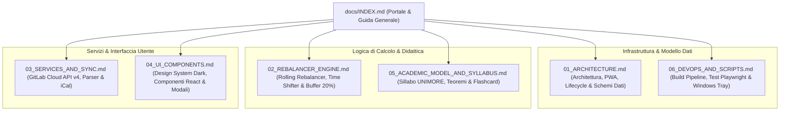
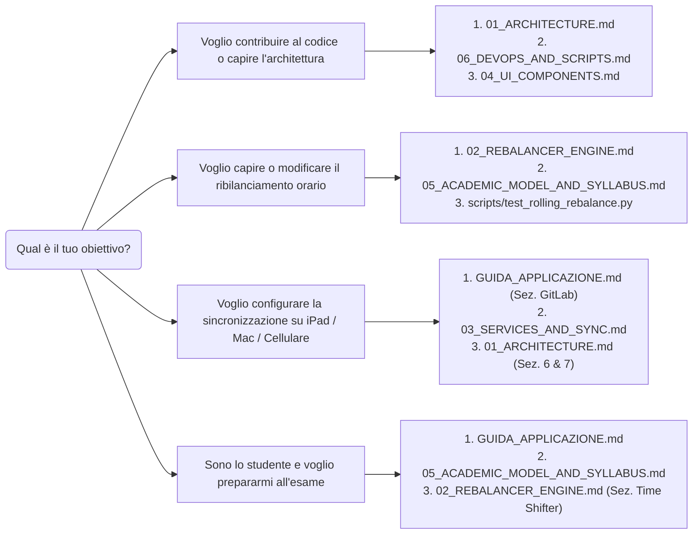

# 📚 StudiPlanner — Portale della Documentazione Tecnica & Architetturale
## Analisi Matematica 1 & Geometria e Algebra Lineare — UNIMORE Coorte 2021

Benvenuto nel **Portale della Documentazione Tecnica** di **StudiPlanner**, la piattaforma Single Page Application (PWA) progettata per guidare e ribilanciare in modo matematicamente rigoroso la preparazione universitaria di uno studente lavoratore a tempo pieno, con target d'esame perentorio fissato al **10 Gennaio 2027**.

Questo portale raccoglie l'intero corpus documentale del progetto, organizzato in manuali monografici verticali che coprono ogni aspetto dell'applicazione: dall'architettura software e gestione dello stato, al motore matematico di ribilanciamento, ai servizi cloud e parser, al design system UI, al sillabo accademico e alle procedure di build e deployment.

---

## 🗺️ Mappa dei Documenti della Suite Tecnica

La documentazione è suddivisa in 6 volumi tematici e nei file guida del workspace:



### Sintesi dei Volumi Documentali

| Documento | Titolo | Argomenti Chiave Trattati | Destinatari |
| :--- | :--- | :--- | :--- |
| 👉 **[01_ARCHITECTURE.md](file:///c:/tmp/StudiPlanner/docs/01_ARCHITECTURE.md)** | **Architettura di Sistema, PWA, Lifecycle & Schemi Dati** | Visione zero-backend, stack React 18 / Tailwind / Babel UMD, Service Worker `studiplanner-v2`, strategie di caching, schemi LocalStorage v2/v1, ErrorBoundary e propagazione dello stato in `App.js`. | Sviluppatori, Architetti Software |
| 👉 **[02_REBALANCER_ENGINE.md](file:///c:/tmp/StudiPlanner/docs/02_REBALANCER_ENGINE.md)** | **Motore Matematico del Rolling Rebalancer & Time Shifter** | Rispetto rigoroso della propedeuticità sequenziale (`A-01..A-32`, `G-01..G-31`), formula del buffer dinamico +20%, algoritmo di rolling rebalance per giorni saltati, Time Shifter e soglia critica settimanale. | Matematici, Algoritmisti, Sviluppatori |
| 👉 **[03_SERVICES_AND_SYNC.md](file:///c:/tmp/StudiPlanner/docs/03_SERVICES_AND_SYNC.md)** | **GitLab Cloud Sync, Parser Spreadsheet & iCalendar** | Integrazione client-side con GitLab REST API v4, decodifica Base64 UTF-8 (`TextDecoder`), auto-pull all'avvio, auto-push debounced (2.5s), merge intelligente non distruttivo, parser XLSX/ODS/CSV e export `.ics`. | Integratori Cloud, Sviluppatori Backend/API |
| 👉 **[04_UI_COMPONENTS.md](file:///c:/tmp/StudiPlanner/docs/04_UI_COMPONENTS.md)** | **Design System Dark Mode, Componenti React & Modali** | Design system `#070b14` con palette Smeraldo (`#10b981`) per Analisi e Indaco (`#6366f1`) per Geometria, viste principali (Dashboard, WeeklyTodo, HistoryLog, TopicsTable), tutti i 7 modali e layout responsive. | UI/UX Designer, Sviluppatori Frontend |
| 👉 **[05_ACADEMIC_MODEL_AND_SYLLABUS.md](file:///c:/tmp/StudiPlanner/docs/05_ACADEMIC_MODEL_AND_SYLLABUS.md)** | **Modello Studente Lavoratore, Sillabo UNIMORE & Teoremi** | Profilo lavoratore full-time, 63 argomenti ufficiali UNIMORE Coorte 2021, elenco dei teoremi con dimostrazione obbligatoria d'esame, simulatore prove scritte e integrazione NotebookLM / NeuraDeck. | Studenti, Docenti, Tutor Accademici |
| 👉 **[06_DEVOPS_AND_SCRIPTS.md](file:///c:/tmp/StudiPlanner/docs/06_DEVOPS_AND_SCRIPTS.md)** | **Pipeline di Build, Test Playwright, Server Locale & Tray App** | Script di concatenamento `build_bundle.py`, suite di test automatizzati `test_rolling_rebalance.py`, webserver Python locale `server.py`, launcher Windows Tray e scorciatoie per la barra delle applicazioni. | DevOps, SysAdmin, Sviluppatori |

### Manuali e Linee Guida Ausiliarie
- 📖 **[GUIDA_APPLICAZIONE.md](file:///c:/tmp/StudiPlanner/GUIDA_APPLICAZIONE.md)**: Manuale utente completo passo-passo per lo studente (come registrare sessioni, usare il Time Shifter, sincronizzare i dispositivi).
- ⚙️ **[GEMINI.md](file:///c:/tmp/StudiPlanner/GEMINI.md)**: Contesto operativo, vincoli didattici immutabili e istruzioni per agenti AI all'interno del repository.
- 🤖 **[AGENTS.md](file:///c:/tmp/StudiPlanner/AGENTS.md)**: Standard sintetici e promemoria delle regole operative per sessioni di sviluppo autonomo.
- 📋 **[README.md](file:///c:/tmp/StudiPlanner/README.md)**: Panoramica generale, istruzioni di avvio rapido e anteprime grafiche dell'applicazione.

---

## 🎯 Percorsi di Lettura Consigliati

In base al tuo obiettivo o ruolo, segui questo itinerario consigliato:



---

## ⚖️ I 5 Vincoli Ingegneristici e Didattici Immutabili

Qualsiasi estensione o refactoring del software deve rigorosamente preservare i 5 vincoli architetturali e didattici definiti in [GEMINI.md](file:///c:/tmp/StudiPlanner/GEMINI.md):

1. **Propedeuticità Sequenziale Rigorosa:**  
   Gli argomenti matematici non devono **mai** essere riordinati per priorità, difficoltà o ore residue. La sequenza didattica segue perentoriamente `A-01 -> A-02 -> ... -> A-32` e `G-01 -> G-02 -> ... -> G-31`. La Prova Generale Finale `A-32` appartiene sempre ed esclusivamente all'ultima settimana pre-esame.
2. **Buffer Temporale Dinamico (+20%):**  
   I campi `Priorità_Esame` (1-5) e `Difficoltà` (1-5) vengono usati esclusivamente per due scopi:
   - Allocare un cuscinetto prudenziale moltiplicando le ore per $1.20$ ($T_{\text{effettivo}} = T_{\text{stimato}} \times 1.20$) quando $\text{Priorità} \ge 4$ oppure $\text{Difficoltà} \ge 4$.
   - Colorare i badge visivi di attenzione nella UI.
3. **Modello Lavoratore Full-Time & Time Shifter:**  
   - Regime feriale serale standard: **2.5 ore/giorno** (fascia 19:30 - 22:00).
   - Regime weekend intensivo: **4.5 ore/giorno** (Sabato e Domenica).
   - Time Shifter: possibilità di modulare dinamicamente con incrementi/decrementi `[- 30m]` e `[+ 30m]` la capacità di specifiche date (es. pausa pranzo o straordinari).
   - Soglia critica settimanale di allerta: default **25.0 ore/settimana** (banner rosso se superata).
4. **Ciclo di Build Obbligatorio & Test di Validazione:**  
   Dopo ogni modifica ai file modulari in `src/`, è obbligatorio rigenerare [bundle.js](file:///c:/tmp/StudiPlanner/bundle.js) ed eseguire i test di regressione:
   ```powershell
   python scripts\build_bundle.py
   python scripts\test_rolling_rebalance.py
   ```
5. **Integrità della Sincronizzazione GitLab Cloud:**  
   Preservare la decodifica nativa Base64 UTF-8 tramite `TextDecoder("utf-8")` nel servizio [gitlabSyncService.js](file:///c:/tmp/StudiPlanner/src/services/gitlabSyncService.js) per impedire la corruzione di accenti o caratteri speciali italiani, mantenendo il debouncing a 2.5s per evitare commit ridondanti.

---

## 📖 Glossario dei Termini Tecnici e Didattici

| Termine | Definizione Operativa |
| :--- | :--- |
| **Rolling Rebalancer** | Algoritmo adattivo continuo che ridistribuisce in avanti le ore degli argomenti rimasti incompiuti a partire dalla data odierna ("Oggi"), senza mai cancellare o saltare argomenti. |
| **Time Shifter** | Meccanismo di override puntuale della disponibilità oraria giornaliera (`customDayCapacities`), modulabile con pulsanti stepper `[- 30m]` e `[+ 30m]`. |
| **Buffer Dinamico** | Maggiorazione del +20% sulle ore stimate assegnata automaticamente agli argomenti più ostici o frequenti nei temi d'esame (Priorità $\ge 4$ o Difficoltà $\ge 4$). |
| **Data Simulata ("Oggi")** | Data attiva utilizzata dal motore per separare il passato (storico immutabile) dal futuro (piano ribilanciato). Di default coincide con la data reale odierna ed è modificabile per simulazioni. |
| **Feynman Checklist** | Metodo di autovalutazione a 3 livelli integrato in ciascun argomento: Spiegazione Intuitiva, Definizione Formale e Dimostrazione a Libro Chiuso. |
| **Spaced Repetition** | Sistema di ripasso spaziato a tre intervalli logaritmici (+24h, +7gg, +21gg) attivabile sul to-do settimanale per consolidare la memoria a lungo termine. |
| **Math Bug Tracker** | Registro integrato per tracciare e classificare gli errori ricorrenti commessi durante gli esercizi (es. cambi di segno, integrali notevoli). |
| **PWA Standalone** | Modalità di visualizzazione nativa della Progressive Web App senza barre degli indirizzi o controlli browser, installabile su Windows, Mac, iPad e Android. |
| **Debounced Auto-Push** | Tecnica che ritarda l'invio della chiamata HTTP di sincronizzazione a GitLab di 2.5 secondi dall'ultima modifica per raggruppare modifiche multiple in un singolo commit. |

---

## ⚡ Guida Rapida di Avvio Sviluppatore

Per avviare l'ambiente di lavoro locale e testare le modifiche:

```powershell
# 1. Posizionarsi nella radice del progetto
cd c:\tmp\StudiPlanner

# 2. Avviare il server web locale (disponibile su http://localhost:3000 e in LAN)
python server.py

# 3. In un altro terminale, dopo aver modificato i sorgenti in src/:
python scripts\build_bundle.py
python scripts\test_rolling_rebalance.py
```

L'applicazione sarà immediatamente consultabile dal browser all'indirizzo `http://localhost:3000` con ricaricamento istantaneo (F5).
